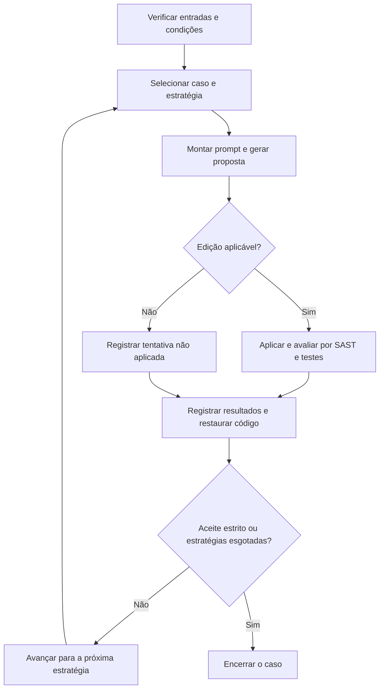

## 3 Metodologia

Este capítulo apresenta os procedimentos metodológicos utilizados para avaliar um pipeline automatizado de correção de vulnerabilidades em código-fonte, integrando Modelos de Linguagem de Grande Escala (LLMs), Análise Estática de Segurança (SAST) e testes automatizados. A avaliação considerou a remoção dos alertas, a preservação do comportamento verificado pelos testes e a ausência de novos alertas de segurança, além de examinar diferentes estratégias de prompt e modelos de linguagem.

O experimento foi conduzido no OWASP Juice Shop, a partir dos alertas identificados pela ferramenta SAST. As seções seguintes descrevem o objeto de estudo, a constituição dos casos, as condições de geração, o procedimento de execução e os critérios de avaliação e análise dos dados. O detalhamento da implementação é apresentado no Capítulo 4, enquanto os resultados e sua interpretação são desenvolvidos no Capítulo 5.

### 3.1 Plano Metodológico

Esta pesquisa foi desenvolvida como um estudo empírico de natureza aplicada, com abordagem predominantemente quantitativa. Em relação aos objetivos, teve caráter exploratório e avaliativo, pois investigou o desempenho de diferentes estratégias de prompt e modelos de linguagem na correção automatizada de vulnerabilidades de segurança, considerando o fluxo de execução adotado. Em relação aos procedimentos, foi conduzida como um estudo experimental sobre uma aplicação de referência, na qual um pipeline automatizado foi executado para avaliar o desempenho das estratégias e dos modelos, com base em métricas definidas previamente. A análise quantitativa foi complementada pela discussão das dificuldades encontradas e dos limites da avaliação.

O estudo foi conduzido a partir da implementação e avaliação de um pipeline automatizado de correção de vulnerabilidades. Esse pipeline recebeu como entrada um projeto com alertas identificados por uma ferramenta SAST, coletou informações sobre as ocorrências encontradas, reuniu o código e, conforme a estratégia de prompt, enriqueceu o contexto fornecido ao modelo de linguagem. Em seguida, solicitou uma proposta de correção à LLM, verificou se a modificação gerada podia ser aplicada e, nos casos aplicáveis, alterou o código e executou novamente a análise estática e os testes automatizados.

O fluxo metodológico geral foi composto pelas seguintes etapas:

1. Preparação do ambiente de execução do projeto;
2. Execução do pipeline automatizado de correção;
3. Consolidação dos resultados em um conjunto estruturado de dados;
4. Análise comparativa dos resultados obtidos.

A Figura 1 apresenta a organização dessas etapas, desde a preparação do ambiente até a análise dos resultados.

**Figura 1 — Visão geral do fluxo metodológico adotado na pesquisa.** A etapa de execução do pipeline automatizado de correção está detalhada na Seção 3.9 e na Figura 2.

Fonte: elaboração dos autores.

O desenho do estudo foi orientado pelas cinco perguntas de pesquisa apresentadas na introdução. Elas abordam a viabilidade do pipeline, as estratégias de prompt, os tipos de vulnerabilidade, as limitações práticas e a comparação entre modelos de linguagem em termos de eficácia, custo e tempo. Para examinar essas questões, foram avaliados diferentes modelos de linguagem e estratégias de prompt sobre um conjunto comum de casos.

Foram adotadas três unidades de organização dos dados. Um caso corresponde a uma ocorrência de alerta identificada no código do projeto. Uma tentativa corresponde à geração e à avaliação de uma proposta para determinado caso, com um modelo e uma estratégia de prompt. Uma campanha reúne as tentativas executadas sob uma configuração registrada. Essas unidades não equivalem ao número de vulnerabilidades comprovadas: um alerta pode indicar uma falha real, um falso positivo ou uma situação ainda sem conclusão.

A metodologia partiu da premissa de que uma correção de vulnerabilidade não deveria ser considerada bem-sucedida apenas porque a ferramenta SAST deixou de apontar um alerta. Uma alteração poderia remover o alerta sem corrigir a causa real da falha ou eliminar a vulnerabilidade comprometendo a funcionalidade esperada do sistema. Por esse motivo, a avaliação combinou três critérios principais: o desaparecimento do alerta original na reanálise estática, a preservação do comportamento verificado pelos testes automatizados e a ausência de novos alertas de segurança.

Assim, uma correção foi aceita somente quando aplicada ao código e aprovada simultaneamente nos três critérios, conforme as definições apresentadas nas Seções 3.10 e 3.11. Esse aceite expressou o atendimento às verificações adotadas, sem constituir, por si só, uma comprovação de eliminação da vulnerabilidade ou de ausência de falhas fora do alcance da análise estática e dos testes utilizados.

### 3.2 Contexto de aplicação do experimento

O experimento foi conduzido em uma aplicação web com múltiplos módulos, dependências e testes automatizados. Esse contexto permitiu avaliar as propostas dos modelos considerando o código existente e as condições de funcionamento da aplicação. A caracterização do projeto selecionado é apresentada na Seção 3.3. As condições de referência do experimento estão resumidas na Tabela 1.

**Tabela 1 — Condições de referência do experimento**

| Elemento | Condição utilizada |
|---|---|
| Aplicação | OWASP Juice Shop 20.1.1 |
| Repositório utilizado (fork) | [caiolamego/juice-shop-tcc](https://github.com/caiolamego/juice-shop-tcc) |
| Revisão do alvo | `f915bddd82790d0f3018902d36ae9b4241a5f51f` |
| Plataforma Docker | `linux/amd64` |
| Node.js e npm do baseline final | 24.14.0 e 11.9.0 |
| Ferramenta SAST | Semgrep 1.177.0 |
| Fuso horário dos processos | UTC |
| Base documental | Versão 2.1, com 14 documentos |

Fonte: configurações, baseline funcional e contratos das campanhas do experimento.

Execuções exploratórias e pilotos contribuíram para preparar o ambiente e ajustar a validação antes das campanhas finais no Juice Shop. Seus registros foram preservados separadamente, mas não foram agregados à população principal para calcular o desempenho dos modelos. Essa delimitação manteve a análise vinculada às condições estabelecidas para as campanhas selecionadas.

As campanhas finais foram executadas em um ambiente Docker padronizado, com o projeto-alvo e suas dependências previamente preparados. A configuração também manteve habilitados os desafios do Juice Shop que poderiam ser desativados automaticamente em contêineres, evitando uma mudança no comportamento analisado. A imagem e a referência dos testes foram identificadas em conjunto, pois utilizar a mesma versão do código não assegura equivalência quando as dependências ou as condições de execução são diferentes.

### 3.3 Objeto de estudo: OWASP Juice Shop

O OWASP Juice Shop é uma aplicação web que simula uma loja virtual, com funcionalidades como consulta de produtos, carrinho de compras e realização e acompanhamento de pedidos. Foi selecionado por ser um projeto de código aberto, deliberadamente vulnerável, com múltiplos módulos, dependências e testes automatizados. Essas características permitiram avaliar a abordagem considerando relações entre partes do projeto e comportamentos já definidos pela aplicação. Sua finalidade didática também ofereceu referências sobre parte das falhas intencionais, sem tornar os desafios conhecidos o único critério de seleção dos casos.

Foi utilizada a versão 20.1.1 do projeto, implementada principalmente em JavaScript e TypeScript, com Node.js, Express e Angular. A versão analisada foi obtida do fork caiolamego/juice-shop-tcc, uma cópia do repositório original mantida separadamente. O código foi fixado em uma revisão específica para que todas as tentativas partissem da mesma base. O conjunto estudado foi determinado pelos alertas produzidos pelo detector no escopo definido, e não pela contagem de desafios pedagógicos da aplicação. As condições de referência estão resumidas na Tabela 1.

### 3.4 Seleção das vulnerabilidades de segurança

O scan combinado arquivado produziu 124 alertas, dos quais 46 foram classificados como fora do escopo. Os 78 restantes constituíram o catálogo ampliado utilizado nas campanhas finais. Cada entrada representou uma ocorrência, definida pela regra, pelo arquivo e por sua localização na revisão fixada. Assim, alertas distintos no mesmo arquivo permaneceram como casos separados, sem a deduplicação por regra e arquivo utilizada em uma etapa anterior do projeto.

**Tabela 2 — Constituição do catálogo ampliado**

| Etapa | Quantidade |
|---|---:|
| Alertas brutos do scan combinado | 124 |
| Alertas excluídos por escopo | 46 |
| Ocorrências incluídas no catálogo | 78 |

Fonte: metadados do catálogo ampliado e classificação arquivada dos alertas.

A preparação do catálogo e a preparação da avaliação funcional ocorreram em etapas distintas. Uma campanha anterior foi executada sobre 52 casos que já possuíam condições de validação definidas. Posteriormente, o mapeamento e os testes foram ampliados para permitir a execução dos 78 casos. Essa evolução foi considerada na delimitação dos dados: os resultados da campanha anterior não foram somados aos das campanhas finais, pois utilizaram condições de avaliação diferentes.

Para cada caso, foram registrados identificador, regra, arquivo e localização, mensagem, severidade, trecho de código e associações a CWE e OWASP quando disponíveis. O catálogo também preservou a triagem de 55 casos classificados como confirmados, 21 como falsos positivos e dois como inconclusivos.

Os rótulos confirmados e inconclusivos tiveram origem nos registros de triagem versionados durante a preparação do experimento. Cada registro associou uma ocorrência a uma classificação e a uma justificativa sobre o contexto do código. Nos casos confirmados, as justificativas relacionaram o alerta a condições de insegurança identificadas, como dados da requisição utilizados em consultas sem parametrização ou informações expostas por rotas públicas. Quando pertinente, também foram registrados vínculos com os desafios da aplicação. Essa confirmação se refere à conclusão da triagem, não à aprovação de uma correção nem à demonstração por testes de exploração em todos os casos.

Na consolidação do catálogo, o código reutilizou as classificações quando houve correspondência entre regra, arquivo e intervalo do alerta na revisão fixada. Divergências puderam ser tratadas por uma revisão explícita, preservada com sua justificativa. Assim, o rótulo não foi deduzido apenas da correspondência com uma regra do Semgrep: o processo incorporou as decisões documentadas da triagem e verificou sua associação às ocorrências analisadas.

Os dois casos inconclusivos permaneceram sem evidência suficiente para confirmar ou descartar a falha indicada. Em um deles, o alerta incidiu sobre uma consulta intermediária na verificação de estoque, sem demonstrar o caminho completo de alteração da cesta. No outro, uma rota servia arquivos de quarentena, mas os registros não demonstravam acesso fora do diretório ou impacto associado a um arquivo específico. Essa classificação preservou a incerteza, em vez de tratar a ausência de confirmação como falso positivo.

Os 21 casos apontados pela LLM como falsos positivos foram revisados pelos dois autores, que examinaram o código, o contexto de cada alerta e a regra correspondente do Semgrep. A revisão confirmou os rótulos ao considerar que os trechos não atendiam às condições de insegurança indicadas pelas regras nos contextos analisados. Essa avaliação distinguiu a identificação de um padrão potencialmente inseguro da existência da falha apontada no uso específico do código.

Entre as justificativas registradas estavam tokens sintéticos utilizados em testes unitários e o uso de eval no CAPTCHA para calcular uma expressão formada por números aleatórios e operadores definidos internamente, sem entrada controlada pelo usuário. Nesses casos, o padrão identificado pela regra não foi considerado suficiente para caracterizar a vulnerabilidade indicada. A confirmação manual referiu-se aos 21 falsos positivos; não representou uma declaração de ausência de outras falhas na aplicação.

Nas campanhas arquivadas, os rótulos de triagem não foram utilizados para retirar casos do conjunto de 78. A confirmação dos rótulos e a definição do recorte utilizado para calcular as métricas são procedimentos distintos.

### 3.5 Ferramenta de análise estática

O Semgrep foi utilizado como ferramenta SAST por oferecer regras compatíveis com JavaScript e TypeScript e permitir a exportação dos alertas em formato estruturado. A ferramenta teve dois papéis no estudo: identificar os casos que poderiam receber propostas de correção e reanalisar o projeto após cada alteração. A reanálise forneceu as informações necessárias para verificar a permanência do alerta original e o aparecimento de novos alertas.

A detecção combinou regras disponibilizadas pelo Semgrep e regras locais elaboradas no desenvolvimento do experimento. As regras locais ampliaram os padrões examinados no código da aplicação, incluindo situações que exigiam uma descrição mais específica. A correspondência com uma regra foi tratada como indicação de um possível problema. Ela não substituiu a interpretação do contexto nem foi considerada, isoladamente, uma comprovação de vulnerabilidade.

Para as campanhas finais, o conjunto de regras e as exclusões foram reunidos em um perfil fixado e identificado por verificações de integridade. Essa medida limitou variações do detector entre as execuções. Foram excluídos caminhos relacionados a dependências, arquivos gerados e outros elementos fora do escopo definido. Os arquivos de soluções pedagógicas do próprio Juice Shop também ficaram fora do escopo operacional, para não serem fornecidos como soluções aos modelos.

### 3.6 Modelos de linguagem e condições de geração

O experimento incluiu os modelos GPT-4.1 mini, GPT-5.6 Luna e GPT-6 Luna. A seleção combinou uma referência já utilizada no projeto com duas famílias mais recentes, escolhidas por sua proposta de uso econômico. O GPT-5.6 Luna foi incluído como geração intermediária, enquanto o GPT-6 Luna acrescentou a geração mais recente do trio. Essa composição permitiu investigar se a adoção de modelos mais recentes oferecia vantagens na correção dos casos avaliados e no custo de obtenção de uma correção aceita, sem presumir superioridade pela geração ou pelo preço.

A escolha inicial do GPT-4.1 mini considerou a viabilidade experimental, o custo das chamadas e a adequação ao fluxo automatizado. Como a avaliação envolveu diferentes casos e estratégias de prompt, foi necessário considerar o consumo acumulado de tokens durante as gerações. A opção por uma versão menor da família GPT-4.1 procurou conciliar esse requisito com os recursos necessários para receber o contexto do código e produzir propostas de alteração. Sua utilização nas execuções exploratórias também forneceu registros de custo, consumo e resultados, permitindo mantê-lo como referência na comparação realizada sob as condições comuns das campanhas finais.

A adequação técnica também envolveu a forma de interação com o pipeline. Segundo a [documentação oficial do modelo](https://developers.openai.com/api/docs/models/gpt-4.1-mini), o GPT-4.1 mini oferece suporte a saídas estruturadas e uma ampla janela de contexto (OPENAI, 2026). Esses recursos eram compatíveis com o fornecimento do trecho de código, das instruções e, nas estratégias correspondentes, do diagnóstico SAST e da documentação recuperada. O formato estruturado permitiu solicitar respostas em JSON com os campos esperados e a lista de edições, facilitando sua leitura pelo aplicador. Essa compatibilidade fundamentou a integração ao experimento, enquanto a validade das propostas permaneceu dependente da reanálise estática e dos testes.

A utilização de modelos de um mesmo provedor também respondeu a uma condição operacional do estudo. Durante a preparação, foram encontradas dificuldades de acesso ao servidor de inferência do Qwen no Colab, por meio do ngrok, e de retorno das requisições. Por esse motivo, os autores optaram por utilizar a API da OpenAI nos três tratamentos, reduzindo diferenças de infraestrutura de hospedagem entre eles. Essa decisão decorreu das condições de execução encontradas, sem constituir uma avaliação da qualidade das correções que o Qwen poderia produzir em uma infraestrutura funcional.

A comparação examinou diferenças de eficácia, custo e tempo dos três modelos no mesmo pipeline. A seleção não pressupôs equivalência de arquitetura, tamanho ou dados de treinamento; cada modelo e sua configuração foram avaliados em conjunto, sem isolar o efeito causal da geração à qual pertenciam.

<!-- Evidência da justificativa de seleção: tcc2-llm-sast-juiceshop@062a203516fd7f55ce86d9c19dc0f23f6e92ed61; docs/historico/features/10-comparacao-modelos-openai/README.md, seções 1–3; decisão de 02/11/2026. -->

Os parâmetros de geração estão apresentados na Tabela 3. A temperatura controla a variação das respostas e foi fixada em zero para favorecer a consistência. O limite de completamento define a quantidade máxima de tokens gerados por chamada; foram adotados 4.096 tokens nos três modelos para manter um teto comum de saída e controlar o consumo. Esse valor correspondeu a uma configuração compartilhada do experimento, sem ser apresentado como o limite ótimo para produzir as correções.

A semente (seed) inicializa os mecanismos pseudoaleatórios da geração. No GPT-4.1 mini, foi mantida em 42 para reduzir variações em eventuais reexecuções, sem garantir respostas idênticas. O papel desse número foi manter uma configuração constante entre as chamadas, sem pressupor que 42 produzisse correções melhores do que outras sementes. Nos Luna, o parâmetro foi omitido porque seu suporte não foi assumido nos perfis de integração.

O esforço de raciocínio configura uma etapa interna de processamento que pode afetar o tempo e o consumo de tokens. Nos Luna, foi desativado (none), pois o estudo não incluiu uma condição adicional com esse recurso ativado. No GPT-4.1 mini, o parâmetro não foi enviado porque o modelo é descrito pela [documentação oficial](https://developers.openai.com/api/docs/models/gpt-4.1-mini) como operando sem uma etapa separada de raciocínio (OPENAI, 2026). Sua omissão decorreu dessa diferença de funcionamento, e não da aplicação de um valor de esforço equivalente ao dos Luna. Esse controle é distinto das instruções de raciocínio guiado presentes nos prompts, que organizaram a tarefa solicitada aos três modelos.

<!-- Evidência da configuração e finalidade da semente: tcc2-llm-sast-juiceshop@062a203516fd7f55ce86d9c19dc0f23f6e92ed61; docs/protocolo_experimental.md, seção 9; docs/historico/features/10-comparacao-modelos-openai/ENTREGA.md, seção Perfis de geração e custo. -->

**Tabela 3 — Parâmetros de geração registrados nas campanhas finais**

| Modelo solicitado | Temperatura | Limite de tokens de completamento | Semente | Esforço de raciocínio |
|---|---:|---:|---|---|
| GPT-4.1 mini | 0 | 4.096 | Fixa: 42 | Não enviado (sem etapa configurável) |
| GPT-5.6 Luna | 0 | 4.096 | Parâmetro não enviado | Desativado (none) |
| GPT-6 Luna | 0 | 4.096 | Parâmetro não enviado | Desativado (none) |

Fonte: contratos de execução de cada campanha.

<!-- Evidência dos perfis de geração: tcc2-llm-sast-juiceshop@062a203516fd7f55ce86d9c19dc0f23f6e92ed61; src/pipeline/etapas/e05_geracao_llm/modelos.py; docs/historico/features/10-comparacao-modelos-openai/ENTREGA.md, seção Perfis de geração e custo; README.md da mesma feature, seções 4–5. As finalidades de controle descritas não representam demonstração de optimalidade dos valores ou de equivalência entre modelos. -->

Cada modelo foi executado em uma campanha própria sobre os mesmos 78 casos, com as estratégias P1 a P4 e o mesmo perfil de análise estática, base documental e baseline funcional. Essa organização permitiu comparar as respostas sob condições de avaliação compartilhadas. Entretanto, o caminho percorrido pelas estratégias dependeu dos resultados de cada caso; portanto, os modelos não produziram necessariamente o mesmo número de tentativas. A comparação considerou essa diferença, além das particularidades dos parâmetros de geração.

As chamadas foram submetidas a limites configuráveis de quantidade e consumo, com registro de tokens, custo informado e erros de comunicação. Nas campanhas finais, a reutilização de respostas armazenadas e de evidências de validação permaneceu desativada. Falhas de transporte foram registradas separadamente das tentativas com resposta disponível. Quando houve nova tentativa de comunicação, esse evento não foi tratado como uma réplica independente do experimento nem convertido automaticamente em resultado negativo de R, F ou M.

### 3.7 Estratégias de prompt

Foram utilizadas quatro estratégias de prompt. Todas receberam uma definição de papel, a tarefa de identificar e corrigir o problema, o código selecionado, as restrições de alteração e o formato esperado de resposta. Para arquivos de até 250 linhas, foi fornecido o conteúdo completo; nos demais, foi selecionada uma janela com até 60 linhas de contexto de cada lado do intervalo do alerta. A mesma política de seleção foi aplicada às quatro estratégias.

A estratégia P1 correspondeu ao prompt simples. O modelo recebeu o código e uma instrução direta para identificar e corrigir a vulnerabilidade, sem o bloco explícito de diagnóstico do Semgrep e sem um documento de apoio. Essa condição representou a abordagem com menor quantidade de orientação adicional entre as estratégias avaliadas.

A estratégia P2 acrescentou um roteiro de raciocínio guiado ao conteúdo de P1. O roteiro orientou a análise da vulnerabilidade, de sua causa e da correção proposta, acompanhada de justificativa técnica e limitações. Essa organização foi utilizada para estruturar a tarefa solicitada ao modelo; não foi interpretada como acesso ou comprovação do raciocínio interno empregado na geração.

A estratégia P3 incluiu o diagnóstico SAST e um documento técnico recuperado da base de conhecimento. O diagnóstico apresentou a localização do alerta, a regra, a CWE e a mensagem da ferramenta. O documento acrescentou orientações sobre o tipo de problema. Como esses dois elementos foram inseridos em conjunto, as diferenças em relação a P1 não permitem atribuir um eventual ganho exclusivamente à recuperação documental.

A estratégia P4 combinou o conteúdo de P3 com o roteiro de raciocínio guiado. Em todas as estratégias, foram mantidas restrições para reduzir alterações alheias ao problema: preservar o comportamento existente, evitar refatorações e renomeações, não modificar testes e manter mensagens e assinaturas existentes. Essas instruções buscaram limitar a correção à necessidade identificada, sem substituir a verificação posterior por SAST e testes.

As respostas foram solicitadas em JSON, com campos para identificação do problema, causa, estratégia de correção, edições, justificativa e limitações. Cada edição indicou o arquivo, o trecho original e o trecho que deveria substituí-lo. O formato estruturado permitiu verificar a resposta antes da aplicação e registrar situações em que ela estava inválida ou não podia ser utilizada. A composição das estratégias está resumida na Tabela 4.

**Tabela 4 — Informações fornecidas em cada estratégia**

| Elemento | P1 | P2 | P3 | P4 |
|---|:---:|:---:|:---:|:---:|
| Instrução, código, restrições e formato de resposta | Sim | Sim | Sim | Sim |
| Roteiro de raciocínio guiado | Não | Sim | Não | Sim |
| Bloco explícito do diagnóstico SAST | Não | Não | Sim | Sim |
| Documento recuperado | Não | Não | Sim | Sim |

Fonte: montagem dos prompts do experimento.

### 3.8 Estratégia de RAG simplificado

O RAG foi implementado por recuperação de documentos técnicos em Markdown, sem utilização de embeddings ou busca vetorial. A base utilizada nas campanhas finais correspondeu à versão 2.1, com 14 documentos em português e exemplos genéricos de JavaScript e TypeScript. Os textos apresentaram características dos problemas, recomendações de correção, cuidados de preservação funcional e limitações da avaliação. A base foi ampliada durante a preparação do experimento para distinguir mecanismos que anteriormente recebiam orientações mais gerais.

A seleção do documento seguiu uma ordem definida. Primeiro, o pipeline procurou uma correspondência para as CWEs registradas no caso; na ausência de correspondência, considerou a categoria de contexto disponível e, por último, o documento genérico. Dessa forma, o procedimento não dependeu de uma busca semântica nem da interpretação de respostas anteriores. A disponibilidade desse recurso de contingência não significa que ele tenha sido acionado em todos os casos: o documento efetivamente recuperado foi registrado por tentativa.

A escolha do RAG simplificado manteve o foco na avaliação do contexto fornecido ao modelo, em vez de transformar o mecanismo de recuperação no objeto principal da pesquisa. O índice e os documentos foram identificados por versão e hashes, permitindo conferir sua integridade e a correspondência com cada campanha. A documentação da base registrou a utilização de fontes técnicas e exemplos genéricos, sem incorporar soluções do Juice Shop ou patches anteriores; somente o corpo do documento selecionado foi enviado no prompt.

### 3.9 Pipeline

O pipeline automatizou a preparação das entradas, a geração das correções e sua avaliação. Para cada caso, o fluxo reuniu o código e as informações previstas na estratégia, solicitou uma resposta ao modelo, verificou as edições propostas, aplicou a alteração e realizou a reanálise estática e os testes. Ao final, os resultados foram registrados e o código foi restaurado. A Figura 2 apresenta esse percurso e a continuidade entre estratégias.

**Figura 2 — Procedimento de avaliação de um caso.** A sequência P1–P4 ocorre dentro de cada caso; casos distintos podem ser executados em paralelo. O aceite estrito corresponde à regra operacional de parada.

Fonte: elaboração a partir do fluxo do pipeline.

Antes das tentativas, foi realizado o preflight, uma verificação automática das condições necessárias para iniciar a execução do experimento. Essa etapa conferiu a versão do projeto analisado, os casos selecionados, as regras de análise estática, os prompts e a referência dos testes funcionais, além de verificar se os alertas esperados eram reproduzidos. Essas condições foram registradas em um contrato de execução, isto é, um registro das configurações e dos arquivos utilizados como referência para aquela execução. Assim, o pipeline pôde identificar incompatibilidades antes de solicitar correções aos modelos e impedir a retomada de uma execução com condições diferentes das originalmente registradas.

As tentativas utilizaram cópias de trabalho separadas do projeto, gerenciadas por Git worktrees. Cada cópia foi restaurada antes e depois de seu uso, mantendo o ponto de partida fixado para a tentativa seguinte. Assim, uma correção individual não foi aplicada sobre alterações acumuladas de outros casos. O funcionamento desse isolamento e a aplicação das edições são detalhados no Capítulo 4.

As estratégias foram executadas na ordem P1, P2, P3 e P4. Para decidir quando encerrar as tentativas de um caso, o pipeline exigiu a remoção do alerta original, a ausência de novos alertas e a aprovação da preservação funcional, representada pelo critério F. Esse critério avaliou se a alteração introduziu falhas nos testes selecionados, em comparação com a execução de referência. Na regra de parada, qualquer falha nova confirmada por reexecução impedia a aprovação funcional e levava à próxima estratégia, até o limite de P4. Essa avaliação foi denominada sem separação.

Na análise principal dos resultados, F recebeu um tratamento diferente. Como o Juice Shop contém vulnerabilidades intencionais, alguns testes dependem de comportamentos inseguros, como a exploração de uma falha para concluir um desafio. Esses testes foram reunidos no conjunto D, conforme os critérios apresentados na Seção 3.10. A falha de um teste desse conjunto após uma correção não foi considerada, por si só, perda de funcionalidade legítima. Por isso, uma tentativa pôde ser aceita na análise principal e, ainda assim, ter sido seguida por outra estratégia durante a execução. Na consolidação dos resultados, a análise principal de cada caso foi encerrada no primeiro aceite segundo esse critério, mantendo os registros posteriores separados.

Respostas com formato inválido, edições que não encontravam o trecho original e alterações fora do escopo permitido foram registradas como tentativas não aplicadas. Falhas operacionais e interrupções receberam registros próprios. Esses estados foram diferenciados de uma correção aplicada e reprovada pela avaliação. Quando não havia evidência suficiente para medir um critério, o resultado permaneceu indeterminado, em vez de receber automaticamente o valor de falha.

As campanhas finais foram configuradas para até quatro casos em paralelo, mantendo sequenciais as estratégias de um mesmo caso. A retomada utilizou os registros existentes para identificar o trabalho já realizado e preservar os artefatos. O recorte principal foi composto por três campanhas concluídas em 6 de novembro de 2026, uma com GPT-4.1 mini, uma com GPT-5.6 Luna e uma com GPT-6 Luna. Cada campanha avaliou os mesmos 78 casos, mantendo a versão do projeto, as regras de análise estática, as estratégias de prompt e as condições de validação, com os parâmetros de geração definidos para cada modelo. Preflights, simulações, pilotos e campanhas descartadas permaneceram identificados como etapas de preparação, sem serem reunidos às tentativas finais para estimar a eficácia.

### 3.10 Validação das correções

O critério R representou a remoção do alerta original. Para verificá-lo, foram comparadas as ocorrências identificadas antes e depois da alteração. Como uma edição pode deslocar o código sem eliminar o problema, a comparação considerou a correspondência entre trechos e seu contexto. Quando essa correspondência não era suficiente, o comparador também utilizou a contagem da mesma regra no mesmo arquivo. A redução de contagem, isoladamente, não foi tomada como prova de remoção de uma ocorrência específica sem correspondência.

O critério M representou a ausência de novos alertas na reanálise do projeto sob o perfil fixado. A avaliação observou também erros de leitura e limitações de análise, que poderiam impedir uma conclusão. O uso de contagens possui uma limitação: a retirada e a criação de ocorrências equivalentes no mesmo arquivo podem se compensar. Assim, M descreve o que foi observado pelo detector nas condições registradas, sem assegurar que nenhuma vulnerabilidade fora de seu alcance tenha sido introduzida.

O critério F representa a preservação funcional, isto é, a manutenção do comportamento esperado das funcionalidades avaliadas após a alteração do código. Sua avaliação utilizou uma execução de referência dos testes, denominada baseline. Essa referência foi produzida sobre o código original, no ambiente correspondente à campanha, e registrou os testes executados e as falhas já existentes. A comparação permitiu examinar as falhas novas após a correção sem atribuir à proposta do modelo um problema que já ocorria antes. O baseline também foi utilizado para conferir se a execução posterior fornecia evidência comparável.

Em cada tentativa, foram selecionados os grupos de testes relacionados aos arquivos efetivamente alterados, incluindo as verificações de compilação correspondentes. Essa seleção utilizou um mapeamento explícito entre arquivos e grupos, em vez de executar toda a suíte em cada avaliação. Quando a alteração alcançava arquivos sem cobertura suficiente ou impedia a execução comparável dos testes, não era atribuída aprovação funcional sem evidência. Portanto, a aprovação em F indica que as verificações selecionadas não identificaram novos problemas no funcionamento avaliado. Ela não assegura que outras funcionalidades, fora desses testes, continuaram funcionando corretamente.

Durante a preparação, foram acrescentados testes para ampliar a avaliação de comportamentos que não estavam suficientemente cobertos. Também foram utilizados controles com alterações deliberadas para verificar se os testes identificavam problemas no comportamento esperado. Esses controles apoiaram a avaliação da capacidade dos testes de identificar problemas em situações específicas. As versões do mapa, dos testes adicionais e da referência funcional foram vinculadas às condições das campanhas.

A natureza deliberadamente vulnerável do Juice Shop exigiu distinguir testes funcionais de testes que dependiam da manutenção da falha. Foi denominado conjunto D o grupo cujas asserções exigiam, por exemplo, a resolução de um desafio por ataque, uma resposta insegura ou a utilização do mecanismo apontado pelo alerta. Testes de comportamento legítimo permaneceram como proteção funcional, com verificações adicionais quando necessário.

Na análise principal, F assume valor 1 quando as verificações necessárias são concluídas com evidência suficiente e não apontam novos problemas de compilação ou falhas persistentes nos testes de comportamento legítimo. Assume valor 0 quando a avaliação identifica uma reprovação funcional, como uma nova falha persistente nesses testes ou um erro de compilação. Quando não há evidência suficiente para concluir a avaliação, F permanece indeterminado. Falhas novas nos grupos de testes levaram à reexecução: as que reapareceram nas duas rodadas foram consideradas persistentes, enquanto as ocorrências isoladas foram registradas como intermitentes.

Foram registradas três formas de calcular F, que diferem no tratamento dos testes dependentes das vulnerabilidades intencionais, conforme a Tabela 5. A interpretação por critérios foi adotada na análise principal: falhas dos testes classificados no conjunto D não reprovaram, por si só, a preservação funcional. As interpretações sem separação e por marcador permitiram verificar quanto os resultados mudavam com esse tratamento, utilizando o mesmo conjunto de tentativas.

**Tabela 5 — Tratamento das falhas nos testes para calcular F**

| Interpretação de F | Tratamento das falhas novas |
|---|---|
| Sem separação | Toda falha nova persistente em um teste reprova F, inclusive nos testes do conjunto D. Essa interpretação foi usada na regra de parada. |
| Por marcador | Falhas nos testes que afirmam explicitamente a resolução de um desafio não reprovam F por si só; as demais falhas novas persistentes reprovam. |
| Por critérios | Falhas nos testes classificados no conjunto D pelos critérios documentados não reprovam F por si só; falhas novas persistentes nos demais testes reprovam. Essa foi a interpretação principal. |

Fonte: critérios do conjunto D e política de validação do experimento.

### 3.11 Métricas de avaliação

As métricas avaliaram três aspectos das propostas: a remoção do alerta original, a preservação funcional e a ausência de novos alertas de segurança. Cada tentativa foi identificada pelo índice $j$, e $m$ representa o total de tentativas da população analisada. Para cada tentativa, foram registrados os critérios $R_j$, $F_j$ e $M_j$, definidos a seguir:

- $R_j$: remoção do alerta original. Assume valor 1 quando o alerta deixa de ser detectado após a alteração, e 0 quando permanece, conforme a comparação descrita na Seção 3.10.
- $F_j$: preservação funcional. Assume valor 1 quando a avaliação funcional é aprovada, e 0 quando é reprovada. Na análise principal, utiliza a interpretação por critérios: falhas nos testes do conjunto D não reprovam F por si só.
- $M_j$: ausência de novos alertas. Assume valor 1 quando a reanálise não identifica novos alertas sob o perfil fixado, e 0 quando identifica.

Esses critérios são binários quando há medição conclusiva. Na ausência de evidência suficiente, o respectivo resultado permanece indeterminado, sem receber automaticamente o valor 0. Uma correção foi aceita somente quando aplicada ao código e aprovada simultaneamente nos três critérios, com $R_j=F_j=M_j=1$.

A métrica principal foi a Taxa de Remediação Validada (TRV), que expressa a proporção de tentativas que atenderam a essas condições. Para calcular seu numerador, $J_V$ representa o conjunto de índices das tentativas aplicadas com os três critérios medidos. Assim:

$$
\mathrm{TRV}=\frac{\sum_{j\in J_V}(R_j\times F_j\times M_j)}{m}
$$

O produto vale 1 apenas quando os três critérios são satisfeitos. O denominador $m$ inclui todas as tentativas da população analisada, inclusive as não aplicadas e as indeterminadas. Essas tentativas não entram no numerador, pois não demonstraram remediação validada; isso não transforma suas medições ausentes em resultados negativos. Quando todas as tentativas são aplicadas e têm os três critérios medidos, a soma equivale a $\sum_{j=1}^{m}(R_j\times F_j\times M_j)$.

As métricas complementares examinaram cada critério separadamente. Seus denominadores consideraram apenas as tentativas com a respectiva medição disponível. Foram definidos $J_R$, $J_F$ e $J_M$ como os conjuntos de índices com R, F e M medidos, respectivamente, e $n_R$, $n_F$ e $n_M$ como suas quantidades de tentativas. Por exemplo, $n_F=|J_F|$ representa o número de tentativas em que F recebeu valor 0 ou 1. Esses denominadores podem diferir entre si e ser menores que $m$.

**Tabela 6 — Fórmulas e significado das métricas complementares**

| Métrica | Fórmula | Significado |
|---|---|---|
| Taxa de Remoção de Issues (TRI) | $\mathrm{TRI}=\dfrac{\sum_{j\in J_R}R_j}{n_R}$ | Proporção de tentativas com remoção do alerta original, entre as que tiveram R medido. |
| Taxa de Preservação Funcional (TPF) | $\mathrm{TPF}=\dfrac{\sum_{j\in J_F}F_j}{n_F}$ | Proporção de tentativas com aprovação funcional, entre as que tiveram F medido na interpretação considerada. |
| Taxa de Não Introdução de Novas Issues (TNINI) | $\mathrm{TNINI}=\dfrac{\sum_{j\in J_M}M_j}{n_M}$ | Proporção de tentativas sem novos alertas, entre as que tiveram M medido. |
| Taxa de Falha Funcional (TFF) | $\mathrm{TFF}=\dfrac{\sum_{j\in J_F}(1-F_j)}{n_F}=1-\mathrm{TPF}$ | Proporção de tentativas com reprovação funcional, usando a mesma definição de F e o mesmo denominador da TPF. |

Fonte: consolidação de métricas do experimento.

TRV, TRI, TPF, TNINI e TFF variam de 0 a 1 e são multiplicadas por 100 quando apresentadas em porcentagem. As tabelas de resultados informam os numeradores, os denominadores e as medições ausentes. Quando o denominador é zero, a métrica é apresentada como indisponível. A TFF descreve reprovação nas verificações realizadas, sem assegurar, isoladamente, a identificação da causa de cada falha.

Também foi calculada a proporção de casos com pelo menos uma tentativa aceita. Sendo $c_{\text{aceitos}}$ o número de casos com aceite e $c_{\text{solicitados}}$ o total de casos solicitados na campanha, essa proporção corresponde a $c_{\text{aceitos}}/c_{\text{solicitados}}$. Um caso é contado uma única vez, mesmo quando recebeu mais de uma tentativa. Essa medida difere da TRV, cujo denominador é o número de tentativas.

Para a análise principal, a cadeia de cada caso foi delimitada pelo primeiro aceite na classificação por critérios, mantendo à parte os registros posteriores. As interpretações alternativas de F foram avaliadas sobre essa mesma população, sem reconstruir uma nova sequência de execução para cada definição.

A comparação entre modelos considerou ainda tokens de entrada e saída, custo conhecido das chamadas, tempo de geração e duração da campanha. Foram distinguidos o tempo de resposta do modelo, o tempo gasto nas verificações e o tempo total decorrido. Como parte do trabalho ocorreu em paralelo, a soma das durações individuais não foi utilizada como equivalente ao tempo total da campanha. Os custos foram interpretados conforme os valores e as condições registrados, sem incluir despesas de infraestrutura que não tivessem sido medidas.

A Redução Relativa de Issues de Segurança (RRIS) foi utilizada para examinar a variação dos alertas após a aplicação conjunta das correções selecionadas. Para cada modelo, foram selecionados os primeiros aceites por caso na definição principal, verificada a integridade dos patches e tentada sua aplicação em sequência. Incompatibilidades foram registradas, e os alertas antes e depois foram obtidos com scans globais comparáveis. O conjunto também recebeu avaliação funcional. A redução estática foi mantida distinta da aprovação funcional conjunta; o procedimento não permite obter a RRIS pela soma dos aceites individuais.

$$
\mathrm{RRIS}=\frac{I_{\text{antes}}-I_{\text{depois}}}{I_{\text{antes}}}
$$

Em que $I_{\text{antes}}$ e $I_{\text{depois}}$ representam as contagens de alertas nos scans comparáveis do projeto antes e depois da aplicação conjunta. O cálculo requer $I_{\text{antes}}>0$; para apresentar a redução em porcentagem, o resultado é multiplicado por 100.

### 3.12 Armazenamento e organização dos dados

Os dados foram organizados para permitir o acompanhamento de cada caso desde o alerta inicial até sua avaliação. Prompts, respostas, edições aplicadas, código corrigido, análises estáticas e testes foram associados ao identificador da tentativa. Os contratos, os registros das sessões e as verificações de integridade permitiram relacionar esses arquivos às condições de execução. A estrutura dos diretórios e dos componentes responsáveis pelo registro é apresentada no Capítulo 4.

### 3.13 Análise dos dados

A população principal foi formada pelas tentativas reais das estratégias previstas, delimitadas conforme o primeiro aceite registrado por caso. Simulações, diagnósticos adicionais, pilotos e registros posteriores ao aceite foram mantidos em categorias separadas. Essa delimitação permitiu conferir o número de casos solicitados, os casos que receberam tentativas e as medições disponíveis. Respostas reutilizadas em etapas históricas também não foram interpretadas como novas gerações independentes.

A análise das estratégias e dos tipos de problema foi organizada por modelo, regra, CWE e categoria OWASP, quando disponíveis. Foram considerados os tamanhos dos grupos e os dados ausentes, evitando interpretar pequenas quantidades como diferenças gerais de desempenho. As classificações da triagem foram preservadas como informação descritiva e para análises complementares; eventual restrição a um grupo deverá ser identificada com seu próprio denominador. Esses recortes apoiam as respostas às perguntas Q1 a Q4.

Após as campanhas, foi realizada uma classificação complementar dos 49 casos sem associação OWASP registrada, preservando as categorias dos outros 29 casos. Para 41 ocorrências, utilizou-se a correspondência explícita entre o CWE registrado e as listas do OWASP Top 10:2025. Oito ocorrências receberam associação contextual, fundamentada no código da revisão utilizada e nas justificativas da triagem arquivada: quatro alertas de consultas NoSQL e quatro de validação com CWE genérico. Nestes últimos, o agrupamento considerou a restrição de negócio, o controle de propriedade ou o estabelecimento de credenciais envolvidos, em vez de atribuir automaticamente todos à categoria de injeção. Essa análise documental, realizada com apoio automatizado, complementou o agrupamento dos resultados; não alterou as entradas das campanhas, os rótulos de falso positivo e inconclusivo ou os critérios de aceite. A classificação representa o tipo de fraqueza sinalizado e não constitui nova comprovação de explorabilidade. A distribuição original e a complementar são apresentadas separadamente no Capítulo 5.

<!-- Evidência: experimento@062a203516fd7f55ce86d9c19dc0f23f6e92ed61; outputs/catalogos/ampliado_v1/catalogo_issues.json; evidencias/classificacao-owasp-complementar-2026-11-11/{manifesto-conferencia.json,decisoes-contextuais.json,revisao-contextual.json}; OWASP/Top10@3a31f35346c3f4e90f350395124382fa53af2afe, 2025/docs/en; Q3. -->

Para responder à Q5, a comparação entre os três modelos foi organizada a partir dos mesmos casos solicitados e dos critérios de avaliação compartilhados. Foram consideradas a proporção de casos aceitos, a TRV, a preservação funcional, os novos alertas, o custo conhecido e os tempos registrados. As diferenças foram interpretadas nas condições observadas, reconhecendo os parâmetros específicos de cada modelo e as trajetórias distintas pelas estratégias. Essa comparação não foi definida como uma classificação universal de superioridade dos modelos.

A avaliação das correções foi baseada nas verificações automatizadas e nas métricas definidas, sem inspeção manual dos patches pelos autores. Para explicar os resultados, o Capítulo 5 apresenta exemplos de acompanhamento de pedidos e de cálculo do CAPTCHA, selecionados pela disponibilidade dos artefatos e pelos resultados contrastantes. A análise documental desses exemplos, realizada com apoio automatizado, relacionou as alterações de código aos registros de análise estática e de testes. Essa leitura apoiou a discussão, sem acrescentar uma etapa de validação humana ao aceite das correções.

### 3.14 Limitações do estudo

A utilização de uma única aplicação deliberadamente vulnerável limita a generalização dos resultados para outros projetos. A avaliação também depende do alcance das regras SAST, da cobertura dos testes selecionados e das classificações arquivadas dos alertas. A remoção de um alerta e a aprovação dos testes representam evidências sob condições definidas, mas não demonstram ausência de falhas em toda a aplicação. As limitações de cada mecanismo foram consideradas na interpretação dos resultados.

A sequência das estratégias, a variabilidade das respostas e as diferenças de parâmetros entre modelos também restringem as comparações. O RAG simplificado pode recuperar orientações menos específicas para certos casos. O recorte principal contém uma campanha final por modelo, sem sustentar estimativas de estabilidade por réplicas independentes. A distribuição do ambiente Docker apoia a repetição do procedimento, mas não assegura respostas idênticas das LLMs ou tempos iguais em equipamentos diferentes.

A execução sequencial constituiu uma limitação do desenho experimental. O projeto partiu da suposição de que, se uma estratégia Pₓ produzisse uma correção aceita, uma estratégia posterior também seria capaz de corrigir o mesmo caso. Essa suposição orientou a interrupção das tentativas após o aceite, mas não foi verificada para todos os casos: as estratégias seguintes deixaram de ser executadas quando a regra de parada foi satisfeita. Assim, P2, P3 e P4 receberam apenas os casos que não encerraram a sequência anteriormente, e suas taxas foram calculadas sobre grupos diferentes. Por isso, as diferenças brutas não permitem demonstrar a superioridade de uma estratégia nem confirmar que o sucesso seria mantido nas etapas seguintes. Além disso, P3 e P4 acrescentaram diagnóstico SAST e documentação em conjunto, o que impede atribuir eventuais diferenças exclusivamente ao RAG.

### 3.15 Declaração de Uso de Inteligência Artificial

As ferramentas Codex e Claude Code foram utilizadas como apoio à escrita de código e de testes do pipeline, com revisão humana do material produzido. Também apoiaram a organização e a redação do trabalho e a revisão gramatical dos textos. A revisão do código de desenvolvimento foi distinta da avaliação dos patches gerados nas campanhas, que seguiu as verificações automatizadas e as métricas definidas neste capítulo. A responsabilidade pelas escolhas metodológicas, pelas informações apresentadas e pela versão final permanece com os autores.

### 3.16 Cronograma

O planejamento da pesquisa distribuiu as atividades entre a preparação do ambiente, a execução do experimento, a análise dos dados e a redação do trabalho. A Tabela 7 apresenta os períodos previstos nesse planejamento. Esses períodos representam a programação das atividades, e não um registro das datas efetivas de conclusão; as datas das campanhas analisadas foram identificadas na Seção 3.9.

**Tabela 7 — Cronograma previsto para o desenvolvimento da pesquisa**

|**Atividade**|**Período previsto**|
|---|---|
|Preparação do ambiente experimental com o OWASP Juice Shop|Agosto de 2026|
|Estudo do código-fonte e identificação das vulnerabilidades elegíveis|Agosto de 2026|
|Execução inicial do SAST e catalogação das _issues_|Agosto – Setembro de 2026|
|Implementação e ajustes do _pipeline_ automatizado|Setembro de 2026|
|Implementação do RAG simplificado|Setembro de 2026|
|Paralelização das chamadas à API da LLM|Setembro – Outubro de 2026|
|Definição e refinamento das estratégias de _prompt_|Outubro de 2026|
|Execução do _pipeline_ sobre as vulnerabilidades selecionadas|Outubro – Novembro de 2026|
|Coleta e consolidação das métricas experimentais|Novembro de 2026|
|Análise dos resultados e discussão dos achados|Novembro – Dezembro de 2026|
|Escrita, revisão e preparação da versão final do TCC|Dezembro de 2026|
