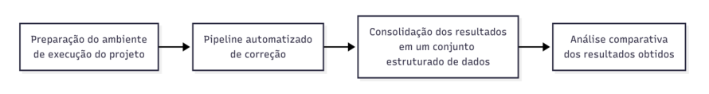
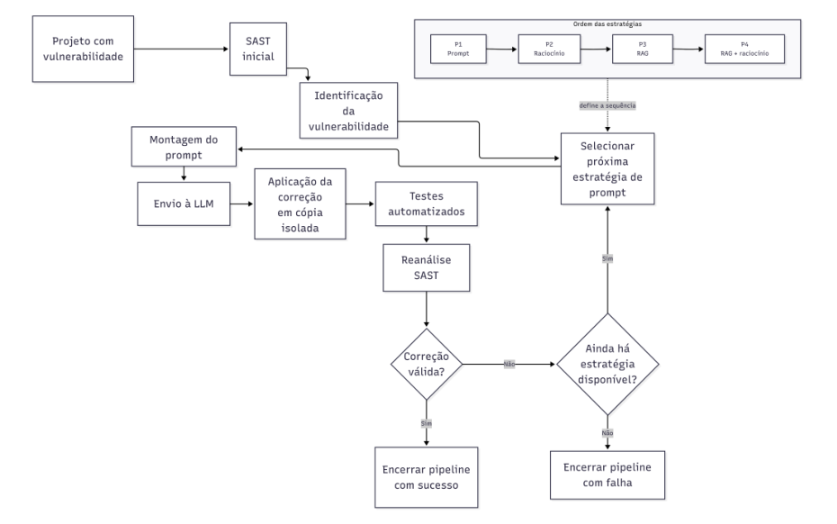

## 3 Metodologia

Este capítulo apresenta os procedimentos metodológicos utilizados para avaliar um pipeline automatizado de correção de vulnerabilidades em código-fonte, integrando Modelos de Linguagem de Grande Escala (LLMs), Análise Estática de Segurança (SAST) e testes automatizados. A avaliação considerou a remoção dos alertas, a preservação do comportamento verificado pelos testes e a ausência de novos alertas de segurança, além de examinar diferentes estratégias de prompt e modelos de linguagem.

O experimento foi conduzido no OWASP Juice Shop, a partir dos alertas identificados pela ferramenta SAST. As seções seguintes descrevem o objeto de estudo, a constituição dos casos, as condições de geração, o procedimento de execução e os critérios de avaliação e análise dos dados. O detalhamento da implementação é apresentado no Capítulo 4, enquanto os resultados e sua interpretação são desenvolvidos no Capítulo 5.

### 3.1 Plano Metodológico

Esta pesquisa foi desenvolvida como um estudo empírico de natureza aplicada, com abordagem predominantemente quantitativa. Em relação aos objetivos, teve caráter exploratório e avaliativo, pois investigou o desempenho de diferentes estratégias de prompt e modelos de linguagem na correção automatizada de vulnerabilidades de segurança, considerando o fluxo de execução adotado. Em relação aos procedimentos, foi conduzida como um estudo experimental sobre uma aplicação de referência, na qual um pipeline automatizado foi executado para avaliar o desempenho das estratégias e dos modelos, com base em métricas definidas previamente. A análise quantitativa foi complementada pela discussão das dificuldades encontradas e dos limites da avaliação.

O estudo foi conduzido a partir da implementação e avaliação de um pipeline automatizado de correção de vulnerabilidades. Esse pipeline recebeu como entrada um projeto com alertas identificados por uma ferramenta SAST, coletou informações sobre as ocorrências encontradas, reuniu o código e, conforme a estratégia de prompt, enriqueceu o contexto fornecido ao modelo de linguagem. Em seguida, solicitou uma proposta de correção à LLM, verificou se a modificação gerada podia ser aplicada e, nos casos aplicáveis, alterou o código e executou novamente a análise estática e os testes automatizados.

O fluxo metodológico geral foi composto pelas seguintes etapas:

1. Preparação do ambiente de execução do projeto;
2. Execução do pipeline automatizado de correção;
3. Consolidação dos resultados em um conjunto estruturado de dados;
4. Análise comparativa dos resultados obtidos.

A Figura 1 apresenta a organização dessas etapas, desde a preparação do ambiente até a análise dos resultados.

**Figura 1 — Visão geral do fluxo metodológico adotado na pesquisa.** A etapa de execução do pipeline automatizado de correção está detalhada na Seção 3.9 e na Figura 2.

Fonte: elaboração dos autores.

O desenho do estudo foi orientado pelas cinco perguntas de pesquisa apresentadas na introdução. Elas abordam a viabilidade do pipeline, as estratégias de prompt, os tipos de vulnerabilidade, as limitações práticas e a comparação entre modelos de linguagem em termos de eficácia, custo e tempo. Para examinar essas questões, foram avaliados diferentes modelos de linguagem e estratégias de prompt sobre um conjunto comum de casos.

Foram adotadas três unidades de organização dos dados. Um caso corresponde a uma ocorrência de alerta identificada no código do projeto. Uma tentativa corresponde à geração e à avaliação de uma proposta para determinado caso, com um modelo e uma estratégia de prompt. Uma campanha reúne as tentativas executadas sob uma configuração registrada. Essas unidades não equivalem ao número de vulnerabilidades comprovadas: um alerta pode indicar uma falha real, um falso positivo ou uma situação ainda sem conclusão.

A metodologia partiu da premissa de que uma correção de vulnerabilidade não deveria ser considerada bem-sucedida apenas porque a ferramenta SAST deixou de apontar um alerta. Uma alteração poderia remover o alerta sem corrigir a causa real da falha ou eliminar a vulnerabilidade comprometendo a funcionalidade esperada do sistema. Por esse motivo, a avaliação combinou três critérios principais: o desaparecimento do alerta original na reanálise estática, a preservação do comportamento verificado pelos testes automatizados e a ausência de novos alertas de segurança.

Assim, uma correção foi aceita somente quando aplicada ao código e aprovada simultaneamente nos três critérios, conforme as definições apresentadas nas Seções 3.10 e 3.11. Esse aceite expressou o atendimento às verificações adotadas, sem constituir, por si só, uma comprovação de eliminação da vulnerabilidade ou de ausência de falhas fora do alcance da análise estática e dos testes utilizados.

### 3.2 Contexto de aplicação do experimento

O experimento foi conduzido em uma aplicação web com múltiplos módulos, dependências e testes automatizados. Esse contexto permitiu avaliar as propostas dos modelos considerando o código existente e as condições de funcionamento da aplicação. A caracterização do projeto selecionado é apresentada na Seção 3.3. As condições de referência do experimento estão resumidas na Tabela 1.

**Tabela 1 — Condições de referência do experimento**

| Elemento | Condição utilizada |
|---|---|
| Aplicação | OWASP Juice Shop 20.1.1 |
| Repositório utilizado (fork) | [caiolamego/juice-shop-tcc](https://github.com/caiolamego/juice-shop-tcc) |
| Plataforma Docker | `linux/amd64` |
| Node.js e npm do baseline final | 24.14.0 e 11.9.0 |
| Ferramenta SAST | Semgrep 1.177.0 |
| Fuso horário dos processos | UTC |
| Base documental | Versão 2.1, com 14 documentos |

Fonte: configurações, baseline funcional e contratos das campanhas do experimento.

Execuções exploratórias e pilotos contribuíram para preparar o ambiente e ajustar a validação antes das campanhas finais no Juice Shop. Seus registros foram preservados separadamente, mas não foram agregados à população principal para calcular o desempenho dos modelos. Essa delimitação manteve a análise vinculada às condições estabelecidas para as campanhas selecionadas.

As campanhas finais foram executadas em um ambiente Docker padronizado, com o projeto-alvo e suas dependências previamente preparados. A configuração também manteve habilitados os desafios do Juice Shop que poderiam ser desativados automaticamente em contêineres, evitando uma mudança no comportamento analisado. A imagem e a referência dos testes foram identificadas em conjunto, pois utilizar a mesma versão do código não assegura equivalência quando as dependências ou as condições de execução são diferentes.

### 3.3 Objeto de estudo: OWASP Juice Shop

O OWASP Juice Shop é uma aplicação web que simula uma loja virtual, com funcionalidades como consulta de produtos, carrinho de compras e realização e acompanhamento de pedidos. Foi selecionado por ser um projeto de código aberto, deliberadamente vulnerável, com múltiplos módulos, dependências e testes automatizados. Essas características permitiram avaliar a abordagem considerando relações entre partes do projeto e comportamentos já definidos pela aplicação. Sua finalidade didática também ofereceu referências sobre parte das falhas intencionais, sem tornar os desafios conhecidos o único critério de seleção dos casos.

Foi utilizada a versão 20.1.1 do projeto, implementada principalmente em JavaScript e TypeScript, com Node.js, Express e Angular. Por esse motivo, a metodologia utilizou ferramentas, regras de análise estática, testes e estratégias de correção compatíveis com essas linguagens e com a estrutura da aplicação. A presença de componentes no servidor e na interface web também permitiu considerar diferentes partes do sistema na identificação dos casos e na avaliação das alterações.

Na versão utilizada nesta pesquisa, o OWASP Juice Shop reúne 113 desafios distribuídos em 16 categorias, abrangendo problemas como exposição de dados sensíveis, injeção, quebra de controle de acesso, validação imprópria de entrada e Cross-Site Scripting (XSS). Os desafios contemplam tipos de risco e fraquezas relacionados a referências de segurança como o OWASP Top 10, o OWASP Application Security Verification Standard (ASVS), o OWASP API Security Top 10 e a Common Weakness Enumeration (CWE). Essa diversidade permite examinar diferentes mecanismos de falha dentro de uma mesma aplicação, mantendo relações entre funcionalidades, dependências e regras de negócio (OWASP Foundation, 2026a).

Além dos desafios de exploração, a versão analisada disponibiliza 33 Coding Challenges, ou desafios de código, nos quais o usuário localiza o trecho vulnerável e identifica uma alternativa de correção. Nesta pesquisa, as propostas de correção foram geradas pelos modelos de linguagem, sem utilizar as alternativas desses exercícios como respostas fornecidas ao pipeline.

<!-- Evidência da caracterização: OWASP Foundation, página oficial do Juice Shop e guia de Coding Challenges; experimento@062a203516fd7f55ce86d9c19dc0f23f6e92ed61; alvo@f915bddd82790d0f3018902d36ae9b4241a5f51f: data/static/challenges.yml (113 entradas, 16 categorias), data/static/codefixes/*.info.yml (33 arquivos) e lib/codingChallenges.ts. Conferência em evidencias/juice-shop-objeto-estudo-2026-11-11.json. -->

### 3.4 Ferramenta de análise estática

O Semgrep foi utilizado como ferramenta SAST por oferecer regras compatíveis com JavaScript e TypeScript e permitir a exportação dos alertas em formato estruturado. A ferramenta teve dois papéis no estudo: identificar os casos que poderiam receber propostas de correção e reanalisar o projeto após cada alteração. A reanálise forneceu as informações necessárias para verificar a permanência do alerta original e o aparecimento de novos alertas.

Uma regra de análise estática descreve uma condição que a ferramenta deve procurar no código. No Semgrep, essas regras são definidas em arquivos YAML e associam um identificador às linguagens examinadas, aos padrões procurados e à mensagem produzida quando há correspondência. Também podem indicar severidade e informações de classificação, como o CWE relacionado. Assim, a regra expressa um critério de detecção, enquanto o alerta registra uma ocorrência encontrada ao aplicar esse critério ao código ([documentação de regras do Semgrep](https://docs.semgrep.dev/writing-rules/overview)).

A detecção combinou regras disponibilizadas pelo Semgrep e regras locais elaboradas no desenvolvimento do experimento. O perfil utilizado nas campanhas finais reuniu 1.074 regras provenientes do conjunto disponibilizado pelo Semgrep e 28 regras locais. Essas quantidades descrevem os critérios disponíveis no perfil, enquanto o número de alertas depende das correspondências encontradas nos arquivos analisados. As regras locais ampliaram os padrões examinados na aplicação, incluindo consultas MongoDB construídas dinamicamente, uso de HTML tratado como confiável no Angular e operações sobre documentos selecionados por identificadores recebidos na requisição.

As regras utilizadas incluíram a busca por padrões de código e o acompanhamento do fluxo de dados. Na busca por padrões, a ferramenta procura construções descritas pela regra, como uma consulta com expressão dinâmica. No acompanhamento de fluxo, denominado taint analysis, a regra define origens de entrada e operações de interesse, permitindo sinalizar quando dados dessas origens alcançam essas operações. Uma regra local, por exemplo, relacionou valores recebidos no corpo ou nos parâmetros da requisição à atualização de documentos selecionados por identificador. Esse mecanismo auxilia a localizar operações que exigem verificação de autorização no contexto da rota ([documentação de análise de fluxo do Semgrep](https://docs.semgrep.dev/writing-rules/data-flow/taint-mode/overview)).

Para as campanhas finais, o conjunto de regras e as exclusões foram reunidos em um perfil fixado e identificado por verificações de integridade. Essa medida limitou variações do detector entre as execuções.

<!-- Evidência das regras: contratos das campanhas finais, perfil_sha256 a9ad1f21b6e4ce3f51dd58e2ff5c4797c90d9bc87384887d17eda8ab6f6844c2; config/perfis/ampliado_piloto_v1/{perfil.json,regras_remotas.yaml,regras_locais.yaml}; regra tcc.mongodb.security.unscoped-document-write. Contagens e relação 52/78 em evidencias/regras-e-casos-2026-11-11.json. -->

### 3.5 Seleção das vulnerabilidades de segurança

Neste estudo, um caso corresponde a uma ocorrência de alerta selecionada para receber propostas de correção. Cada caso foi definido pela regra que originou o alerta, pelo arquivo e pela localização do trecho na versão analisada, recebendo um identificador próprio no catálogo. Uma mesma regra pode originar vários casos ao encontrar o padrão em locais diferentes.

O catálogo é o conjunto organizado desses registros. Cada caso pôde receber tentativas com diferentes modelos e estratégias de prompt. Uma tentativa corresponde à geração e à avaliação de uma proposta de correção para aquele caso. A existência de um caso no catálogo também não significa que a vulnerabilidade tenha sido confirmada, pois os alertas foram mantidos com seus respectivos rótulos de triagem.

O scan combinado arquivado produziu 124 alertas, dos quais 46 foram classificados como fora do escopo. Os 78 restantes constituíram o catálogo ampliado utilizado nas campanhas finais. A seleção partiu das regras e das condições de análise apresentadas na Seção 3.4. Alertas distintos no mesmo arquivo permaneceram separados conforme sua localização, sem a deduplicação por regra e arquivo utilizada em uma etapa anterior do projeto.

Os critérios de escopo limitaram a avaliação ao código das funcionalidades da aplicação, que podia ser examinado pela análise estática e pelos testes do Juice Shop. Foram excluídos os alertas nos exemplos dos Coding Challenges, localizados em `data/static/codefixes/`, nos arquivos de automação do GitHub, em `.github/workflows/`, e nos arquivos de configuração do npm, `.npmrc`. Os exemplos dos Coding Challenges contêm alternativas de correção dos exercícios pedagógicos, e sua exclusão evitou fornecê-las aos modelos como soluções. Os outros dois tipos de arquivo tratam de integração contínua e gerenciamento de dependências, aspectos cuja segurança não era avaliada pela suíte de testes da aplicação. A exclusão expressou uma decisão sobre o recorte do experimento, sem determinar se cada alerta correspondia a uma falha real ou a um falso positivo. A Tabela 2 apresenta a distribuição das exclusões.

<!-- Evidência das exclusões: outputs/catalogos/ampliado_v1/exclusoes.json (46 registros: 31 em data/static/codefixes/, 13 em .github/workflows/, dois em .npmrc e frontend/.npmrc); scripts/auditoria/classificar_scan_combinado.py; docs/protocolo_experimental.md, seção de exclusão de caminhos. Conferência em evidencias/exclusoes-escopo-2026-11-11.json. -->

**Tabela 2 — Constituição do catálogo ampliado**

| Etapa | Quantidade |
|---|---:|
| Alertas brutos do scan combinado | 124 |
| Excluídos em exemplos dos Coding Challenges | 31 |
| Excluídos em arquivos de automação do GitHub | 13 |
| Excluídos em configurações do npm | 2 |
| Alertas excluídos por escopo | 46 |
| Ocorrências incluídas no catálogo | 78 |

Fonte: metadados do catálogo ampliado e classificação arquivada dos alertas.

A identificação dos casos e a preparação dos testes necessários para avaliar suas correções ocorreram em etapas distintas. O catálogo já continha 78 ocorrências, mas uma campanha anterior utilizou um subconjunto de 52 casos para os quais a avaliação funcional estava preparada. Isso significava que os arquivos envolvidos nesses casos já estavam relacionados aos grupos de testes utilizados para verificar o efeito das alterações, com uma execução de referência disponível para comparação.

Os outros 26 casos também pertenciam ao catálogo, mas ainda exigiam a preparação das condições de avaliação funcional adotadas no experimento. A ampliação do mapeamento entre arquivos e testes e a inclusão de verificações adicionais permitiram executar as campanhas finais sobre os 78 casos. Assim, a passagem de 52 para 78 representou a ampliação do conjunto que podia ser avaliado sob as condições preparadas. Os resultados da campanha anterior foram mantidos separados dos resultados finais, pois as referências e a cobertura da avaliação eram diferentes.

Para cada caso, foram registrados identificador, regra, arquivo e localização, mensagem, severidade, trecho de código e associações a CWE e OWASP quando disponíveis. O catálogo também preservou a triagem de 55 casos classificados como confirmados, 21 como falsos positivos e dois como inconclusivos.

Os rótulos confirmados e inconclusivos tiveram origem nos registros de triagem versionados durante a preparação do experimento. Cada registro associou uma ocorrência a uma classificação e a uma justificativa sobre o contexto do código. Nos casos confirmados, as justificativas relacionaram o alerta a condições de insegurança identificadas, como dados da requisição utilizados em consultas sem parametrização ou informações expostas por rotas públicas. Quando pertinente, também foram registrados vínculos com os desafios da aplicação. Essa confirmação se refere à conclusão da triagem, não à aprovação de uma correção nem à demonstração por testes de exploração em todos os casos.

Na consolidação do catálogo, o código reutilizou as classificações quando houve correspondência entre regra, arquivo e intervalo do alerta na revisão fixada. Divergências puderam ser tratadas por uma revisão explícita, preservada com sua justificativa.

### 3.6 Modelos de linguagem e condições de geração

O experimento incluiu os modelos GPT-4.1 mini, GPT-5.6 Luna e GPT-6 Luna. A seleção combinou uma referência já utilizada no projeto com duas famílias mais recentes, escolhidas por sua proposta de uso econômico. Essa composição permitiu investigar se a adoção de modelos mais recentes oferecia vantagens na correção dos casos avaliados e no custo de obtenção de uma correção aceita, sem presumir superioridade pela geração ou pelo preço.

A escolha inicial do GPT-4.1 mini considerou a viabilidade experimental, o custo das chamadas e a adequação ao fluxo automatizado. Como a avaliação envolveu diferentes casos e estratégias de prompt, foi necessário considerar o consumo acumulado de tokens durante as gerações. A opção por uma versão menor da família GPT-4.1 procurou conciliar esse requisito com os recursos necessários para receber o contexto do código e produzir propostas de alteração. Sua utilização nas execuções exploratórias também forneceu registros de custo, consumo e resultados, permitindo mantê-lo como referência na comparação realizada sob as condições comuns das campanhas finais.

A adequação técnica também envolveu a forma de interação com o pipeline. Segundo a [documentação oficial do modelo](https://developers.openai.com/api/docs/models/gpt-4.1-mini), o GPT-4.1 mini oferece suporte a saídas estruturadas e uma ampla janela de contexto (OPENAI, 2026). Esses recursos eram compatíveis com o fornecimento do trecho de código, das instruções e, nas estratégias correspondentes, do diagnóstico SAST e da documentação recuperada. O formato estruturado permitiu solicitar respostas em JSON com os campos esperados e a lista de edições, facilitando sua leitura pelo aplicador. Essa compatibilidade fundamentou a integração ao experimento, enquanto a validade das propostas permaneceu dependente da reanálise estática e dos testes.

A utilização de modelos de um mesmo provedor também respondeu a uma condição operacional do estudo. Durante a preparação, foram encontradas dificuldades de acesso ao servidor de inferência do Qwen no Colab, por meio do ngrok, e de retorno das requisições. Por esse motivo, os autores optaram por utilizar a API da OpenAI nos três tratamentos, reduzindo diferenças de infraestrutura de hospedagem entre eles. Essa decisão decorreu das condições de execução encontradas, sem constituir uma avaliação da qualidade das correções que o Qwen poderia produzir em uma infraestrutura funcional.

A comparação examinou diferenças de eficácia, custo e tempo dos três modelos no mesmo pipeline. A seleção não pressupôs equivalência de arquitetura, tamanho ou dados de treinamento. Cada modelo e sua configuração foram avaliados em conjunto, sem isolar o efeito causal da geração à qual pertenciam.

<!-- Evidência da justificativa de seleção: tcc2-llm-sast-juiceshop@062a203516fd7f55ce86d9c19dc0f23f6e92ed61; docs/historico/features/10-comparacao-modelos-openai/README.md, seções 1–3; decisão de 02/11/2026. -->

Cada modelo foi executado em uma campanha própria sobre os mesmos 78 casos, com as estratégias P1 a P4 e o mesmo perfil de análise estática, base documental e baseline funcional. Essa organização permitiu comparar as respostas sob condições de avaliação compartilhadas. Entretanto, o caminho percorrido pelas estratégias dependeu dos resultados de cada caso. Portanto, os modelos não produziram necessariamente o mesmo número de tentativas. A comparação considerou essa diferença, além das particularidades dos parâmetros de geração.

### 3.7 Estratégias de prompt

O experimento avaliou diferentes estratégias de prompt para examinar a qualidade das correções geradas com diferentes formas de instrução. A comparação buscou observar os resultados de estratégias mais estruturadas, com contexto adicional e raciocínio guiado, em relação a instruções simples. Foram utilizadas quatro estratégias.

A primeira foi o **prompt simples (P1)**, no qual o modelo recebeu o trecho de código do OWASP Juice Shop associado ao caso selecionado e uma instrução direta para identificar e corrigir a vulnerabilidade. Nessa estratégia, o código foi fornecido sem um bloco explícito com o diagnóstico SAST e sem um documento de contexto recuperado.

A segunda foi o **prompt com raciocínio guiado (P2)**, inspirado na ideia de Chain-of-Thought discutida no referencial teórico. Neste trabalho, essa estratégia foi utilizada como uma maneira de estruturar a tarefa em etapas explícitas, sem representar acesso ou validação do raciocínio interno do modelo. O roteiro orientou o modelo a percorrer cinco etapas: identificar a vulnerabilidade, explicar sua causa, descrever o impacto de segurança, propor uma correção e justificar tecnicamente por que a alteração remove ou mitiga o problema. As limitações da correção foram solicitadas em um campo do formato JSON comum às quatro estratégias.

A terceira foi o **prompt com RAG simplificado (P3)**, no qual o modelo recebeu, além do código e do alerta SAST, um documento de contexto recuperado automaticamente da base de conhecimento. O diagnóstico apresentou a localização do alerta, a regra, a CWE e a mensagem da ferramenta. O documento acrescentou orientações relacionadas ao tipo de problema, conforme o procedimento de recuperação descrito na Seção 3.8.

A quarta foi o **prompt com RAG simplificado e raciocínio guiado (P4)**, combinando o contexto técnico recuperado e o diagnóstico SAST com uma estrutura de análise em etapas. Essa estratégia reuniu os elementos de contextualização de P3 e o roteiro de raciocínio guiado de P2.

Em todas as estratégias, foram mantidos a definição de papel, a tarefa de correção, as restrições de alteração e o formato esperado de resposta. A seleção do código enviado seguiu a mesma regra nas quatro estratégias, conforme descrito no Capítulo 4. As instruções também orientaram a preservar o comportamento existente, evitar refatorações e renomeações, manter mensagens e assinaturas e não modificar os testes. Essas restrições buscaram limitar a alteração ao problema analisado, mantendo a avaliação posterior por SAST e testes.

Para permitir a integração automática com o pipeline, as respostas dos modelos foram solicitadas em formato estruturado JSON. O formato adotado conteve os seguintes campos:

1. Vulnerabilidade identificada;
2. Causa da vulnerabilidade;
3. Estratégia de correção;
4. Lista de edições para corrigir o código;
5. Justificativa técnica;
6. Limitações da correção.

Cada edição informou o arquivo a ser alterado, o trecho original e o trecho que deveria substituí-lo. A padronização da saída permitiu ao pipeline extrair as alterações propostas, verificar se podiam ser aplicadas e registrar os dados da tentativa. Respostas com formato inválido ou edições que não podiam ser utilizadas foram identificadas antes de serem tratadas como correções aplicadas.

A Tabela 3 resume as informações fornecidas em cada estratégia. Em P3 e P4, o diagnóstico SAST e o documento recuperado foram acrescentados em conjunto. Por isso, as diferenças observadas em relação a P1 e P2 não permitem atribuir um eventual ganho exclusivamente ao RAG.

**Tabela 3 — Informações fornecidas em cada estratégia**

| Elemento | P1 | P2 | P3 | P4 |
|---|:---:|:---:|:---:|:---:|
| Instrução, código, restrições e formato de resposta | Sim | Sim | Sim | Sim |
| Roteiro de raciocínio guiado | Não | Sim | Não | Sim |
| Bloco explícito do diagnóstico SAST | Não | Não | Sim | Sim |
| Documento recuperado | Não | Não | Sim | Sim |

Fonte: montagem dos prompts do experimento.

<!-- Evidência: seção 3.6 do texto original como referência de organização; src/pipeline/etapas/e04_prompt/montagem.py, config/prompts/roteiro_raciocinio_guiado.md e src/pipeline/etapas/e05_geracao_llm/esquema.py para composição e formato efetivamente implementados. -->

### 3.8 Estratégia de RAG simplificado

Neste trabalho, o RAG foi implementado de forma simplificada, por meio da recuperação automática de documentos de contexto associados ao tipo de problema indicado pelo alerta SAST. A abordagem utilizou uma base documental controlada e um mapeamento explícito entre CWEs, categorias de contexto e documentos de apoio, sem empregar embeddings, bancos vetoriais ou ranqueamento por similaridade semântica.

Essa decisão metodológica foi adotada por questões de viabilidade e alinhamento com o escopo do trabalho. O objetivo foi avaliar a correção automatizada com diferentes formas de instrução e de contexto técnico fornecido aos modelos, mantendo o mecanismo de recuperação simples e identificável. Assim, a recuperação foi baseada na associação direta entre as informações registradas no caso e o documento correspondente.

A base de conhecimento foi composta por arquivos em formato Markdown, organizados no diretório `knowledge_base/` do projeto. A base foi ampliada durante a preparação para distinguir mecanismos que anteriormente recebiam orientações mais gerais.

Cada documento de contexto foi organizado nos seguintes elementos:

1. Descrição e sinais do problema;
2. Origem e condições para sua ocorrência;
3. Impactos e interpretação;
4. Mitigação por mecanismo;
5. Preservação funcional;
6. Exemplo genérico de código vulnerável e corrigido;
7. Limitações e verificação da correção.

Além do corpo técnico, os arquivos mantiveram informações de categoria, versão e fontes consultadas. Os exemplos foram genéricos, sem incorporar soluções do Juice Shop ou patches gerados em tentativas anteriores. Somente o corpo do documento selecionado foi enviado no prompt.

O fluxo do RAG simplificado foi composto pelas seguintes etapas:

1. Identificação do alerta pela ferramenta SAST;
2. Leitura das CWEs e da categoria de contexto registradas no caso;
3. Seleção automática do documento conforme a prioridade de recuperação descrita no Capítulo 4;
4. Leitura do arquivo Markdown e verificação de sua integridade;
5. Inclusão do corpo do documento no prompt, junto ao código e ao diagnóstico SAST;
6. Envio do prompt enriquecido ao modelo de linguagem;
7. Geração da proposta de correção.

O índice e os documentos foram identificados por versão e verificações de integridade, permitindo relacionar o contexto fornecido às condições de cada campanha. O documento selecionado e o motivo da recuperação também foram registrados por tentativa.

Essa estratégia permitiu comparar condições com e sem documentação recuperada. Entretanto, como P3 e P4 também acrescentaram o diagnóstico SAST, as diferenças observadas não permitem isolar um efeito exclusivo do RAG. O contexto adicional foi tratado como apoio à geração, mantendo a avaliação das propostas pela reanálise estática e pelos testes automatizados.

A abordagem mantém o princípio de recuperar conhecimento externo antes da geração da resposta. Por isso, neste trabalho, foi denominada RAG simplificado ou contextualização baseada em recuperação por categoria, com prioridade de seleção pelo CWE.

<!-- Evidência: seção 3.7 do texto original como referência de organização; src/pipeline/etapas/e03_contexto_rag/recuperacao.py, knowledge_base/{_index.yaml,manifesto.json,README.md}, documentos da base e montagem.py para o procedimento implementado. Conferência dos 78 casos e de 382 prompts P3/P4 das campanhas finais em evidencias/rag-simplificado-2026-11-11.json. -->

### 3.9 Pipeline

O pipeline foi implementado por meio de scripts responsáveis por orquestrar as etapas do experimento. A execução automatizada teve como objetivo reduzir a intervenção manual, padronizar a coleta de dados e permitir a repetição do procedimento sob condições registradas. O fluxo reuniu a identificação dos casos, a geração das propostas de correção, a aplicação das alterações e sua avaliação.

O fluxo do pipeline foi composto pelas seguintes etapas:

1. Executar a análise SAST de referência e conferir os alertas esperados no projeto;
2. Selecionar os casos elegíveis no catálogo, conforme o escopo definido;
3. Coletar o código associado ao caso na cópia de trabalho do projeto;
4. Consultar os metadados do alerta, incluindo a regra, as CWEs e a categoria de contexto disponíveis;
5. Recuperar o documento de apoio, quando a estratégia utilizava RAG simplificado;
6. Montar o prompt de acordo com a estratégia selecionada;
7. Enviar a requisição à API do modelo de linguagem;
8. Receber e verificar a resposta estruturada e as edições propostas;
9. Aplicar a correção na cópia isolada do projeto, quando a proposta era utilizável;
10. Executar as verificações de compilação e os testes selecionados para os arquivos alterados;
11. Executar novamente a análise SAST e comparar os alertas antes e depois da alteração;
12. Registrar os resultados da tentativa, incluindo os critérios medidos e os artefatos produzidos;
13. Restaurar o estado do projeto para a próxima tentativa.

A análise de referência e a conferência dos casos integraram a preparação da campanha. As etapas de geração, aplicação e avaliação foram repetidas para cada caso e estratégia alcançada. Quando uma proposta não podia ser aplicada, a tentativa era registrada nessa condição, sem ser tratada como uma alteração submetida à validação. A Figura 2 apresenta o processamento de um caso e a continuidade entre as estratégias.

**Figura 2 — Fluxo de correção de um caso, com tentativas progressivas por estratégia de prompt.** Casos distintos podem ser executados em paralelo. P1 corresponde ao prompt simples, P2 ao prompt com raciocínio guiado, P3 ao prompt com RAG simplificado e P4 à combinação de RAG simplificado e raciocínio guiado. O aceite estrito corresponde à regra operacional de parada.

Fonte: elaboração dos autores.

A figura apresenta a visão geral do processo. Na implementação utilizada no experimento, a reanálise SAST foi executada depois das verificações de compilação e dos testes automatizados, como representado na figura e na ordem descrita nas etapas 10 e 11. A aprovação funcional indicada na decisão de continuidade correspondeu ao critério estrito da regra de parada, distinguido da classificação principal dos resultados nos parágrafos seguintes.

A Figura 2 representa o processamento de um caso por vez em cada cópia de trabalho. As tentativas utilizaram cópias de trabalho separadas do projeto. Cada cópia foi restaurada antes e depois de seu uso, mantendo o ponto de partida fixado para a tentativa seguinte. Assim, uma correção individual não foi aplicada sobre alterações acumuladas de outros casos. O funcionamento desse isolamento e a aplicação das edições são detalhados no Capítulo 4.

As estratégias foram executadas na ordem P1, P2, P3 e P4. Para decidir quando encerrar as tentativas de um caso, o pipeline exigiu a remoção do alerta original, a ausência de novos alertas e a aprovação da preservação funcional, representada pelo critério F, detalhado na Seção 3.10. Esse critério avaliou se a alteração introduziu falhas nos testes selecionados, em comparação com a execução de referência. Na regra de parada, qualquer falha nova confirmada por reexecução impedia a aprovação funcional e levava à próxima estratégia, até o limite de P4. Essa avaliação foi denominada sem separação.

Na análise principal dos resultados, F recebeu um tratamento diferente. Como o Juice Shop contém vulnerabilidades intencionais, alguns testes dependem de comportamentos inseguros, como a exploração de uma falha para concluir um desafio. Esses testes foram reunidos no conjunto D, conforme os critérios apresentados na Seção 3.10. A falha de um teste desse conjunto após uma correção não foi considerada, por si só, perda de funcionalidade legítima. Por isso, uma tentativa pôde ser aceita na análise principal e, ainda assim, ter sido seguida por outra estratégia durante a execução. Na consolidação dos resultados, a análise principal de cada caso foi encerrada no primeiro aceite segundo esse critério, mantendo os registros posteriores separados.

Respostas com formato inválido, edições que não encontravam o trecho original e alterações fora do escopo permitido foram registradas como tentativas não aplicadas. Falhas operacionais e interrupções receberam registros próprios. Esses estados foram diferenciados de uma correção aplicada e reprovada pela avaliação. Quando não havia evidência suficiente para medir um critério, o resultado permaneceu indeterminado, em vez de receber automaticamente o valor de falha.

<!-- Evidência: seção 3.8 do texto original como referência da apresentação em 13 etapas; src/pipeline/orquestracao/{campanha.py,preflight.py} e etapas e04_prompt, e06_aplicacao, e07_validacao e e08_registro. A preparação da campanha foi distinguida do ciclo por tentativa; testes selecionados e regra de parada refletem o experimento executado. -->

### 3.10 Validação das correções

A validação das correções teve como finalidade verificar se as alterações propostas pelos modelos atenderam às condições de segurança e funcionamento definidas para o experimento. Uma proposta aplicada ao código poderia retirar o alerta original, comprometer uma funcionalidade ou introduzir novos problemas detectáveis. Por esse motivo, sua avaliação combinou a reanálise estática com a execução de testes automatizados, considerando os resultados em relação ao código original.

Para organizar essa avaliação, foram definidos três critérios. O critério R corresponde à remoção do alerta original, F à preservação funcional e M à ausência de novos alertas de segurança. Esses critérios representaram condições verificadas em cada tentativa aplicada e fundamentaram a classificação das correções e o cálculo das métricas. O aceite exigiu o atendimento simultâneo aos três critérios, segundo a interpretação de F adotada em cada análise. As verificações utilizadas para avaliar cada um são descritas a seguir.

O critério R representou a remoção do alerta original. Para verificá-lo, foram comparadas as ocorrências identificadas antes e depois da alteração. Como uma edição pode deslocar o código sem eliminar o problema, a comparação considerou a correspondência entre trechos e seu contexto. Quando essa correspondência não era suficiente, o comparador também utilizou a contagem da mesma regra no mesmo arquivo. A redução de contagem, isoladamente, não foi tomada como prova de remoção de uma ocorrência específica sem correspondência.

O critério M representou a ausência de novos alertas na reanálise do projeto sob o perfil fixado. A avaliação observou também erros de leitura e limitações de análise, que poderiam impedir uma conclusão. O uso de contagens possui uma limitação: a retirada e a criação de ocorrências equivalentes no mesmo arquivo podem se compensar. Assim, M descreve o que foi observado pelo detector nas condições registradas, sem assegurar que nenhuma vulnerabilidade fora de seu alcance tenha sido introduzida.

O critério F representa a preservação funcional, isto é, a manutenção do comportamento esperado das funcionalidades avaliadas após a alteração do código. Sua avaliação utilizou uma execução de referência dos testes, denominada baseline. Essa referência foi produzida sobre o código original, no ambiente correspondente à campanha, e registrou os testes executados e as falhas já existentes. A comparação permitiu examinar as falhas novas após a correção sem atribuir à proposta do modelo um problema que já ocorria antes. O baseline também foi utilizado para conferir se a execução posterior fornecia evidência comparável.

Durante a preparação, foram utilizados controles com alterações deliberadas para verificar se os testes identificavam problemas no comportamento esperado. Esses controles apoiaram a avaliação da capacidade dos testes de identificar problemas em situações específicas. As versões do mapa, dos testes adicionais e da referência funcional foram vinculadas às condições das campanhas.

A natureza deliberadamente vulnerável do Juice Shop exigiu distinguir testes funcionais de testes que dependiam da manutenção da falha. Foi denominado conjunto D o grupo cujas asserções exigiam, por exemplo, a resolução de um desafio por ataque, uma resposta insegura ou a utilização do mecanismo apontado pelo alerta. Testes de comportamento legítimo permaneceram como proteção funcional, com verificações adicionais quando necessário.

Na análise principal, F assume valor 1 quando as verificações necessárias são concluídas com evidência suficiente e não apontam novos problemas de compilação ou falhas persistentes nos testes de comportamento legítimo. Assume valor 0 quando a avaliação identifica uma reprovação funcional, como uma nova falha persistente nesses testes ou um erro de compilação. Quando não há evidência suficiente para concluir a avaliação, F permanece indeterminado. Falhas novas nos grupos de testes levaram à reexecução: as que reapareceram nas duas rodadas foram consideradas persistentes, enquanto as ocorrências isoladas foram registradas como intermitentes.

Foram registradas três formas de calcular F, que diferem no tratamento dos testes dependentes das vulnerabilidades intencionais, conforme a Tabela 4. A interpretação por critérios foi adotada na análise principal: falhas dos testes classificados no conjunto D não reprovaram, por si só, a preservação funcional. As interpretações sem separação e por marcador permitiram verificar quanto os resultados mudavam com esse tratamento, utilizando o mesmo conjunto de tentativas.

**Tabela 4 — Tratamento das falhas nos testes para calcular F**

| Interpretação de F | Tratamento das falhas novas |
|---|---|
| Sem separação | Toda falha nova persistente em um teste reprova F, inclusive nos testes do conjunto D. Essa interpretação foi usada na regra de parada. |
| Por marcador | Falhas nos testes que afirmam explicitamente a resolução de um desafio não reprovam F por si só. As demais falhas novas persistentes reprovam. |
| Por critérios | Falhas nos testes classificados no conjunto D pelos critérios documentados não reprovam F por si só. Falhas novas persistentes nos demais testes reprovam. Essa foi a interpretação principal. |

Fonte: critérios do conjunto D e política de validação do experimento.

### 3.11 Métricas de avaliação

As métricas avaliaram três aspectos das propostas: a remoção do alerta original, a preservação funcional e a ausência de novos alertas de segurança. Cada tentativa foi identificada pelo índice $j$, e $m$ representa o total de tentativas da população analisada. Para cada tentativa, foram registrados os critérios $R_j$, $F_j$ e $M_j$, definidos a seguir:

- $R_j$: remoção do alerta original. Assume valor 1 quando o alerta deixa de ser detectado após a alteração, e 0 quando permanece, conforme a comparação descrita na Seção 3.10.
- $F_j$: preservação funcional. Assume valor 1 quando a avaliação funcional é aprovada, e 0 quando é reprovada. Na análise principal, utiliza a interpretação por critérios: falhas nos testes do conjunto D não reprovam F por si só.
- $M_j$: ausência de novos alertas. Assume valor 1 quando a reanálise não identifica novos alertas sob o perfil fixado, e 0 quando identifica.

Esses critérios são binários quando há medição conclusiva. Na ausência de evidência suficiente, o respectivo resultado permanece indeterminado, sem receber automaticamente o valor 0. Uma correção foi aceita somente quando aplicada ao código e aprovada simultaneamente nos três critérios, com $R_j=F_j=M_j=1$.

A métrica principal foi a Taxa de Remediação Validada (TRV), que expressa a proporção de tentativas que atenderam a essas condições. Para calcular seu numerador, $J_V$ representa o conjunto de índices das tentativas aplicadas com os três critérios medidos. Assim:

$$
\mathrm{TRV}=\frac{\sum_{j\in J_V}(R_j\times F_j\times M_j)}{m}
$$

O produto vale 1 apenas quando os três critérios são satisfeitos. O denominador $m$ inclui todas as tentativas da população analisada, inclusive as não aplicadas e as indeterminadas. Essas tentativas não entram no numerador, pois não demonstraram remediação validada. Isso não transforma suas medições ausentes em resultados negativos. Quando todas as tentativas são aplicadas e têm os três critérios medidos, a soma equivale a $\sum_{j=1}^{m}(R_j\times F_j\times M_j)$.

As métricas complementares examinaram cada critério separadamente. Seus denominadores consideraram apenas as tentativas com a respectiva medição disponível. Foram definidos $J_R$, $J_F$ e $J_M$ como os conjuntos de índices com R, F e M medidos, respectivamente, e $n_R$, $n_F$ e $n_M$ como suas quantidades de tentativas. Por exemplo, $n_F=|J_F|$ representa o número de tentativas em que F recebeu valor 0 ou 1. Esses denominadores podem diferir entre si e ser menores que $m$.

A Taxa de Remoção de Issues (TRI) indicou a proporção de tentativas em que o alerta original deixou de ser detectado, considerando aquelas com resultado conclusivo para R:

$$
\mathrm{TRI}=\frac{\sum_{j\in J_R}R_j}{n_R}
$$

A Taxa de Preservação Funcional (TPF) indicou a proporção de tentativas com aprovação nas verificações funcionais, entre aquelas com F medido na interpretação considerada:

$$
\mathrm{TPF}=\frac{\sum_{j\in J_F}F_j}{n_F}
$$

A Taxa de Não Introdução de Novas Issues (TNINI) indicou a proporção de tentativas em que a reanálise não identificou novos alertas de segurança, considerando aquelas com resultado conclusivo para M:

$$
\mathrm{TNINI}=\frac{\sum_{j\in J_M}M_j}{n_M}
$$

A Taxa de Falha Funcional (TFF) indicou a proporção de tentativas com reprovação funcional. Seu cálculo utilizou a mesma interpretação de F e o mesmo denominador da TPF, correspondendo ao complemento dessa taxa:

$$
\mathrm{TFF}=\frac{\sum_{j\in J_F}(1-F_j)}{n_F}=1-\mathrm{TPF}
$$

TRV, TRI, TPF, TNINI e TFF variam de 0 a 1 e são multiplicadas por 100 quando apresentadas em porcentagem. As tabelas de resultados informam os numeradores, os denominadores e as medições ausentes. Quando o denominador é zero, a métrica é apresentada como indisponível. A TFF descreve reprovação nas verificações realizadas, sem assegurar, isoladamente, a identificação da causa de cada falha.

Também foi calculada a proporção de casos com pelo menos uma tentativa aceita. Sendo $c_{\text{aceitos}}$ o número de casos com aceite e $c_{\text{solicitados}}$ o total de casos solicitados na campanha, essa proporção corresponde a $c_{\text{aceitos}}/c_{\text{solicitados}}$. Um caso é contado uma única vez, mesmo quando recebeu mais de uma tentativa. Essa medida difere da TRV, cujo denominador é o número de tentativas.

Para a análise principal, a cadeia de cada caso foi delimitada pelo primeiro aceite na classificação por critérios, mantendo à parte os registros posteriores. As interpretações alternativas de F foram avaliadas sobre essa mesma população, sem reconstruir uma nova sequência de execução para cada definição.

A comparação entre modelos considerou ainda tokens de entrada e saída, custo conhecido das chamadas, tempo de geração e duração da campanha. Foram distinguidos o tempo de resposta do modelo, o tempo gasto nas verificações e o tempo total decorrido. Como parte do trabalho ocorreu em paralelo, a soma das durações individuais não foi utilizada como equivalente ao tempo total da campanha. Os custos foram interpretados conforme os valores e as condições registrados, sem incluir despesas de infraestrutura que não tivessem sido medidas.

A Redução Relativa de Issues de Segurança (RRIS) foi utilizada para examinar a variação dos alertas após a aplicação conjunta das correções selecionadas. Para cada modelo, foram selecionados os primeiros aceites por caso na definição principal, verificada a integridade dos patches e tentada sua aplicação em sequência. Incompatibilidades foram registradas, e os alertas antes e depois foram obtidos com scans globais comparáveis. O conjunto também recebeu avaliação funcional. A redução estática foi mantida distinta da aprovação funcional conjunta. O procedimento não permite obter a RRIS pela soma dos aceites individuais.

$$
\mathrm{RRIS}=\frac{I_{\text{antes}}-I_{\text{depois}}}{I_{\text{antes}}}
$$

Em que $I_{\text{antes}}$ e $I_{\text{depois}}$ representam as contagens de alertas nos scans comparáveis do projeto antes e depois da aplicação conjunta. O cálculo requer $I_{\text{antes}}>0$. Para apresentar a redução em porcentagem, o resultado é multiplicado por 100.

### 3.12 Armazenamento, organização e análise dos dados

Os dados foram organizados para permitir o acompanhamento de cada caso desde o alerta inicial até sua avaliação. Prompts, respostas, edições aplicadas, código corrigido, análises estáticas e testes foram associados ao identificador da tentativa. Os contratos de execução, que registram as configurações de cada campanha, os registros das sessões e as verificações de integridade permitiram relacionar esses arquivos às condições de execução. A estrutura dos diretórios e dos componentes responsáveis pelo registro é apresentada no Capítulo 4.

Cada tentativa de correção recebeu um identificador único, utilizado para nomear os artefatos e relacioná-los aos registros do experimento. A composição desse identificador reuniu o caso analisado, a categoria OWASP, a sigla do tipo de vulnerabilidade, a estratégia de prompt e a execução correspondente, separados por sublinhados. A identificação do artefato foi complementada pelo diretório, pelo sufixo ou pela extensão do arquivo. A Figura 3 ilustra os componentes dessa nomenclatura com um exemplo abreviado.

**Figura 3 — Estrutura do identificador utilizado na nomenclatura dos artefatos gerados pelo pipeline.**

Fonte: elaboração dos autores.

No exemplo da figura, `V01` identifica o caso, `A05` a categoria OWASP, `SQLI` o tipo de vulnerabilidade, `P1` a estratégia de prompt, `E01` a execução e `codigo` o artefato. Nos resultados do experimento, os casos receberam identificadores iniciados por `AMP`, e as execuções foram identificadas pelo código da campanha. Os códigos corrigidos mantiveram seus nomes e caminhos relativos dentro de um diretório da tentativa. Prompts, respostas, patches e relatórios foram associados ao mesmo identificador em seus respectivos diretórios.

Essa organização permitiu acompanhar cada tentativa desde o alerta inicial até a avaliação da proposta e comparar estratégias diferentes para o mesmo caso. Na versão final dos artefatos, os nomes incorporaram as categorias OWASP de uma classificação complementar, realizada após as campanhas e apresentada no Capítulo 5. Os identificadores e caminhos anteriores foram preservados em mapas de correspondência, permitindo rastrear a padronização sem modificar o conteúdo experimental dos arquivos.

<!-- Evidência da nomenclatura: scripts/relatorios/padronizar_artefatos_finais.py; outputs/resultados_finais/OWASP_20261111_V2/{mapa_artefatos.csv,mapa_tentativas.csv,conferencia.json}; identificadores dos registros e dos arquivos em campanha/. A Figura 3 ilustra o esquema de campos, não reproduz literalmente os identificadores mais extensos das campanhas finais. -->

A população principal foi formada pelas tentativas reais das estratégias previstas, delimitadas conforme o primeiro aceite registrado por caso. Simulações, diagnósticos adicionais, pilotos e registros posteriores ao aceite foram mantidos em categorias separadas. Essa delimitação permitiu conferir o número de casos solicitados, os casos que receberam tentativas e as medições disponíveis.

A análise das estratégias e dos tipos de problema foi organizada por modelo, regra, CWE e categoria OWASP, quando disponíveis. Foram considerados os tamanhos dos grupos e os dados ausentes, evitando interpretar pequenas quantidades como diferenças gerais de desempenho. As classificações da triagem foram preservadas como informação descritiva e para análises complementares. Eventual restrição a um grupo deverá ser identificada com seu próprio denominador. Esses recortes apoiam as respostas às perguntas Q1 a Q4.

Para responder à Q5, a comparação entre os três modelos foi organizada a partir dos mesmos casos solicitados e dos critérios de avaliação compartilhados. Foram consideradas a proporção de casos aceitos, a TRV, a preservação funcional, os novos alertas, o custo conhecido e os tempos registrados. As diferenças foram interpretadas nas condições observadas, reconhecendo os parâmetros específicos de cada modelo e as trajetórias distintas pelas estratégias. Essa comparação não foi definida como uma classificação universal de superioridade dos modelos.

### 3.13 Limitações do estudo

A utilização de uma única aplicação deliberadamente vulnerável limita a generalização dos resultados para outros projetos. A avaliação também depende do alcance das regras SAST, da cobertura dos testes selecionados e das classificações arquivadas dos alertas. A remoção de um alerta e a aprovação dos testes representam evidências sob condições definidas, mas não demonstram ausência de falhas em toda a aplicação. As limitações de cada mecanismo foram consideradas na interpretação dos resultados.

O aceite das correções foi decidido somente pelas verificações automatizadas, sem inspeção manual dos patches pelos autores. Além disso, o pipeline só aplicou uma edição quando o trecho original indicado pelo modelo foi localizado de forma única no arquivo. Quando isso não ocorreu, a tentativa foi registrada como não aplicada, mesmo que a correção proposta pudesse ser adequada. Na população principal, essa situação ocorreu em 20 das 685 tentativas, 15 delas do GPT-4.1 mini, conforme detalhado na Seção 4.4.

A sequência das estratégias, a variabilidade das respostas e as diferenças de parâmetros entre modelos também restringem as comparações. O RAG simplificado pode recuperar orientações menos específicas para certos casos. O recorte principal contém uma campanha final por modelo, sem sustentar estimativas de estabilidade por réplicas independentes. A distribuição do ambiente Docker apoia a repetição do procedimento, mas não assegura respostas idênticas das LLMs ou tempos iguais em equipamentos diferentes.

A execução sequencial constituiu uma limitação do desenho experimental. O projeto partiu da suposição de que, se uma estratégia Pₓ produzisse uma correção aceita, uma estratégia posterior também seria capaz de corrigir o mesmo caso. Essa suposição orientou a interrupção das tentativas após o aceite, mas não foi verificada para todos os casos: as estratégias seguintes deixaram de ser executadas quando a regra de parada foi satisfeita. Assim, P2, P3 e P4 receberam apenas os casos que não encerraram a sequência anteriormente, e suas taxas foram calculadas sobre grupos diferentes. Por isso, as diferenças brutas não permitem demonstrar a superioridade de uma estratégia nem confirmar que o sucesso seria mantido nas etapas seguintes. Além disso, P3 e P4 acrescentaram diagnóstico SAST e documentação em conjunto, o que impede atribuir eventuais diferenças exclusivamente ao RAG.

### 3.14 Declaração de Uso de Inteligência Artificial

As ferramentas Codex e Claude Code foram utilizadas como apoio à escrita de código e de testes do pipeline, com revisão humana do material produzido. Também apoiaram a organização e a redação do trabalho e a revisão gramatical dos textos. A revisão do código de desenvolvimento foi distinta da avaliação dos patches gerados nas campanhas, que seguiu as verificações automatizadas e as métricas definidas neste capítulo. A responsabilidade pelas escolhas metodológicas, pelas informações apresentadas e pela versão final permanece com os autores.

### 3.15 Cronograma

O planejamento da pesquisa distribuiu as atividades entre a preparação do ambiente, a execução do experimento, a análise dos dados e a redação do trabalho. A Tabela 5 apresenta os períodos previstos nesse planejamento. Esses períodos representam a programação das atividades, e não um registro das datas efetivas de conclusão. As datas das campanhas analisadas são informadas na Seção 4.6.

**Tabela 5 — Cronograma previsto para o desenvolvimento da pesquisa**

|**Atividade**|**Período previsto**|
|---|---|
|Preparação do ambiente experimental com o OWASP Juice Shop|Agosto de 2026|
|Estudo do código-fonte e identificação das vulnerabilidades elegíveis|Agosto de 2026|
|Execução inicial do SAST e catalogação das _issues_|Agosto – Setembro de 2026|
|Implementação e ajustes do _pipeline_ automatizado|Setembro de 2026|
|Implementação do RAG simplificado|Setembro de 2026|
|Paralelização das chamadas à API da LLM|Setembro – Outubro de 2026|
|Definição e refinamento das estratégias de _prompt_|Outubro de 2026|
|Execução do _pipeline_ sobre as vulnerabilidades selecionadas|Outubro – Novembro de 2026|
|Coleta e consolidação das métricas experimentais|Novembro de 2026|
|Análise dos resultados e discussão dos achados|Novembro – Dezembro de 2026|
|Escrita, revisão e preparação da versão final do TCC|Dezembro de 2026|
