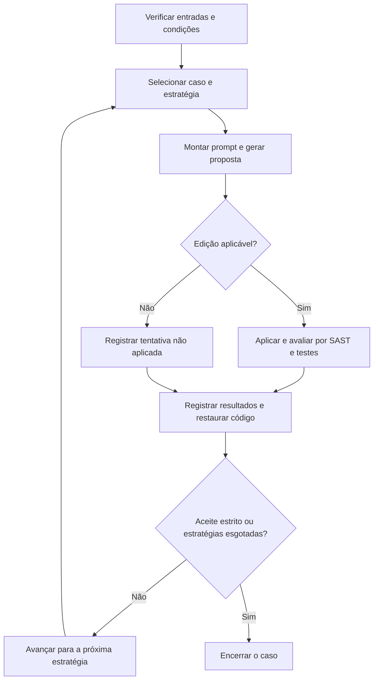

## 3 Metodologia

Este capítulo apresenta os procedimentos metodológicos utilizados para avaliar um pipeline automatizado de correção de vulnerabilidades em código-fonte, integrando Modelos de Linguagem de Grande Escala (LLMs), Análise Estática de Segurança (SAST) e testes automatizados. A avaliação considerou a remoção dos alertas, a preservação do comportamento verificado pelos testes e a ausência de novos alertas de segurança. Também foram examinadas diferentes estratégias de prompt e diferentes modelos de linguagem.

O experimento foi conduzido no OWASP Juice Shop, a partir dos alertas identificados pela ferramenta SAST. As seções seguintes descrevem o objeto de estudo, a constituição dos casos, as condições de geração, o procedimento de execução e os critérios de avaliação e análise dos dados. O detalhamento da implementação é apresentado no Capítulo 4, enquanto os resultados e sua interpretação são desenvolvidos no Capítulo 5.

### 3.1 Caracterização e desenho da pesquisa

Esta pesquisa é um estudo empírico de natureza aplicada, com abordagem predominantemente quantitativa. Seu caráter exploratório e avaliativo decorre da investigação do desempenho de uma solução automatizada em uma aplicação de referência. Foram utilizadas medidas de remoção de alertas e preservação funcional para examinar as tentativas de correção, complementadas pela discussão das dificuldades encontradas e dos limites da avaliação.

O desenho do estudo manteve as perguntas de pesquisa do TCC1 sobre a viabilidade do pipeline, as estratégias de prompt, os tipos de vulnerabilidade e as limitações práticas de execução. No TCC2, foi acrescentada a Q5, voltada à comparação entre modelos de linguagem em termos de eficácia, custo e tempo. Dessa forma, o estudo passou a examinar o comportamento do pipeline em diferentes condições de geração, mantendo um conjunto comum de casos para os modelos comparados.

Foram adotadas três unidades de organização dos dados. Um caso corresponde a uma ocorrência de alerta identificada no código do projeto. Uma tentativa corresponde à geração e à avaliação de uma proposta para determinado caso, com um modelo e uma estratégia de prompt. Uma campanha reúne as tentativas executadas sob uma configuração registrada. Essas unidades não equivalem ao número de vulnerabilidades comprovadas: um alerta pode indicar uma falha real, um falso positivo ou uma situação ainda sem conclusão.

### 3.2 Objeto de estudo e ambiente experimental

O OWASP Juice Shop foi selecionado por ser uma aplicação web de código aberto, deliberadamente vulnerável, com múltiplos módulos, dependências e testes automatizados. Essas características permitiram avaliar a abordagem em uma base mais completa que os exemplos isolados da prova de conceito. Sua finalidade didática também ofereceu referências sobre parte das falhas intencionais, sem tornar os desafios conhecidos o único critério de seleção dos casos.

Foi utilizada a versão 20.1.1 do projeto, implementada principalmente em JavaScript e TypeScript, com Node.js, Express e Angular. O código foi fixado em uma revisão específica para que todas as tentativas partissem da mesma base. O conjunto estudado foi determinado pelos alertas produzidos pelo detector no escopo definido, e não pela contagem de desafios pedagógicos da aplicação. As condições de referência estão resumidas na Tabela 1.

**Tabela 1 — Condições de referência do experimento**

| Elemento | Condição utilizada |
|---|---|
| Aplicação | OWASP Juice Shop 20.1.1 |
| Revisão do alvo | `f915bddd82790d0f3018902d36ae9b4241a5f51f` |
| Plataforma Docker | `linux/amd64` |
| Node.js e npm do baseline final | 24.14.0 e 11.9.0 |
| Ferramenta SAST | Semgrep 1.177.0 |
| Fuso horário dos processos | UTC |
| Base documental | Versão 2.1, com 14 documentos |

Fonte: configurações, baseline funcional e contratos das campanhas do experimento.

A prova de conceito do TCC1 utilizou casos reduzidos em Python e análise estática com Bandit para verificar a integração inicial entre geração, aplicação e avaliação das correções. No TCC2, esse fluxo foi adaptado ao Juice Shop e ao Semgrep. Execuções exploratórias e pilotos contribuíram para preparar o ambiente e ajustar a validação antes das campanhas finais. Seus registros foram preservados, mas não foram agregados à população principal para calcular o desempenho dos modelos.

As campanhas finais foram executadas em um ambiente Docker padronizado, com o projeto-alvo e suas dependências previamente preparados. A configuração também manteve habilitados os desafios do Juice Shop que poderiam ser desativados automaticamente em contêineres, evitando uma mudança no comportamento analisado. A imagem e a referência dos testes foram identificadas em conjunto, pois utilizar a mesma versão do código não assegura equivalência quando as dependências ou as condições de execução são diferentes.

### 3.3 Análise estática e constituição do catálogo

O Semgrep foi utilizado como ferramenta SAST por oferecer regras compatíveis com JavaScript e TypeScript e permitir a exportação dos alertas em formato estruturado. A ferramenta teve dois papéis no estudo: identificar os casos que poderiam receber propostas de correção e reanalisar o projeto após cada alteração. A reanálise forneceu as informações necessárias para verificar a permanência do alerta original e o aparecimento de novos alertas.

A detecção combinou regras disponibilizadas pelo Semgrep e regras locais elaboradas no desenvolvimento do experimento. As regras locais ampliaram os padrões examinados no código da aplicação, incluindo situações que exigiam uma descrição mais específica. A correspondência com uma regra foi tratada como indicação de um possível problema. Ela não substituiu a interpretação do contexto nem foi considerada, isoladamente, uma comprovação de vulnerabilidade.

Para as campanhas finais, o conjunto de regras e as exclusões foram reunidos em um perfil fixado e identificado por verificações de integridade. Essa medida limitou variações do detector entre as execuções. Foram excluídos caminhos relacionados a dependências, arquivos gerados e outros elementos fora do escopo definido. Os arquivos de soluções pedagógicas do próprio Juice Shop também ficaram fora do escopo operacional, para não serem fornecidos como soluções aos modelos.

O scan combinado arquivado produziu 124 alertas, dos quais 46 foram classificados como fora do escopo. Os 78 restantes constituíram o catálogo ampliado utilizado nas campanhas finais. Cada entrada representou uma ocorrência, definida pela regra, pelo arquivo e por sua localização na revisão fixada. Assim, alertas distintos no mesmo arquivo permaneceram como casos separados, sem a deduplicação por regra e arquivo utilizada em uma etapa anterior do projeto.

**Tabela 2 — Constituição do catálogo ampliado**

| Etapa | Quantidade |
|---|---:|
| Alertas brutos do scan combinado | 124 |
| Alertas excluídos por escopo | 46 |
| Ocorrências incluídas no catálogo | 78 |

Fonte: metadados do catálogo ampliado e classificação arquivada dos alertas.

A preparação do catálogo e a preparação da avaliação funcional ocorreram em etapas distintas. Uma campanha anterior foi executada sobre 52 casos que já possuíam condições de validação definidas. Posteriormente, o mapeamento e os testes foram ampliados para permitir a execução dos 78 casos. Essa evolução foi considerada na delimitação dos dados: os resultados da campanha anterior não foram somados aos das campanhas finais, pois utilizaram condições de avaliação diferentes.

Para cada caso, foram registrados identificador, regra, arquivo e localização, mensagem, severidade, trecho de código e associações a CWE e OWASP quando disponíveis. O catálogo também preservou a triagem arquivada de 55 casos classificados como confirmados, 21 como falsos positivos e dois como inconclusivos. Esses rótulos não foram usados para retirar casos do conjunto de 78. Sua existência modifica a previsão do TCC1 de não identificar previamente falsos positivos, embora eles tenham permanecido na avaliação. [PENDENTE: confirmar com os autores quem realizou a triagem, o procedimento de revisão e o nível de validação humana dessas classificações.]

### 3.4 Modelos de linguagem e condições de geração

O experimento incluiu os modelos GPT-4.1 mini, GPT-5.6 Luna e GPT-6 Luna. O GPT-4.1 mini já havia sido previsto no TCC1, considerando a viabilidade de realizar múltiplas chamadas e o custo da geração. A inclusão dos outros dois modelos ampliou a avaliação para examinar diferenças de eficácia, custo e tempo no mesmo pipeline. [PENDENTE: registrar a justificativa dos autores para a escolha específica de GPT-5.6 Luna e GPT-6 Luna, distinguindo-a da finalidade geral de comparar modelos.]

As condições de geração foram registradas para cada modelo. Foram mantidos temperatura zero e limite de 4.096 tokens de completamento, mas os parâmetros adicionais não foram idênticos. O GPT-4.1 mini recebeu uma semente fixa, enquanto os modelos Luna utilizaram a configuração de esforço de raciocínio desativado. Essas condições estão apresentadas na Tabela 3. A semente e a temperatura foram usadas como configurações de controle, sem pressupor que produzissem respostas integralmente determinísticas.

**Tabela 3 — Parâmetros de geração registrados nas campanhas finais**

| Modelo solicitado | Temperatura | Limite de tokens de completamento | Parâmetro adicional |
|---|---:|---:|---|
| GPT-4.1 mini | 0 | 4.096 | Semente fixa: 42 |
| GPT-5.6 Luna | 0 | 4.096 | Esforço de raciocínio: desativado |
| GPT-6 Luna | 0 | 4.096 | Esforço de raciocínio: desativado |

Fonte: contratos de execução de cada campanha.

Cada modelo foi executado em uma campanha própria sobre os mesmos 78 casos, com as estratégias P1 a P4 e o mesmo perfil de análise estática, base documental e baseline funcional. Essa organização permitiu comparar as respostas sob condições de avaliação compartilhadas. Entretanto, o caminho percorrido pelas estratégias dependeu dos resultados de cada caso; portanto, os modelos não produziram necessariamente o mesmo número de tentativas. A comparação considerou essa diferença, além das particularidades dos parâmetros de geração.

As chamadas foram submetidas a limites configuráveis de quantidade e consumo, com registro de tokens, custo informado e erros de comunicação. Nas campanhas finais, a reutilização de respostas armazenadas e de evidências de validação permaneceu desativada. Falhas de transporte foram registradas separadamente das tentativas com resposta disponível. Quando houve nova tentativa de comunicação, esse evento não foi tratado como uma réplica independente do experimento nem convertido automaticamente em resultado negativo de R, F ou M.

### 3.5 Estratégias de prompt

Foram utilizadas quatro estratégias de prompt, mantendo os elementos previstos no TCC1. Todas receberam uma definição de papel, a tarefa de identificar e corrigir o problema, o código selecionado, as restrições de alteração e o formato esperado de resposta. Para arquivos de até 250 linhas, foi fornecido o conteúdo completo; nos demais, foi selecionada uma janela com até 60 linhas de contexto de cada lado do intervalo do alerta. A mesma política de seleção foi aplicada às quatro estratégias.

A estratégia P1 correspondeu ao prompt simples. O modelo recebeu o código e uma instrução direta para identificar e corrigir a vulnerabilidade, sem o bloco explícito de diagnóstico do Semgrep e sem um documento de apoio. Essa condição representou a abordagem com menor quantidade de orientação adicional entre as estratégias avaliadas.

A estratégia P2 acrescentou um roteiro de raciocínio guiado ao conteúdo de P1. O roteiro orientou a análise da vulnerabilidade, de sua causa e da correção proposta, acompanhada de justificativa técnica e limitações. Essa organização foi utilizada para estruturar a tarefa solicitada ao modelo; não foi interpretada como acesso ou comprovação do raciocínio interno empregado na geração.

A estratégia P3 incluiu o diagnóstico SAST e um documento técnico recuperado da base de conhecimento. O diagnóstico apresentou a localização do alerta, a regra, a CWE e a mensagem da ferramenta. O documento acrescentou orientações sobre o tipo de problema. Como esses dois elementos foram inseridos em conjunto, as diferenças em relação a P1 não permitem atribuir um eventual ganho exclusivamente à recuperação documental.

A estratégia P4 combinou o conteúdo de P3 com o roteiro de raciocínio guiado. Em todas as estratégias, foram mantidas restrições para reduzir alterações alheias ao problema: preservar o comportamento existente, evitar refatorações e renomeações, não modificar testes e manter mensagens e assinaturas existentes. Essas instruções buscaram limitar a correção à necessidade identificada, sem substituir a verificação posterior por SAST e testes.

As respostas foram solicitadas em JSON, com campos para identificação do problema, causa, estratégia de correção, edições, justificativa e limitações. Cada edição indicou o arquivo, o trecho original e o trecho que deveria substituí-lo. O formato estruturado permitiu verificar a resposta antes da aplicação e registrar situações em que ela estava inválida ou não podia ser utilizada. A composição das estratégias está resumida na Tabela 4.

**Tabela 4 — Informações fornecidas em cada estratégia**

| Elemento | P1 | P2 | P3 | P4 |
|---|:---:|:---:|:---:|:---:|
| Instrução, código, restrições e formato de resposta | Sim | Sim | Sim | Sim |
| Roteiro de raciocínio guiado | Não | Sim | Não | Sim |
| Bloco explícito do diagnóstico SAST | Não | Não | Sim | Sim |
| Documento recuperado | Não | Não | Sim | Sim |

Fonte: montagem dos prompts do experimento.

### 3.6 Recuperação de contexto por RAG simplificado

O RAG foi implementado por recuperação de documentos técnicos em Markdown, sem utilização de embeddings ou busca vetorial. A base utilizada nas campanhas finais correspondeu à versão 2.1, com 14 documentos em português e exemplos genéricos de JavaScript e TypeScript. Os textos apresentaram características dos problemas, recomendações de correção, cuidados de preservação funcional e limitações da avaliação. A base foi ampliada durante a preparação do experimento para distinguir mecanismos que anteriormente recebiam orientações mais gerais.

A seleção do documento seguiu uma ordem definida. Primeiro, o pipeline procurou uma correspondência para as CWEs registradas no caso; na ausência de correspondência, considerou a categoria de contexto disponível e, por último, o documento genérico. Dessa forma, o procedimento não dependeu de uma busca semântica nem da interpretação de respostas anteriores. A disponibilidade desse recurso de contingência não significa que ele tenha sido acionado em todos os casos: o documento efetivamente recuperado foi registrado por tentativa.

A escolha do RAG simplificado manteve o foco na avaliação do contexto fornecido ao modelo, em vez de transformar o mecanismo de recuperação no objeto principal da pesquisa. O índice e os documentos foram identificados por versão e hashes, permitindo conferir sua integridade e a correspondência com cada campanha. A documentação da base registrou a utilização de fontes técnicas e exemplos genéricos, sem incorporar soluções do Juice Shop ou patches anteriores; somente o corpo do documento selecionado foi enviado no prompt.

### 3.7 Procedimento de execução do pipeline

O pipeline automatizou a preparação das entradas, a geração das correções e sua avaliação. Para cada caso, o fluxo reuniu o código e as informações previstas na estratégia, solicitou uma resposta ao modelo, verificou as edições propostas, aplicou a alteração e realizou a reanálise estática e os testes. Ao final, os resultados foram registrados e o código foi restaurado. A Figura 1 apresenta esse percurso e a continuidade entre estratégias.

**Figura 1 — Procedimento de avaliação de um caso.** A sequência P1–P4 ocorre dentro de cada caso; casos distintos podem ser executados em paralelo. O aceite estrito corresponde à regra operacional de parada.

Fonte: elaboração a partir do fluxo do pipeline.

Antes das tentativas, foi realizada uma verificação inicial, denominada preflight. Nessa etapa, foram conferidos o alvo, os casos selecionados, as regras, os prompts e a referência funcional, incluindo a reprodução dos alertas esperados. As condições foram reunidas em um contrato de execução. Essa preparação permitiu detectar incompatibilidades antes da geração e impedir a retomada de uma saída com configurações diferentes das originalmente registradas.

As tentativas utilizaram cópias de trabalho separadas do projeto, gerenciadas por Git worktrees. Cada cópia foi restaurada antes e depois de seu uso, mantendo o ponto de partida fixado para a tentativa seguinte. Assim, uma correção individual não foi aplicada sobre alterações acumuladas de outros casos. O funcionamento desse isolamento e a aplicação das edições são detalhados no Capítulo 4.

As estratégias foram executadas na ordem P1, P2, P3 e P4. A interrupção operacional de um caso exigiu aceite na avaliação mais estrita, sem separar os testes do conjunto D das demais falhas novas. Já a classificação principal utilizada na análise considerou a interpretação de F por critérios, descrita na seção seguinte. Por isso, uma tentativa aceita nessa interpretação pôde ser seguida por outras estratégias na execução. A separação entre a regra de parada e a população analisada foi mantida explícita na consolidação dos dados.

Respostas com formato inválido, edições que não encontravam o trecho original e alterações fora do escopo permitido foram registradas como tentativas não aplicadas. Falhas operacionais e interrupções receberam registros próprios. Esses estados foram diferenciados de uma correção aplicada e reprovada pela avaliação. Quando não havia evidência suficiente para medir um critério, o resultado permaneceu indeterminado, em vez de receber automaticamente o valor de falha.

As campanhas finais foram configuradas para até quatro casos em paralelo, mantendo sequenciais as estratégias de um mesmo caso. A retomada utilizou os registros existentes para identificar o trabalho já realizado e preservar os artefatos. O recorte principal foi composto pelas três campanhas de 6 de novembro de 2026, uma para cada modelo. Preflights, simulações, pilotos e campanhas descartadas permaneceram identificados como etapas de preparação, sem serem reunidos às tentativas finais para estimar a eficácia.

### 3.8 Validação das correções

O critério R representou a remoção do alerta original. Para verificá-lo, foram comparadas as ocorrências identificadas antes e depois da alteração. Como uma edição pode deslocar o código sem eliminar o problema, a comparação considerou a correspondência entre trechos e seu contexto. Quando essa correspondência não era suficiente, o comparador também utilizou a contagem da mesma regra no mesmo arquivo. A redução de contagem, isoladamente, não foi tomada como prova de remoção de uma ocorrência específica sem correspondência.

O critério M representou a ausência de novos alertas na reanálise do projeto sob o perfil fixado. A avaliação observou também erros de leitura e limitações de análise, que poderiam impedir uma conclusão. O uso de contagens possui uma limitação: a retirada e a criação de ocorrências equivalentes no mesmo arquivo podem se compensar. Assim, M descreve o que foi observado pelo detector nas condições registradas, sem assegurar que nenhuma vulnerabilidade fora de seu alcance tenha sido introduzida.

A preservação funcional foi avaliada em relação a uma execução de referência dos testes, denominada baseline. Essa referência foi produzida sobre o código original, no ambiente correspondente à campanha, e registrou os testes executados e as falhas já existentes. A comparação permitiu examinar as falhas novas após a correção sem atribuir à proposta do modelo um problema que já ocorria antes. O baseline também foi utilizado para conferir se a execução posterior fornecia evidência comparável.

Em cada tentativa, foram selecionados os grupos de testes relacionados aos arquivos efetivamente alterados, incluindo as verificações de compilação correspondentes. Essa seleção utilizou um mapeamento explícito entre arquivos e grupos, em vez de executar toda a suíte em cada avaliação. Quando a alteração alcançava arquivos sem cobertura suficiente ou impedia a execução comparável dos testes, não era atribuída aprovação funcional sem evidência. Portanto, F se refere ao comportamento coberto pelas verificações selecionadas, e não à ausência de regressões em toda a aplicação.

Durante a preparação, foram acrescentados testes para ampliar a avaliação de comportamentos que não estavam suficientemente cobertos. Também foram utilizados controles com alterações deliberadas para verificar se os testes identificavam problemas no comportamento esperado. Esses controles apoiaram a avaliação da capacidade de detecção dos testes para situações específicas; não constituíram demonstração de cobertura completa. As versões do mapa, dos testes adicionais e da referência funcional foram vinculadas às condições das campanhas.

A natureza deliberadamente vulnerável do Juice Shop exigiu distinguir testes funcionais de testes que dependiam da manutenção da falha. Foi denominado conjunto D o grupo cujas asserções exigiam, por exemplo, a resolução de um desafio por ataque, uma resposta insegura ou a utilização do mecanismo apontado pelo alerta. Os critérios desse conjunto foram ampliados durante a preparação das campanhas finais, inclusive a partir de uma execução exploratória descartada. Testes de comportamento legítimo permaneceram como proteção funcional, com verificações adicionais quando necessário. Essa evolução foi preservada nos registros, sem apresentar toda a classificação como decisão anterior às etapas exploratórias.

Foram mantidas três interpretações de F: sem separação, por marcador e por critérios, resumidas na Tabela 5. A interpretação por critérios foi adotada como principal, enquanto as demais apoiaram a análise de sensibilidade sobre o mesmo conjunto de tentativas. Falhas novas nos grupos de testes levaram à reexecução, considerando como persistentes as que reapareciam nas duas rodadas; ocorrências isoladas foram registradas como intermitentes. Falhas operacionais ou evidência insuficiente impediram a atribuição de aprovação, mesmo quando não havia uma regressão funcional comprovada.

**Tabela 5 — Interpretações da preservação funcional**

| Interpretação de F | Tratamento das falhas novas |
|---|---|
| Sem separação | Todas as falhas novas consideradas persistentes contam contra a aprovação. |
| Por marcador | Separam-se os testes que afirmam explicitamente a resolução de um desafio. |
| Por critérios | Separam-se os testes classificados no conjunto D pelos critérios documentados, incluindo condições associadas a casos específicos. |

Fonte: critérios do conjunto D e política de validação do experimento.

### 3.9 Métricas de avaliação

A métrica principal foi a Taxa de Remediação Validada (TRV), mantendo o conceito apresentado no TCC1. Para cada tentativa, R assume valor 1 quando o alerta original foi removido, F assume valor 1 quando a avaliação funcional foi aprovada na interpretação considerada e M assume valor 1 quando não foram identificados novos alertas. O aceite exige os três valores simultaneamente. O denominador da TRV inclui todas as tentativas da população analisada, inclusive as não aplicadas e as indeterminadas; estas não entram no numerador, sem que isso as transforme em medições negativas dos critérios ausentes.

$$
\mathrm{TRV}=\frac{\text{tentativas aplicadas com }R=F=M=1}{m}
$$

Em que $m$ corresponde ao total de tentativas da população analisada.

As métricas complementares foram a Taxa de Remoção de Issues (TRI), a Taxa de Preservação Funcional (TPF), a Taxa de Não Introdução de Novas Issues (TNINI) e a Taxa de Falha Funcional (TFF). No catálogo ampliado, seus cálculos consideraram as tentativas com a medição correspondente disponível. Essa definição atualiza os denominadores simplificados do TCC1 e evita confundir ausência de resultado com falha observada. A TFF utilizou o mesmo conjunto da TPF. As expressões estão apresentadas na Tabela 6.

**Tabela 6 — Definição das métricas complementares**

| Métrica | Cálculo e conjunto considerado |
|---|---|
| TRI | Soma de $R_j$ dividida pelo número de tentativas com R medido. |
| TPF | Soma de $F_j$ dividida pelo número de tentativas com F medido, na interpretação adotada. |
| TNINI | Soma de $M_j$ dividida pelo número de tentativas com M medido. |
| TFF | $1-\mathrm{TPF}$, com o mesmo denominador da TPF. |

Fonte: consolidação de métricas do experimento.

As tabelas de resultados deverão informar os numeradores e denominadores. Quando não houver medição disponível para uma métrica, seu valor será apresentado como indisponível.

Também foi calculada a proporção de casos com pelo menos uma tentativa aceita em relação aos casos solicitados na campanha. Essa medida foi diferenciada da TRV, cujo denominador é o número de tentativas. Para a análise principal, a cadeia de cada caso foi delimitada pelo primeiro aceite na classificação registrada, mantendo à parte os registros posteriores. As interpretações alternativas de F foram avaliadas sobre essa mesma população, sem reconstruir uma nova sequência de execução para cada definição.

A comparação entre modelos considerou ainda tokens de entrada e saída, custo conhecido das chamadas, tempo de geração e duração da campanha. Foram distinguidos o tempo de resposta do modelo, o tempo gasto nas verificações e o tempo total decorrido. Como parte do trabalho ocorreu em paralelo, a soma das durações individuais não foi utilizada como equivalente ao tempo total da campanha. Os custos foram interpretados conforme os valores e as condições registrados, sem incluir despesas de infraestrutura que não tivessem sido medidas.

A Redução Relativa de Issues de Segurança (RRIS) foi utilizada para examinar a variação dos alertas após a aplicação conjunta das correções selecionadas. Para cada modelo, foram selecionados os primeiros aceites por caso na definição principal, verificada a integridade dos patches e tentada sua aplicação em sequência. Incompatibilidades foram registradas, e os alertas antes e depois foram obtidos com scans globais comparáveis. O conjunto também recebeu avaliação funcional. A redução estática foi mantida distinta da aprovação funcional conjunta; o procedimento não permite obter a RRIS pela soma dos aceites individuais.

$$
\mathrm{RRIS}=\frac{I_{\text{antes}}-I_{\text{depois}}}{I_{\text{antes}}}
$$

Em que $I_{\text{antes}}$ e $I_{\text{depois}}$ representam as contagens de alertas nos scans comparáveis do projeto antes e depois da aplicação conjunta.

### 3.10 Registro e análise dos dados

Os dados foram organizados para permitir o acompanhamento de cada caso desde o alerta inicial até sua avaliação. Prompts, respostas, edições aplicadas, código corrigido, análises estáticas e testes foram associados ao identificador da tentativa. Os contratos, os registros das sessões e as verificações de integridade permitiram relacionar esses arquivos às condições de execução. A estrutura dos diretórios e dos componentes responsáveis pelo registro é apresentada no Capítulo 4.

A população principal foi formada pelas tentativas reais das estratégias previstas, delimitadas conforme o primeiro aceite registrado por caso. Simulações, diagnósticos adicionais, pilotos e registros posteriores ao aceite foram mantidos em categorias separadas. Essa delimitação permitiu conferir o número de casos solicitados, os casos que receberam tentativas e as medições disponíveis. Respostas reutilizadas em etapas históricas também não foram interpretadas como novas gerações independentes.

A análise das estratégias e dos tipos de problema foi organizada por modelo, regra, CWE e categoria OWASP, quando disponíveis. Foram considerados os tamanhos dos grupos e os dados ausentes, evitando interpretar pequenas quantidades como diferenças gerais de desempenho. As classificações da triagem foram preservadas como informação descritiva e para análises complementares; eventual restrição a um grupo deverá ser identificada com seu próprio denominador. Esses recortes apoiam as respostas às perguntas Q1 a Q4.

Para responder à Q5, a comparação entre os três modelos foi organizada a partir dos mesmos casos solicitados e dos critérios de avaliação compartilhados. Foram consideradas a proporção de casos aceitos, a TRV, a preservação funcional, os novos alertas, o custo conhecido e os tempos registrados. As diferenças foram interpretadas nas condições observadas, reconhecendo os parâmetros específicos de cada modelo e as trajetórias distintas pelas estratégias. Essa comparação não foi definida como uma classificação universal de superioridade dos modelos.

As taxas por estratégia foram interpretadas considerando que P2, P3 e P4 recebem os casos que não interromperam a sequência anteriormente. Essa seleção impede atribuir diferenças brutas apenas ao conteúdo dos prompts. Também foi preservado o limite de P3 e P4 acrescentarem diagnóstico e documentação em conjunto. A discussão pode ser complementada pela inspeção de exemplos de aceites e falhas, desde que seu procedimento seja registrado. [PENDENTE: confirmar se foi realizada inspeção qualitativa dos patches, identificar responsáveis, critérios e casos examinados antes de apresentá-la como etapa concluída.]

### 3.11 Limitações metodológicas e uso de inteligência artificial

A utilização de uma única aplicação deliberadamente vulnerável limita a generalização dos resultados para outros projetos. A avaliação também depende do alcance das regras SAST, da cobertura dos testes selecionados e das classificações arquivadas dos alertas. A remoção de um alerta e a aprovação dos testes representam evidências sob condições definidas, mas não demonstram ausência de falhas em toda a aplicação. As limitações de cada mecanismo foram consideradas na interpretação dos resultados.

A sequência das estratégias, a variabilidade das respostas e as diferenças de parâmetros entre modelos também restringem as comparações. O RAG simplificado pode recuperar orientações menos específicas para certos casos, e a evolução do conjunto D exige examinar a sensibilidade das conclusões às definições funcionais. O recorte principal contém uma campanha final por modelo, sem sustentar estimativas de estabilidade por réplicas independentes. A distribuição do ambiente Docker apoia a repetição do procedimento, mas não assegura respostas idênticas das LLMs ou tempos iguais em equipamentos diferentes.

Ferramentas de inteligência artificial generativa foram utilizadas como apoio à organização e à redação deste trabalho. A responsabilidade pelas escolhas metodológicas, pelas informações apresentadas e pela versão final permanece com os autores. [PENDENTE: completar a declaração com o uso efetivo de IA no desenvolvimento do pipeline e nas demais etapas, identificando ferramentas, atividades apoiadas e o nível de revisão humana realizado. Não afirmar validação integral de conteúdo ou código sem confirmação.]
