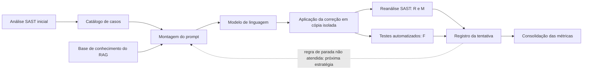
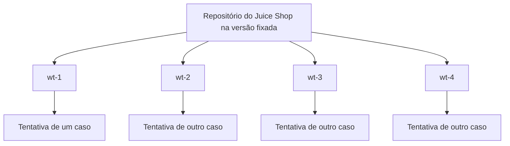

## 4 Implementação

Este capítulo apresenta a implementação do _pipeline_ utilizado para executar o experimento descrito no Capítulo 3. São descritos os principais passos da sua elaboração, a estrutura do projeto, a organização dos arquivos produzidos e a forma de execução do _pipeline_. Os resultados obtidos são apresentados e discutidos no Capítulo 5.

Para facilitar o acompanhamento, o capítulo utiliza um caso real como exemplo ao longo das seções: um alerta de _path traversal_ no arquivo `routes/keyServer.ts` do OWASP Juice Shop, processado pelo modelo GPT-4.1 mini em uma das campanhas finais do experimento.

### 4.1 Visão geral

O fluxo do _pipeline_ foi apresentado na Seção 3.9 e representado na Figura 2. Esta seção descreve como esse fluxo foi organizado na implementação.

Diferentemente de um conjunto pequeno de casos criados especificamente para um experimento, o Juice Shop é uma aplicação completa, com servidor em Node.js e Express, interface em Angular, banco de dados, dependências externas e uma suíte de testes própria. Essa característica exigiu soluções específicas de implementação, como a preparação de um ambiente padronizado, o isolamento das alterações de cada tentativa, a aplicação de edições em arquivos extensos e a seleção dos testes relacionados ao código modificado. Essas soluções são apresentadas ao longo deste capítulo.

A solução foi organizada no estilo arquitetural conhecido como dutos e filtros (_pipes and filters_). Nesse estilo, cada etapa do processamento, chamada de filtro, executa uma única responsabilidade: ela lê arquivos de entrada e grava arquivos de saída, que passam a ser a entrada da etapa seguinte. Os arquivos que ligam uma etapa à outra são os dutos. Essa organização permitiu desenvolver e verificar cada etapa separadamente e deixou registrado em arquivo tudo o que foi produzido em cada tentativa. A Figura 4 apresenta as etapas principais e a forma como se conectam.



**Figura 4 — Etapas principais do _pipeline_ e suas conexões.**

Fonte: elaboração dos autores.

Na figura, a seta tracejada representa a sequência de estratégias de _prompt_. Quando a correção produzida por uma estratégia não atende à regra de parada descrita na Seção 3.9, que exige R, F e M iguais a 1, o mesmo caso é submetido à estratégia seguinte, até que uma correção atenda a essa regra ou que as quatro estratégias sejam utilizadas.

### 4.2 Elaboração do _pipeline_

A elaboração do _pipeline_ foi organizada em sete partes: a preparação do ambiente experimental, a identificação das vulnerabilidades com o Semgrep, a definição dos testes automatizados utilizados na validação, a construção das estratégias de _prompt_, a montagem da base de conhecimento do RAG simplificado, a integração com os modelos de linguagem e a definição do fluxo experimental.

#### 4.2.1 Preparação do ambiente experimental

Para que todas as execuções utilizassem exatamente as mesmas ferramentas e versões, o ambiente foi empacotado com o Docker. Assim, a execução não depende das versões instaladas na máquina de cada pesquisador, e qualquer computador com o Docker executa o _pipeline_ nas mesmas condições.

A imagem construída para este trabalho reúne o Node.js 24.14.0, o Python 3.11, o Semgrep 1.177.0 e uma cópia do OWASP Juice Shop na versão v20.1.1, já com as dependências instaladas e o código compilado. O Juice Shop foi fixado em um _commit_ específico do seu repositório, identificado por `f915bddd8279`. Fixar o _commit_ garantiu que todas as tentativas partissem do mesmo código-fonte. O código do _pipeline_, as configurações e os resultados não ficam dentro da imagem. A pasta do projeto é conectada ao contêiner durante a execução, e os arquivos produzidos permanecem no computador de quem executa.

Cada tentativa de correção altera arquivos do Juice Shop. Se todas as tentativas utilizassem a mesma pasta, a alteração feita em uma poderia interferir na avaliação de outra, e cada tentativa precisaria terminar antes que a seguinte começasse. Para evitar esse problema, foram utilizadas as _worktrees_ do Git.

Normalmente, um repositório Git possui uma única pasta de trabalho, onde ficam os arquivos que podem ser editados. O recurso de _worktrees_ permite criar pastas de trabalho adicionais, todas ligadas ao mesmo repositório. Cada _worktree_ contém a sua própria cópia dos arquivos em uma versão escolhida, enquanto o histórico do projeto continua armazenado uma única vez. Na prática, cada _worktree_ funciona como uma cópia separada do Juice Shop, na qual uma correção pode ser aplicada e testada sem afetar as demais.

Neste trabalho, foram criadas quatro _worktrees_, chamadas wt-1, wt-2, wt-3 e wt-4, todas na versão fixada do Juice Shop. Com elas, até quatro casos diferentes puderam ser processados ao mesmo tempo, cada um em sua própria cópia. A Figura 5 representa essa organização.



**Figura 5 — Cópias de trabalho do Juice Shop utilizadas pelo _pipeline_.**

Fonte: elaboração dos autores.

As _worktrees_ não receberam uma instalação nova das dependências do Juice Shop. As bibliotecas da aplicação e os arquivos já compilados foram copiados da cópia de referência existente na imagem para cada _worktree_. Para confirmar que cada cópia era idêntica à referência, foi calculado o _hash_ dos arquivos copiados e comparado com o _hash_ da referência.

Durante o desenvolvimento, também foi mantida uma rotina que prepara o Juice Shop e as _worktrees_ diretamente no computador, sem o Docker. Essa rotina clona o repositório do Juice Shop, cria as quatro _worktrees_ na versão fixada e instala as dependências em cada uma. As campanhas finais do experimento utilizaram o ambiente Docker descrito nesta seção. A forma como as _worktrees_ são reservadas e restauradas durante a execução é detalhada na Seção 4.4.

#### 4.2.2 Identificação das vulnerabilidades com o Semgrep

O ponto de partida do experimento foi a análise estática do Juice Shop com o Semgrep. Neste trabalho, cada execução dessa análise sobre o código é chamada de _scan_. Em um _scan_, o Semgrep percorre os arquivos do projeto, compara o código com um conjunto de regras e gera um relatório em formato JSON com os alertas encontrados. Cada alerta informa a regra acionada, o arquivo e a linha do código, uma mensagem explicativa e, quando disponíveis, a CWE, a categoria do OWASP Top 10 e a severidade.

As regras e as configurações da análise foram reunidas em um perfil de regras. O perfil define quais regras são aplicadas, quais pastas ficam fora da análise e os limites de tempo do Semgrep. O perfil utilizado combina 1.074 regras do conjunto público `p/default`, mantido pelos desenvolvedores do Semgrep, com 28 regras locais, escritas pelos autores para padrões de vulnerabilidade presentes no Juice Shop que as regras públicas não identificavam, conforme a Seção 3.4. As regras públicas foram copiadas para um arquivo e mantidas fixas no perfil, de forma que uma atualização do Semgrep não alterasse o conjunto de regras durante o experimento.

Antes de cada _scan_, o _pipeline_ confere o perfil. São comparados os _hashes_ dos arquivos de regras e da lista de exclusões com os valores registrados, e a versão do Semgrep é verificada. Caso algum desses elementos tenha sido alterado, a execução é interrompida. Esse cuidado garante que a análise feita antes da correção e a análise feita depois dela utilizam exatamente as mesmas regras.

O _scan_ inicial deu origem ao catálogo de casos, que é a lista de alertas submetidos ao _pipeline_. Cada caso corresponde a um alerta em uma posição específica do código e reúne as informações descritas na Seção 3.5. O catálogo final contém 78 casos.

O identificador de cada caso é formado pelo prefixo AMP seguido de 16 caracteres calculados a partir do _hash_ da regra, do arquivo e da posição do alerta. Dessa forma, dois alertas da mesma regra em linhas diferentes de um mesmo arquivo recebem identificadores distintos, e um mesmo alerta mantém sempre o mesmo identificador.

No caso utilizado como exemplo, o Semgrep apontou a linha 14 do arquivo `routes/keyServer.ts` com a regra `express-res-sendfile`, do conjunto público, associada à CWE-73. O código não garante que o caminho final permaneça dentro da pasta prevista, o que caracteriza uma vulnerabilidade de _path traversal_, na qual um atacante manipula o caminho para ler arquivos fora do local permitido. O caso recebeu o identificador `AMP95adf572d3c6677f`. O trecho apontado é apresentado a seguir.

```typescript
if (!file.includes('/')) {
  res.sendFile(path.resolve('encryptionkeys/', file))
} else {
  res.status(403)
  next(new Error('File names cannot contain forward slashes!'))
}
```

#### 4.2.3 Testes automatizados utilizados na validação

A verificação funcional das correções utilizou a suíte de testes do próprio Juice Shop. Essa suíte possui três tipos de teste. Os testes unitários do servidor verificam funções isoladas da aplicação. Os testes de API enviam requisições HTTP à aplicação, carregada em memória durante o teste, e conferem as respostas, como o código de status e o conteúdo retornado. Os testes de interface verificam os componentes Angular em um navegador simulado. Os dois primeiros tipos utilizam o executor de testes do próprio Node.js, e o terceiro utiliza a ferramenta Vitest. Além dos testes, a validação inclui a compilação do código, realizada pelo compilador do TypeScript para o servidor e pela ferramenta de compilação do Angular quando a interface é alterada. Uma correção que impede a compilação já é considerada uma falha funcional.

Executar a suíte completa em cada tentativa tornaria o experimento muito demorado, pois a suíte reúne centenas de testes e exige a inicialização da aplicação. Por isso, os testes foram organizados em 52 grupos, cada um reunindo os testes de uma funcionalidade da aplicação, como o carrinho de compras, o envio de arquivos ou a entrega de arquivos. Desses grupos, 36 são de API, 7 do servidor e 9 da interface. Um mapa relaciona cada um dos 46 arquivos do Juice Shop que possuem alertas no catálogo aos grupos que exercitam o seu comportamento. Quando uma correção altera um arquivo, são executados os grupos ligados a ele no mapa. Se a correção altera mais de um arquivo, são executados os grupos ligados a todos eles, e um grupo comum a dois arquivos é executado uma única vez.

Em alguns arquivos, a suíte original do Juice Shop não exercitava o comportamento que uma correção poderia alterar. Para esses casos, os autores escreveram testes adicionais, reunidos em 16 arquivos. Um exemplo são os testes do CAPTCHA aritmético, que conferem se a expressão gerada é calculada corretamente, se o resultado é armazenado e se uma resposta incorreta continua sendo recusada no envio de comentários. Esses testes adicionais são copiados para o Juice Shop somente durante a validação e removidos em seguida, de forma que o código analisado pelo Semgrep não é afetado por eles.

Antes da execução do experimento, todos os grupos foram executados no código original do Juice Shop, sem nenhuma correção. Esse resultado corresponde ao _baseline_ descrito na Seção 3.10 e registrou a situação de cada um dos 574 testes executados nos grupos. Durante a validação de uma tentativa, o resultado dos testes é comparado com o _baseline_, e somente as falhas que não existiam no código original são atribuídas à correção. Quando um teste falha pela primeira vez em uma tentativa, o grupo é executado novamente, e apenas as falhas que se repetem nas duas execuções, chamadas de persistentes, são consideradas. Esse procedimento evita que uma instabilidade momentânea, como um atraso do sistema, seja contada como quebra de funcionalidade.

Durante o desenvolvimento, observou-se também que parte dos testes do Juice Shop só passa enquanto a vulnerabilidade existe. Como o Juice Shop é uma aplicação criada para o ensino de segurança, alguns testes foram escritos para confirmar que os seus desafios de exploração funcionam. Um exemplo é um teste que altera um produto sem autenticação e espera que a operação seja aceita. Uma correção bem-sucedida faz esse tipo de teste falhar. Esses testes formam o conjunto D, definido na Seção 3.10. A implementação manteve a lista desses testes, com o critério de inclusão de cada um, e registrou separadamente as falhas que pertencem a ela. Durante a execução, a decisão de passar para a estratégia seguinte considerou as falhas de todos os testes, inclusive as do conjunto D, como na interpretação sem separação apresentada na Tabela 5. O registro separado permitiu calcular F, na mesma validação, também na interpretação por critérios, adotada na análise principal.

#### 4.2.4 Elaboração das estratégias de _prompt_

As quatro estratégias de _prompt_ descritas na Seção 3.7, identificadas como P1, P2, P3 e P4, foram implementadas por uma rotina única de montagem, que reúne blocos de texto conforme a estratégia selecionada, nas combinações resumidas na Tabela 4.

Todos os _prompts_ compartilham uma base comum. Ela é formada por uma mensagem que define o papel do modelo, como um engenheiro de segurança de aplicações especializado em TypeScript, Node.js e Express, pela tarefa de identificar e corrigir a vulnerabilidade presente no código, pelo código do arquivo, por um conjunto de restrições e pela descrição do formato da resposta. Quando o arquivo tem até 250 linhas, ele é enviado completo. Em arquivos maiores, é enviado um trecho com até 60 linhas antes e 60 linhas depois das linhas apontadas pelo alerta, e o _prompt_ informa quais linhas foram mostradas. O código é lido diretamente da _worktree_, e não do relatório do Semgrep, para que o modelo receba o texto exato do arquivo que será alterado.

As restrições pedem que o modelo altere apenas o necessário para corrigir a vulnerabilidade, sem refatorar ou renomear o código, que não altere mensagens de erro, textos exibidos ao usuário ou assinaturas de funções, que não modifique arquivos de teste e que preserve o comportamento funcional existente. Também pedem que cada trecho a ser substituído seja copiado literalmente do código fornecido e apareça uma única vez no arquivo, condição necessária para que a correção possa ser aplicada automaticamente, como descrito na Seção 4.4. Esse texto foi mantido igual nas quatro estratégias e em todos os modelos.

A resposta do modelo foi definida como um objeto JSON com seis campos: a vulnerabilidade identificada, a causa da vulnerabilidade, a estratégia de correção, as edições, a justificativa técnica e as limitações da correção. O campo de edições é uma lista em que cada item informa o arquivo, o trecho original e o trecho que o substitui. Esse formato permite que o _pipeline_ altere apenas as linhas necessárias, sem que o modelo precise reescrever o arquivo inteiro, o que seria inviável em arquivos extensos do Juice Shop. Cada _prompt_ é gravado em arquivo antes do envio, o que permite consultar exatamente o conteúdo recebido pelo modelo em cada tentativa.

No caso utilizado como exemplo, o arquivo `routes/keyServer.ts` possui 20 linhas e foi enviado completo. Na estratégia P3, o _prompt_ recebeu também o bloco do alerta, reproduzido a seguir com a mensagem resumida, e o documento sobre _path traversal_ da base de conhecimento.

```text
Alerta da ferramenta de analise estatica (Semgrep) que deve ser corrigido:
- Arquivo: routes/keyServer.ts
- Linha: 14
- Regra: javascript.express.security.audit.express-res-sendfile.express-res-sendfile
- CWE: CWE-73: External Control of File Name or Path
- Mensagem: The application processes user-input, this is passed to res.sendFile
  which can allow an attacker to arbitrarily read files on the system through
  path traversal. (...)
```

#### 4.2.5 Base de conhecimento do RAG simplificado

O RAG simplificado foi implementado com uma base de conhecimento formada por 14 documentos em formato Markdown. Treze deles são dedicados a uma categoria de vulnerabilidade, como injeção, controle de acesso, falhas criptográficas, _Cross-Site Scripting_ e _path traversal_, e o último é um documento genérico, utilizado quando nenhuma categoria específica corresponde ao alerta. Cada documento é organizado em sete seções: descrição e sinais da falha, origem e condições em que ela ocorre, impactos, formas de mitigação, cuidados para preservar o funcionamento da aplicação, um exemplo genérico de código vulnerável e corrigido, e limitações e formas de verificação da correção.

A escolha do documento é feita por um índice, que associa cada CWE ao documento correspondente. Para cada caso, o recuperador utiliza a primeira CWE do alerta que esteja presente no índice. Quando nenhuma CWE do alerta está no índice, utiliza a categoria registrada no catálogo e, se ela também não corresponder a um documento, utiliza o documento genérico. Nas campanhas finais, todos os 78 casos tiveram uma CWE reconhecida pelo índice, e o documento genérico não precisou ser utilizado. Conforme definido na Seção 3.8, a recuperação é feita por essa associação direta, sem busca por similaridade.

#### 4.2.6 Integração com os modelos de linguagem

A comunicação com os modelos de linguagem foi isolada em um componente próprio, responsável por enviar o _prompt_, receber a resposta e registrar as informações da chamada. Com essa separação, a troca do modelo não exige alterar as etapas de aplicação e validação. Nas campanhas finais, esse componente utilizou a API da OpenAI com os modelos GPT-4.1 mini, GPT-5.6 Luna e GPT-6 Luna.

As chamadas utilizaram o recurso de saída estruturada da API, no qual o formato JSON esperado é enviado junto com o _prompt_ e a resposta é obrigatoriamente gerada nesse formato. Esse recurso reduz respostas que não podem ser interpretadas pelo _pipeline_. A temperatura foi fixada em zero, valor que torna as respostas do modelo menos variáveis, e o tamanho máximo da resposta foi limitado a 4.096 _tokens_.

As chamadas foram enviadas uma de cada vez, mesmo quando havia casos sendo processados em paralelo, para respeitar os limites de requisições da API e permitir o controle preciso do consumo. Cada requisição teve tempo limite de 120 segundos. Em erros temporários de comunicação, como falhas de rede ou excesso momentâneo de requisições, a chamada foi repetida, com no máximo três envios.

No caso utilizado como exemplo, a resposta do GPT-4.1 mini na estratégia P3 propôs a edição apresentada a seguir, reproduzida sem os campos de justificativa.

```json
{
  "edicoes": [
    {
      "arquivo": "routes/keyServer.ts",
      "trecho_original": "    if (!file.includes('/')) {\n      res.sendFile(path.resolve('encryptionkeys/', file))\n    } else {",
      "trecho_corrigido": "    if (!file.includes('/')) {\n      res.sendFile(file, { root: path.resolve('encryptionkeys/') })\n    } else {"
    }
  ]
}
```

Na justificativa, o modelo explicou que a opção `root` da função `res.sendFile` define a pasta raiz permitida e faz com que o próprio Express recuse caminhos que saiam dela, mantendo a verificação original que rejeita nomes com barras.

#### 4.2.7 Definição do fluxo experimental

Com o ambiente, o catálogo, os testes, as estratégias de _prompt_, a base de conhecimento e a integração com os modelos definidos, foi estabelecido o fluxo experimental. A execução geral seguiu a sequência apresentada a seguir.

```text
Juice Shop na versão fixada
→ Análise SAST inicial com o Semgrep e formação do catálogo de casos
→ Para cada caso, nas estratégias P1, P2, P3 e P4, em sequência:
    → Reserva de uma worktree
    → Montagem e registro do prompt
    → Geração da correção pelo modelo de linguagem
    → Aplicação da correção na worktree
    → Execução dos testes relacionados ao arquivo alterado (F)
    → Nova análise com o Semgrep e comparação dos alertas (R e M)
    → Registro da tentativa e restauração da worktree
    → Encerramento do caso quando a correção atende à regra de parada
→ Consolidação das métricas
→ Avaliação conjunta das correções aceitas (RRIS)
```

Os casos foram processados em paralelo, em até quatro ao mesmo tempo, um em cada _worktree_. Dentro de um mesmo caso, as estratégias foram executadas em sequência, e a estratégia seguinte só foi utilizada quando a anterior não produziu uma correção que atendesse à regra de parada, conforme a Figura 2, apresentada na Seção 3.9.

### 4.3 Estrutura do projeto

A implementação está disponível em repositório público no GitHub, em [caiolamego/tcc2-llm-sast-juiceshop](https://github.com/caiolamego/tcc2-llm-sast-juiceshop). A estrutura principal do projeto foi organizada da seguinte forma:

```text
tcc2-llm-sast-juiceshop/
  src/pipeline/
    etapas/
      e01_analise_sast/
      e02_catalogo/
      e03_contexto_rag/
      e04_prompt/
      e05_geracao_llm/
      e06_aplicacao/
      e07_validacao/
      e08_registro/
      e09_metricas/
    orquestracao/
    painel/
  config/
  rules/
  knowledge_base/
  tests/
  scripts/
  docker/
  outputs/
  workspace/
  executar.py
  painel.py
  Dockerfile
  compose.yaml
```

O diretório `src/pipeline/etapas/` contém as etapas do _pipeline_, numeradas na ordem do fluxo. A etapa `e01_analise_sast` executa o Semgrep, interpreta o relatório e compara os alertas antes e depois da correção. A `e02_catalogo` carrega e confere o catálogo de casos. A `e03_contexto_rag` recupera o documento da base de conhecimento. A `e04_prompt` monta os _prompts_ de cada estratégia. A `e05_geracao_llm` realiza a comunicação com os modelos de linguagem. A `e06_aplicacao` gerencia as _worktrees_ e aplica as edições propostas. A `e07_validacao` seleciona e executa os testes. A `e08_registro` grava o resultado de cada tentativa, e a `e09_metricas` calcula as métricas a partir desses registros.

O diretório `orquestracao/` contém a rotina que conduz a execução, ligando as etapas para cada caso e estratégia, e a verificação inicial das entradas. O diretório `painel/` contém a interface web de acompanhamento, apresentada na Seção 4.6.

O diretório `config/` reúne as configurações do experimento, como o perfil de regras do Semgrep, o mapa entre arquivos e grupos de testes, a lista do conjunto D, o roteiro de raciocínio guiado e as configurações de cada execução. O diretório `rules/` contém as regras locais do Semgrep e os seus arquivos de exemplo. O diretório `knowledge_base/` contém os 14 documentos do RAG simplificado, o índice e o manifesto com os _hashes_.

O diretório `tests/` contém dois tipos de teste. Os testes unitários verificam o funcionamento do próprio _pipeline_, como a montagem dos _prompts_, a aplicação das edições e o cálculo das métricas, sem chamar os modelos de linguagem. Os testes adicionais do Juice Shop, descritos na Seção 4.2.3, ficam separados em uma pasta própria. O diretório `scripts/` reúne rotinas auxiliares, como a preparação do Juice Shop, a geração do catálogo e do _baseline_ dos testes, a avaliação conjunta da RRIS e a geração de relatórios. O diretório `docker/` contém as rotinas de preparação das _worktrees_ dentro do contêiner e a referência da imagem utilizada.

O diretório `outputs/` armazena os arquivos produzidos em cada execução, organizados conforme descrito na próxima seção. O diretório `workspace/` contém o repositório do Juice Shop e as quatro _worktrees_. Ele não faz parte do controle de versões do projeto, pois é preparado a partir da versão fixada do Juice Shop. Por fim, o arquivo `executar.py` inicia a execução pelo terminal, o arquivo `painel.py` inicia a interface web, e os arquivos `Dockerfile` e `compose.yaml` definem, respectivamente, a construção da imagem e a forma como o contêiner é executado.

### 4.4 Fluxo de execução e armazenamento dos resultados

Esta seção descreve o caminho percorrido por uma tentativa de correção, desde a reserva de uma _worktree_ até o registro do resultado, e os arquivos gravados em cada etapa.

**Reserva da _worktree_.** As quatro _worktrees_ formam um conjunto de cópias disponíveis. Quando um caso começa a ser processado, ele recebe uma _worktree_ livre, que fica reservada até o fim da tentativa e não pode ser utilizada por outro caso nesse intervalo. Antes de ser entregue, a _worktree_ é restaurada para a versão fixada do Juice Shop: os arquivos alterados voltam ao conteúdo original e os arquivos criados são removidos, preservando apenas as dependências instaladas. O _pipeline_ também impede que duas execuções diferentes utilizem o mesmo conjunto de _worktrees_ ao mesmo tempo. Com isso, cada tentativa parte sempre do código original, mesmo que a tentativa anterior naquela cópia tenha sido interrompida por um erro.

**Montagem do _prompt_ e chamada ao modelo.** O _prompt_ é montado conforme a estratégia, a partir do código lido na _worktree_, e gravado em arquivo. Em seguida, é enviado ao modelo, e a resposta recebida também é gravada, junto com as informações da chamada descritas na Seção 4.2.6.

**Aplicação da correção.** Antes de alterar qualquer arquivo, o _pipeline_ confere cada edição proposta. O arquivo indicado precisa existir dentro da _worktree_. Em seguida, o trecho original de cada edição é procurado no arquivo. Esse trecho funciona como uma âncora, isto é, uma referência que indica o local exato da alteração. Quando a âncora aparece exatamente uma vez no arquivo, ela é substituída pelo trecho corrigido. Quando não aparece ou aparece mais de uma vez, a tentativa é registrada como não aplicada, pois não é possível saber com segurança onde a alteração deveria ser feita. Essa exigência é uma limitação do _pipeline_, pois uma correção adequada pode deixar de ser avaliada apenas porque o modelo copiou o trecho original de forma imprecisa. Na população principal das campanhas finais, isso ocorreu em 20 das 685 tentativas: 15 do GPT-4.1 mini, em sete casos, quatro do GPT-5.6 Luna, em três casos, e uma do GPT-6 Luna.

Durante o desenvolvimento, observou-se que, em alguns casos, os modelos copiavam o trecho original com uma quantidade diferente de espaços no início das linhas, o que impedia a correspondência exata. Para os arquivos JavaScript e TypeScript, foi implementado um tratamento para essa situação. Se a âncora, com duas ou mais linhas, não é encontrada exatamente, o _pipeline_ procura no arquivo um bloco com o mesmo conteúdo, linha por linha, que difira apenas por um recuo uniforme, ou seja, a mesma quantidade de espaços a mais ou a menos em todas as linhas. Nomes, aspas, operadores e qualquer outro conteúdo precisam ser idênticos. Se existir exatamente um bloco nessas condições, a substituição é feita nesse bloco, e o trecho corrigido recebe o mesmo ajuste de recuo para ficar alinhado ao código ao redor. Antes de aceitar a correspondência, o _pipeline_ também confirma, por meio do compilador do TypeScript instalado no próprio Juice Shop, que o bloco encontrado e o trecho enviado pelo modelo possuem os mesmos elementos de código. O compilador monta a estrutura sintática de cada trecho e separa os seus elementos básicos, como nomes, operadores e sinais de pontuação, que precisam aparecer na mesma ordem nos dois trechos. Se nenhum bloco ou mais de um bloco atender a essas condições, a tentativa continua registrada como não aplicada.

As edições de uma mesma resposta são todas conferidas antes que qualquer arquivo seja gravado. Se uma delas falhar, nenhuma alteração é feita. Dessa forma, a _worktree_ nunca fica com uma correção aplicada pela metade. Quando a aplicação é concluída, são gravados o arquivo corrigido e o _patch_, que é o registro das diferenças entre o código original e o código alterado.

**Validação funcional.** Com a correção aplicada, são executados a compilação e os grupos de testes ligados aos arquivos alterados, conforme a Seção 4.2.3. Os testes adicionais desses grupos são copiados para a _worktree_ apenas durante a execução. As compilações e os testes de interface de casos diferentes podem ser executados ao mesmo tempo. Os grupos de testes de API, por outro lado, foram executados um de cada vez, porque alguns desses testes utilizam recursos de rede do computador que não podem ser compartilhados por duas execuções simultâneas. O resultado de cada grupo, com os testes executados, as falhas e o tempo, é gravado em arquivo e define o valor de F.

**Nova análise estática.** Em seguida, o Semgrep analisa novamente o projeto na _worktree_, com o mesmo perfil de regras da análise inicial. O relatório resultante é comparado ao relatório inicial para definir R e M. A comparação precisa reconhecer um mesmo alerta mesmo quando a correção desloca as linhas do arquivo. Para isso, o comparador procura primeiro alertas da mesma regra, no mesmo arquivo e na mesma posição. Quando a posição muda, compara o código ao redor de cada alerta para identificar a correspondência. Se ainda assim não for possível relacionar os alertas, considera a quantidade de alertas da mesma regra no mesmo arquivo: se a quantidade não diminuiu, o alerta original é considerado presente, e se aumentou, considera-se que um alerta novo apareceu. As situações em que nenhuma dessas verificações permite uma conclusão segura são registradas como indeterminadas e não são contadas como correções aceitas. O relatório da nova análise e o resultado da comparação são gravados em arquivo.

**Registro e restauração.** Por fim, o resultado da tentativa é acrescentado ao arquivo consolidado da execução, que reúne em uma linha por tentativa o caso, a estratégia, o modelo, os valores de R, F e M, a classificação final, os tempos, os _tokens_, o custo e os caminhos de todos os arquivos produzidos. A _worktree_ é então restaurada e devolvida ao conjunto de cópias disponíveis. Se a correção atendeu à regra de parada, o caso é encerrado. Caso contrário, o mesmo caso é submetido à próxima estratégia.

Os arquivos de cada tentativa são nomeados com o identificador descrito na Seção 3.12 e ilustrado na Figura 3. Durante as campanhas, quando a regra do Semgrep não informava uma categoria do OWASP, o campo correspondente desse identificador recebia o valor `SEMOWASP`. Na versão final dos artefatos, esse valor foi substituído pela categoria da classificação complementar descrita na mesma seção. O identificador da execução indica o tipo de execução, a data e a hora de início e um código aleatório que diferencia execuções iniciadas no mesmo momento. Os arquivos de uma execução ficam reunidos em uma pasta própria, com a seguinte estrutura:

```text
outputs/campanha_docker/<EXECUCAO>/
  contrato_execucao.json
  sast_antes/
  prompts/
  respostas_llm/
  patches/
  codigos_corrigidos/
  testes/
  sast_depois/
  comparacoes/
  resultados_consolidados/
```

O arquivo `contrato_execucao.json` registra as condições da execução, como os modelos e parâmetros utilizados, a versão do Juice Shop, as estratégias, a lista de casos e os _hashes_ do catálogo, do perfil de regras, da base de conhecimento, dos testes e do próprio código do _pipeline_. As pastas `sast_antes/` e `sast_depois/` guardam os relatórios do Semgrep antes e depois das correções. As pastas `prompts/` e `respostas_llm/` guardam o conteúdo enviado e recebido em cada tentativa. As pastas `patches/` e `codigos_corrigidos/` guardam as alterações aplicadas, `testes/` guarda os resultados da validação funcional e `comparacoes/` guarda o resultado da comparação dos alertas. A pasta `resultados_consolidados/` contém o arquivo consolidado com uma linha por tentativa. A versão final dos artefatos, com a classificação complementar nos nomes, foi reunida na pasta `outputs/resultados_finais/`, que contém uma cópia dessa estrutura para cada campanha e mapas que relacionam os nomes originais aos atuais. As métricas calculadas a partir desses registros são gravadas em uma pasta separada, descrita na Seção 4.5.

No caso utilizado como exemplo, as estratégias P1 e P2 produziram correções que foram aplicadas e não quebraram os testes, mas o Semgrep continuou apontando o alerta na mesma linha. Por isso, o caso foi submetido à estratégia P3. A correção proposta pelo GPT-4.1 mini nessa estratégia foi aplicada por correspondência exata da âncora e gerou o _patch_ a seguir.

```diff
     if (!file.includes('/')) {
-      res.sendFile(path.resolve('encryptionkeys/', file))
+      res.sendFile(file, { root: path.resolve('encryptionkeys/') })
     } else {
```

O código alterado foi compilado e aprovado nos testes do grupo de entrega de arquivos. Na nova análise, o alerta original deixou de ser apontado e nenhum alerta novo apareceu. Com R, F e M iguais a 1, a correção atendeu à regra de parada e o caso foi encerrado, sem a execução da estratégia P4. Os arquivos dessa tentativa receberam o identificador `AMP95adf572d3c6677f_A06_PATHTRAV_P3_AMP_REAL_20261106T151004Z_f49ac0d2`, no qual `A06` é a categoria do OWASP Top 10:2025 associada à regra e `PATHTRAV` é a sigla do tipo de vulnerabilidade.

### 4.5 Métricas de avaliação

As métricas utilizadas seguem a definição apresentada na Seção 3.11. Nesta etapa, elas foram calculadas a partir dos registros gerados pelo _pipeline_, para classificar cada tentativa de correção e consolidar o desempenho das estratégias de _prompt_ e dos modelos.

O cálculo das métricas foi implementado em uma rotina separada, que lê o arquivo consolidado e os arquivos de cada tentativa e gera as métricas em formato JSON e CSV. Essa rotina permite que as métricas possam ser recalculadas a qualquer momento a partir dos registros da execução. As métricas são geradas de forma geral e agrupadas por estratégia de _prompt_, por caso, por CWE, por categoria do OWASP Top 10, por severidade, por regra do Semgrep e por documento da base de conhecimento, o que permite responder às perguntas de pesquisa sobre estratégias, modelos e tipos de vulnerabilidade.

A RRIS foi calculada por uma rotina própria, pois depende da aplicação conjunta das correções. Para cada modelo, essa rotina reserva uma _worktree_ restaurada, executa o Semgrep sobre o projeto original e aplica, em sequência, os _patches_ do primeiro aceite de cada caso na análise principal, na ordem em que as tentativas começaram. Quando um _patch_ não pode ser aplicado sobre os anteriores, porque altera linhas já modificadas por outra correção, ele é registrado como conflito e deixado de fora. Em seguida, o projeto com as correções reunidas é analisado novamente pelo Semgrep e submetido aos testes.

### 4.6 Execução do _pipeline_

A execução do _pipeline_ é iniciada por um arquivo de configuração, que define a lista de casos, as estratégias de _prompt_, o modelo, a quantidade de _worktrees_ utilizadas e o modo de execução. Com o ambiente Docker preparado, a execução de um modelo é iniciada pelo terminal com um comando como o apresentado a seguir.

```text
docker compose run --rm tcc .venv/bin/python executar.py \
  --config config/execucao_docker_78.yaml --modelo gpt-4.1-mini --modo real
```

Foram implementados três modos de execução. O modo de verificação inicial, chamado de _preflight_ na Seção 3.9, confere as entradas, como o catálogo, o perfil de regras, a base de conhecimento, o _baseline_ dos testes e as _worktrees_, repete a análise inicial do Semgrep para confirmar que ela reproduz o catálogo e monta os _prompts_, sem chamar os modelos. O modo de simulação percorre todo o fluxo com respostas simuladas, sem custo com a API, e foi utilizado para testar o _pipeline_ durante o desenvolvimento. O modo real executa o fluxo completo com chamadas aos modelos de linguagem e foi o utilizado nas campanhas finais. Os resultados de cada modo são gravados em pastas separadas, o que impede que dados de verificação ou de simulação sejam confundidos com os das campanhas finais.

No início da execução, o contrato de execução é gravado com as condições descritas na Seção 4.4. Ele também permite retomar uma execução interrompida, por exemplo por uma queda de energia. Ao ser iniciada novamente com o mesmo identificador, a execução reaproveita as tentativas já registradas e continua a partir do ponto em que parou.

Além do terminal, foi desenvolvido um painel web para acompanhar as execuções. O painel é uma página aberta no navegador do próprio computador, acessível apenas localmente. Nele, é possível escolher o modelo e o modo de execução, iniciar e interromper uma execução e acompanhar o seu andamento. São exibidas todas as informações relevantes do processamento. O painel utiliza o mesmo arquivo de configuração e os mesmos comandos da execução pelo terminal, de forma que os dois caminhos produzem resultados equivalentes. Quando uma interrupção é solicitada, o painel aguarda a conclusão das tentativas em andamento antes de encerrar a execução, evitando que uma correção fique aplicada pela metade ou que uma tentativa seja registrada de forma incompleta. [PENDENTE: inserir uma ou duas capturas de tela do painel, mostrando a seleção do modelo e o acompanhamento de uma execução.]
