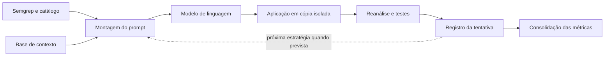
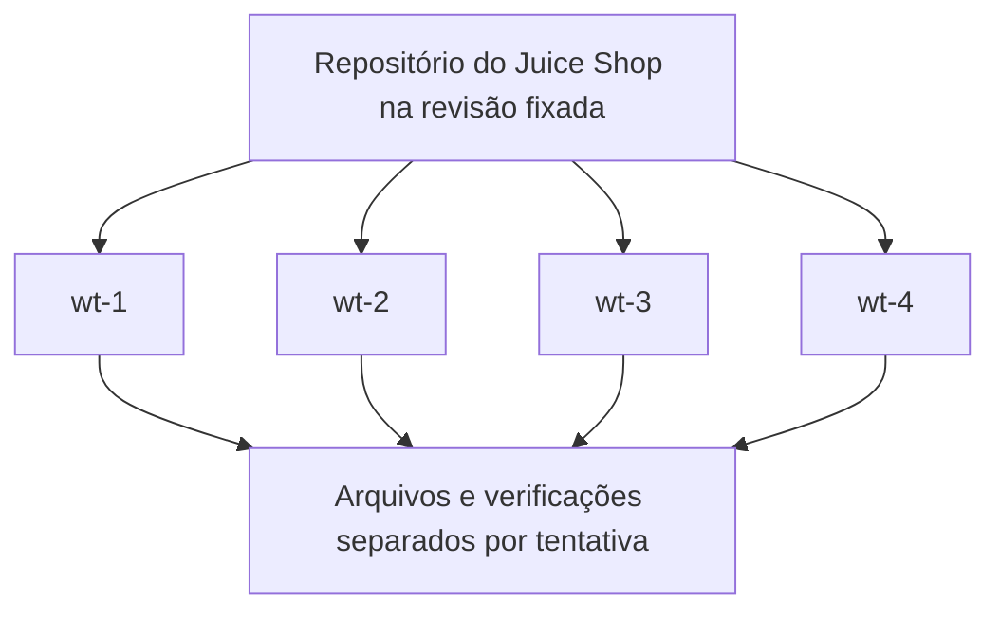

## 4 Desenvolvimento e implementação do pipeline

Este capítulo apresenta o desenvolvimento do pipeline utilizado para executar o experimento descrito no Capítulo 3. A solução integrou a leitura dos alertas de segurança, a geração de propostas pelos modelos de linguagem, a aplicação das edições e a avaliação das alterações. O foco desta apresentação é explicar como essas partes foram organizadas e conectadas, mantendo os resultados e a comparação de desempenho para o Capítulo 5.

A exposição começa pela visão geral da solução e pela organização do projeto. Em seguida, são descritas a preparação dos casos, a construção dos prompts, a integração com os modelos, o isolamento das tentativas e a validação. Por fim, são apresentados o controle das campanhas, o painel web e a organização dos registros que permitem acompanhar e repetir o procedimento.

### 4.1 Visão geral da solução

O pipeline foi desenvolvido para transformar alertas identificados no Juice Shop em tentativas de correção que pudessem ser aplicadas e avaliadas de forma automatizada. Para isso, foi necessário reunir informações do código, solicitar respostas em um formato utilizável e executar ferramentas externas após cada alteração. A automação também incluiu o registro de situações em que a resposta não podia ser aplicada ou a avaliação não produzia uma conclusão.

A solução foi organizada no estilo dutos e filtros, em que cada etapa possui uma responsabilidade e produz informações utilizadas pelas seguintes. Nesse contexto, os filtros correspondem às etapas de análise, preparação, geração, aplicação, validação e registro; os dutos são os dados e arquivos que as conectam. Um coordenador organiza a execução dessas etapas para os diferentes casos. A Figura 1 resume as principais conexões, sem representar a ordem interna de todos os testes.



**Figura 1 — Principais etapas e conexões do pipeline.** A recuperação de contexto participa da montagem dos prompts que utilizam RAG. O coordenador controla os casos, as estratégias e o uso das cópias isoladas.

Fonte: elaboração a partir da organização e do fluxo do código do projeto.

As entradas principais foram o código do alvo, o catálogo de casos, o perfil de regras e as configurações da campanha. As saídas incluíram prompts, respostas, patches, análises estáticas, testes e métricas. Para ilustrar esse percurso, foi selecionada uma tentativa real sobre a consulta de acompanhamento de pedidos, no arquivo routes/trackOrder.ts, gerada com GPT-4.1 mini e P1. O exemplo será utilizado para mostrar como os componentes se conectam; a interpretação dos resultados de segurança permanece reservada ao capítulo seguinte.

### 4.2 Tecnologias e organização do projeto

A automação foi desenvolvida principalmente em Python, responsável por preparar as chamadas, coordenar os processos e organizar os arquivos produzidos. O Semgrep realizou a análise estática, enquanto as ferramentas do ecossistema JavaScript e TypeScript foram utilizadas para compilar e testar o Juice Shop. O Git apoiou a preparação do alvo e o isolamento das tentativas. A Tabela 1 apresenta a função dessas tecnologias na solução.

**Tabela 1 — Tecnologias e responsabilidades na solução**

| Tecnologia | Responsabilidade |
|---|---|
| Python | Coordenação das etapas, integração e registro dos dados. |
| Semgrep | Identificação e reanálise dos alertas de segurança. |
| Git | Controle da revisão do alvo e gerenciamento das cópias de trabalho. |
| Node.js e ferramentas JavaScript/TypeScript | Execução, compilação e testes da aplicação estudada. |
| Docker | Disponibilização do ambiente preparado. |
| HTML, CSS e JavaScript | Interface web local de acompanhamento. |

Fonte: código e arquivos de configuração do projeto.

O repositório foi dividido para separar implementação, configuração e evidências de execução. Essa organização permitiu localizar as entradas de uma campanha e os resultados que ela produziu, sem reunir todos os arquivos na mesma pasta. A Tabela 2 apresenta os diretórios principais; os arquivos individuais são mencionados apenas quando ajudam a compreender uma responsabilidade.

**Tabela 2 — Organização principal do repositório**

| Diretório | Conteúdo |
|---|---|
| src/ | Etapas do pipeline, coordenação e painel. |
| config/ | Configurações, perfis e mapas usados na execução. |
| rules/ | Regras locais de análise estática e exemplos associados. |
| knowledge_base/ | Documentos e índice de recuperação de contexto. |
| tests/ | Testes do pipeline, das regras e verificações adicionais do alvo. |
| scripts/ | Rotinas de preparação, avaliação e relatórios. |
| outputs/ | Entradas geradas e resultados identificados por execução. |
| workspace/ | Repositório e cópias de trabalho do Juice Shop. |
| .cache/ | Dados locais de controle e armazenamento temporário. |

Fonte: estrutura do repositório experimental.

Dentro do código principal, as etapas do pipeline foram organizadas em módulos que acompanham o fluxo do experimento. A coordenação das campanhas ficou separada das rotinas de análise, geração, aplicação e validação. Também foram reunidas funções comuns, como identificação de caminhos e verificação das condições de execução. O painel utilizou os mesmos componentes de controle, evitando criar um segundo fluxo de avaliação.

O ambiente Docker reuniu as ferramentas e uma referência do Juice Shop com as dependências preparadas. O repositório do pipeline foi montado no contêiner, permitindo manter código e resultados acessíveis no computador do usuário. Arquivos de configuração e comandos de apoio organizaram a preparação e a conferência do ambiente. Essa distribuição preservou a distinção entre a imagem de referência, as configurações do experimento e os dados produzidos pelas campanhas.

### 4.3 Detecção e preparação dos casos

A integração com o Semgrep foi responsável por executar a ferramenta com o perfil selecionado e interpretar sua saída em JSON. As ocorrências foram organizadas em campos como regra, arquivo, localização, mensagem e classificação associada. O sistema também registrou avisos e falhas de análise, para que uma leitura incompleta não fosse confundida com ausência de alertas. O perfil foi verificado antes de ser utilizado.

As regras locais foram organizadas em arquivos próprios, acompanhados por exemplos de código. No caso ilustrativo, a regra procurou consultas que utilizavam o operador $where com uma expressão construída dinamicamente. O padrão buscava sinalizar situações em que valores poderiam ser incorporados à expressão da consulta. Essa regra permitiu localizar a linha de acompanhamento de pedidos, sem tornar sua correspondência uma análise completa de todas as condições de exploração.

A formação do catálogo foi implementada em uma rotina que leu o scan e a classificação arquivada dos alertas. Antes de publicar os casos, a rotina conferiu a correspondência entre regra, arquivo, localização e revisão do alvo. Dessa forma, a tarefa de organizar as entradas permaneceu distinta da atribuição dos rótulos da triagem. A existência desses rótulos e os limites de sua validação foram apresentados na metodologia.

Cada ocorrência recebeu um identificador associado à regra e à sua localização no código fixado. Também foram armazenados o trecho relacionado, as informações de segurança disponíveis e a identificação do arquivo de origem. A composição do identificador permitiu manter separados alertas próximos ou repetidos no mesmo arquivo. Isso apoiou a ligação entre o caso inicial e as diferentes estratégias utilizadas para avaliá-lo.

No exemplo selecionado, o catálogo apontou uma consulta em que o identificador do pedido era incorporado a uma expressão de $where. Ao carregar esse caso, o pipeline conferiu as entradas e leu o arquivo da cópia de trabalho para montar o prompt. O exemplo mostra a passagem de uma ocorrência do detector para uma tarefa de geração. A classificação posterior da tentativa dependeu das etapas de aplicação e validação, descritas adiante.

### 4.4 Construção dos prompts e recuperação de contexto

A montagem dos prompts reuniu uma instrução de tarefa, o código selecionado, as restrições de alteração e o formato esperado de resposta. O componente responsável leu o conteúdo da cópia de trabalho, utilizando o arquivo completo ou uma janela de linhas conforme a política descrita no Capítulo 3. Essa leitura evitou depender exclusivamente do trecho fornecido no relatório da ferramenta, que poderia não estar disponível na execução anônima do Semgrep.

As diferenças entre as estratégias P1–P4 foram implementadas pela inclusão dos blocos previstos para cada uma. O roteiro foi acrescentado em P2 e P4; o diagnóstico SAST e a documentação recuperada foram acrescentados em P3 e P4. Os demais elementos permaneceram comuns. Essa composição permitiu utilizar uma mesma rotina de montagem, mantendo registradas as informações efetivamente fornecidas em cada tentativa, conforme a comparação apresentada no capítulo metodológico.

O recuperador de contexto consultou o índice da base e selecionou o documento correspondente à primeira CWE mapeada. Quando necessário, utilizou a categoria disponível ou o documento genérico. Antes de entregar o texto ao montador, conferiu a integridade do índice e dos documentos. Somente o corpo do documento selecionado foi incorporado ao prompt; os dados sobre fontes e versões permaneceram disponíveis nos registros de apoio.

No exemplo de acompanhamento de pedidos, P1 recebeu o arquivo completo, com 29 linhas, e a instrução direta de correção. Não foram acrescentados o diagnóstico explícito ou um documento recuperado. O prompt foi salvo antes da geração, permitindo consultar exatamente o conteúdo enviado ao modelo. Nas estratégias com RAG, o mesmo registro também identifica o documento recuperado e sua versão, sem exigir que todas essas informações apareçam no texto destinado ao modelo.

**Excerto do prompt registrado no caso ilustrativo:**

> Tarefa: identifique e corrija a vulnerabilidade de seguranca presente no codigo abaixo.
>
> Arquivo: routes/trackOrder.ts (completo, 29 linhas)

O excerto reproduz a abertura da mensagem. O código, as restrições e o formato de resposta permanecem no arquivo completo da tentativa, identificado nas notas de evidência.

### 4.5 Integração com os modelos de linguagem

A integração com os modelos foi separada do restante do processamento para permitir selecionar a geração sem reescrever as etapas de aplicação e avaliação. Nas campanhas finais, essa integração utilizou a API da OpenAI com GPT-4.1 mini, GPT-5.6 Luna e GPT-6 Luna. O repositório também contém suporte a um provedor adicional, que não integrou as campanhas do recorte final.

As configurações foram convertidas para os parâmetros esperados por cada modelo, mantendo uma interface comum para o coordenador. Essa adaptação considerou diferenças no suporte aos parâmetros, como o esforço de raciocínio desativado nos Luna. Além do nome solicitado, foram registrados o modelo retornado e as condições da geração. Os valores utilizados nas campanhas foram apresentados na metodologia, evitando repeti-los nesta seção.

A resposta foi definida por uma estrutura com campos descritivos e uma lista de edições. Cada edição informou o arquivo, o trecho original e seu substituto. A verificação desse formato permitiu distinguir uma resposta utilizável de conteúdo vazio, recusa ou estrutura inválida. O excerto a seguir foi extraído da resposta real do caso ilustrativo e mostra a edição proposta sem reproduzir as justificativas completas do modelo.

```json
{
  "edicoes": [
    {
      "arquivo": "routes/trackOrder.ts",
      "trecho_original": "    db.ordersCollection.find({ $where: `this.orderId === '${id}'` }).then((order: any) => {",
      "trecho_corrigido": "    db.ordersCollection.find({ orderId: id }).then((order: any) => {"
    }
  ]
}
```

**Excerto da resposta — Edição proposta para o acompanhamento de pedidos.** Fonte: resposta arquivada da campanha com GPT-4.1 mini.

O cliente também registrou as respostas, os tokens, o tempo de geração e o custo calculado a partir dos preços configurados. Erros de comunicação receberam tratamento próprio, com novas tentativas limitadas e controle do consumo. O armazenamento de respostas para reutilização foi implementado como opção, mas permaneceu desativado nas campanhas finais. Essas diferenças entre recursos disponíveis e condições utilizadas foram mantidas nos registros.

### 4.6 Aplicação das correções e isolamento

#### 4.6.1 Isolamento com Git worktrees

As worktrees foram utilizadas como cópias de trabalho separadas, ligadas ao mesmo repositório Git. Cada uma disponibilizou arquivos próprios para receber uma edição e executar as verificações da tentativa. Esse arranjo permitiu manter diferentes trabalhos em andamento sem que uma correção substituísse diretamente o código utilizado por outra. A relação entre o repositório de referência e as cópias é representada na Figura 2.



**Figura 2 — Cópias de trabalho utilizadas pelo pipeline.** Cada tentativa utiliza uma cópia reservada, que é restaurada antes de ser disponibilizada novamente. A figura representa o isolamento dos arquivos, e não máquinas ou redes independentes.

Fonte: preparação do ambiente e gerenciamento das worktrees.

A preparação partiu da mesma revisão fixada do Juice Shop. No ambiente Docker, as worktrees receberam as dependências e os arquivos preparados da referência da imagem, com conferência do conteúdo copiado. As campanhas finais utilizaram quatro cópias de execução. O projeto também disponibilizou uma rotina de preparação fora do Docker, distinguindo essa possibilidade do procedimento efetivamente adotado no recorte principal.

Esse isolamento se refere aos arquivos utilizados por cada tentativa e não cria, por si só, uma máquina independente. Portas e outros recursos locais ainda precisaram ser coordenados. A execução de testes que compartilham recursos recebeu controle próprio para evitar interferência. Essa distinção é importante para compreender por que disponibilizar quatro worktrees não significa executar todas as etapas de quatro tentativas simultaneamente.

#### 4.6.2 Gerenciamento das worktrees

O gerenciamento manteve um conjunto de worktrees disponíveis e entregou uma delas ao trabalho que precisava aplicar e avaliar uma proposta. Antes do uso, foram verificadas a existência da cópia, a revisão do alvo e as dependências necessárias. A reserva retirou temporariamente a worktree do conjunto disponível, evitando que outra tentativa utilizasse os mesmos arquivos enquanto a avaliação estava em andamento.

O ciclo de uso incluiu restauração antes da entrega e após a conclusão, com a devolução da cópia ao conjunto disponível. A rotina de encerramento também foi prevista para situações de erro, reduzindo a possibilidade de uma alteração incompleta alcançar a tentativa seguinte. Essa restauração permitiu manter o ponto de partida do experimento mesmo quando a proposta não era aplicável ou a avaliação falhava.

Além da reserva de cada cópia, o sistema impediu que processos diferentes utilizassem o mesmo conjunto de worktrees ao mesmo tempo. A limpeza recuperou arquivos rastreados e removeu arquivos novos não ignorados, preservando explicitamente as dependências instaladas. Ela não foi tratada como remoção de todo conteúdo local: a preparação e as verificações do ambiente permaneceram necessárias para conferir os elementos mantidos entre as tentativas.

#### 4.6.3 Aplicação das edições

Antes de modificar o código, o aplicador verificou se o caminho informado estava dentro da cópia de trabalho e se o arquivo existia. Também restringiu alterações em elementos protegidos, como os testes do alvo e arquivos centrais de dependências. As edições foram verificadas e organizadas antes da gravação. Isso permitiu registrar uma proposta fora do escopo ou incompleta sem tratá-la como correção aplicada.

A substituição utilizou o trecho original da resposta como ponto de referência, denominado âncora. Uma correspondência única permitiu localizar a alteração; trechos ausentes ou repetidos podiam tornar a aplicação inviável. Para diferenças limitadas de indentação em JavaScript e TypeScript, foi incorporado um tratamento conservador. A solução buscou acomodar esse problema de formatação, sem interpretar livremente a intenção do modelo ou escolher arbitrariamente entre posições ambíguas.

No caso ilustrativo, a edição substituiu a consulta com $where por um filtro direto no campo orderId. Após a gravação, foram preservados o arquivo corrigido e o patch, isto é, o registro das diferenças entre as versões. O excerto abaixo reproduz as linhas alteradas e permite acompanhar a proposta. A aplicação bem-sucedida apenas habilitou sua avaliação; ela não demonstrou, isoladamente, segurança ou equivalência funcional.

```diff
-    db.ordersCollection.find({ $where: `this.orderId === '${id}'` }).then((order: any) => {
+    db.ordersCollection.find({ orderId: id }).then((order: any) => {
```

**Excerto do patch do caso ilustrativo.** Fonte: alteração registrada na campanha com GPT-4.1 mini. O patch completo e o código corrigido permanecem associados à tentativa.

### 4.7 Implementação da validação

A validação reuniu a reanálise de segurança e os testes para produzir os valores de R, F e M definidos no Capítulo 3. O componente de medição recebeu o código alterado e as referências da campanha, executou as verificações previstas e reuniu os resultados. Essa separação permitiu registrar aprovação, reprovação e ausência de conclusão, incluindo os motivos de interrupção e os limites da evidência disponível.

O comparador SAST procurou acompanhar as ocorrências entre o código original e o alterado. Para isso, considerou correspondências de posição e contexto e, quando necessário, a quantidade de alertas da mesma regra no mesmo arquivo. Essa solução enfrentou a dificuldade de alterações que deslocam linhas sem remover o problema. As situações que não podiam ser resolvidas com segurança permaneceram inconclusivas, conforme os limites metodológicos já apresentados.

A verificação funcional utilizou uma referência dos testes e um mapa que relaciona arquivos alterados a grupos de verificações. Quando a proposta modificou mais de um arquivo, foram reunidos os grupos correspondentes, sem repetir desnecessariamente o mesmo grupo. A rotina também conferiu a compatibilidade da referência com as condições da execução. Assim, a seleção dos testes foi um procedimento explícito e registrado.

As verificações incluíram compilação e execução dos grupos selecionados, com preparação das condições locais e limites de tempo. Falhas de execução, testes ausentes ou relatórios insuficientes foram tratados separadamente de uma asserção funcional reprovada. Quando surgiram falhas novas, houve reexecução para identificar sua persistência. Esses controles permitiram evitar que uma verificação incompleta fosse interpretada automaticamente como aprovação.

As falhas registradas foram classificadas automaticamente segundo o conjunto D, preservando as três interpretações de F. O processamento aplicou os critérios para distinguir falhas novas associadas à manutenção da vulnerabilidade daquelas consideradas problemas funcionais. Os valores foram armazenados juntos, permitindo a análise posterior de sensibilidade sem perder o resultado da avaliação mais estrita. A classificação principal e a regra de parada utilizaram esses valores de formas distintas, descritas na seção de coordenação.

Entre os testes adicionais, o conjunto de CAPTCHA aritmético verificou a geração da expressão, o resultado calculado, sua persistência e o uso na submissão de feedback. Por exemplo, o teste associado a 2+3*4 conferiu o resultado 14, além da rejeição de uma resposta incorreta e da aceitação da resposta esperada. Esse tipo de verificação apoiou a preservação de comportamentos legítimos quando a lógica interna era modificada. Sua existência não foi tomada como cobertura completa da funcionalidade ou prova de ausência de vulnerabilidades.

### 4.8 Orquestração e execução das campanhas

O coordenador conectou as etapas e organizou o processamento dos casos. Antes da geração, a verificação inicial conferiu as entradas e reuniu as condições no contrato de execução. O mesmo contrato foi utilizado para comparar uma eventual retomada com a configuração original. Dessa forma, o controle da campanha permaneceu separado das tarefas específicas de geração, aplicação e validação.

Os casos foram distribuídos entre trabalhos de execução que utilizaram as worktrees disponíveis. Dentro de cada caso, as estratégias seguiram em sequência, enquanto casos distintos puderam avançar de forma concorrente. O acesso a recursos compartilhados, como chamadas ao provedor e determinados testes, recebeu coordenação adicional. Por isso, o paralelismo foi definido no nível dos casos, sem pressupor simultaneidade de todas as operações internas.

A decisão de interromper as estratégias foi implementada a partir do aceite sem separação das falhas do conjunto D. A classificação principal da tentativa, por sua vez, considerou F por critérios. Essa diferença permitiu que a execução produzisse registros posteriores a um aceite da definição principal, posteriormente identificados na consolidação. Na retomada, o coordenador consultou os registros existentes e a regra de parada para decidir o que ainda precisava executar.

A execução por terminal foi disponibilizada por um lançador que reuniu as configurações e preparou os comandos do coordenador e da consolidação. Foram distinguidos três modos: verificação inicial, que confere as entradas e prepara os prompts; simulação, que utiliza geração simulada; e execução real, que realiza chamadas ao modelo. A escolha desses modos permaneceu explícita, evitando interpretar dados de preparação ou simulação como respostas reais de uma campanha.

O painel web local ofereceu a seleção do modelo e do modo, o início e a parada cooperativa, além do acompanhamento dos logs, das tentativas e dos tempos registrados. Sua interface foi implementada em HTML, CSS e JavaScript, atendida por um servidor Python restrito ao computador local. O painel utilizou os mesmos comandos e critérios do lançador por terminal. O pedido de parada aguardou o encerramento da atividade em curso, em vez de forçar a interrupção imediata. [PENDENTE: inserir uma ou duas capturas reais do painel, identificando a configuração e as informações de acompanhamento exibidas.]

### 4.9 Registro, métricas e reprodução

Os arquivos foram organizados por execução e vinculados aos identificadores das tentativas. Essa estrutura permitiu acompanhar o caso ilustrativo desde o prompt e a resposta até o patch, a comparação dos alertas e os testes. O registro consolidado reuniu os caminhos desses arquivos e as classificações correspondentes. A Tabela 3 resume os principais grupos de informações preservados, sem reproduzir toda a árvore de resultados.

**Tabela 3 — Informações preservadas por execução**

| Grupo | Conteúdo |
|---|---|
| Entradas e contrato | Condições e referências utilizadas na campanha. |
| Prompts e respostas | Conteúdo enviado e recebido em cada tentativa. |
| Patches e código corrigido | Alteração aplicada e arquivos produzidos. |
| Comparações e testes | Evidências da avaliação estática e funcional. |
| Registros e sessões | Identificação, classificações e informações operacionais. |
| Métricas | Dados consolidados e tabelas de análise. |

Fonte: arquivos de resultados e rotinas de registro do pipeline.

O contrato de execução e as verificações de integridade identificaram os componentes utilizados, incluindo catálogo, regras, base documental e referência dos testes. A retomada exigiu correspondência com essas condições. Os registros de sessão também preservaram o contexto operacional da campanha, enquanto cada tentativa foi acrescentada ao arquivo consolidado. Esses recursos apoiaram a conferência da origem dos dados sem depender apenas da descrição textual do experimento.

A consolidação leu os registros e os artefatos associados para produzir métricas em JSON e tabelas CSV. O processamento distinguiu a população principal, os registros posteriores ao primeiro aceite e as condições de simulação ou diagnóstico. Também manteve as medições ausentes e as interpretações alternativas de F. As fórmulas e os denominadores foram definidos no capítulo metodológico; a implementação organizou os dados para aplicar essas definições de forma verificável.

A avaliação conjunta da RRIS foi implementada em uma rotina separada, que selecionou patches aceitos individualmente e tentou aplicá-los em sequência sobre uma cópia limpa. Alterações incompatíveis foram registradas, sem substituir silenciosamente a seleção original. O conjunto resultante recebeu reanálise estática e avaliação funcional. Seus arquivos e condições foram preservados para distinguir redução conjunta dos alertas e funcionamento das alterações integradas, cuja interpretação será apresentada no Capítulo 5.

A organização também permite repetir o procedimento em outra máquina compatível mediante a imagem Docker exportada, a revisão do repositório, as configurações e o baseline correspondentes. Foram disponibilizadas rotinas para salvar e carregar a imagem, acompanhadas de verificações da referência utilizada. Essa possibilidade de replicação não exige reconstruir todas as dependências a cada transferência, mas também não implica obter respostas idênticas dos modelos nem comprova que uma execução independente já tenha sido realizada.
