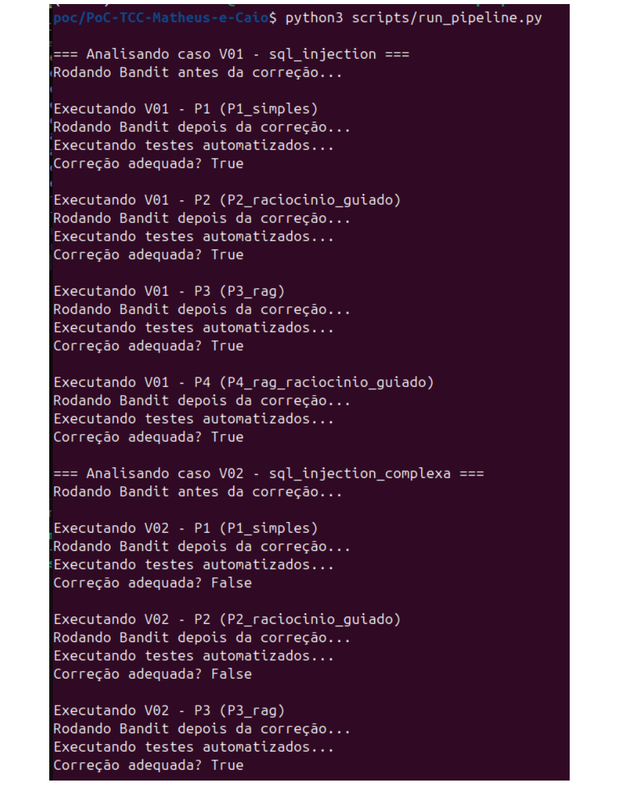
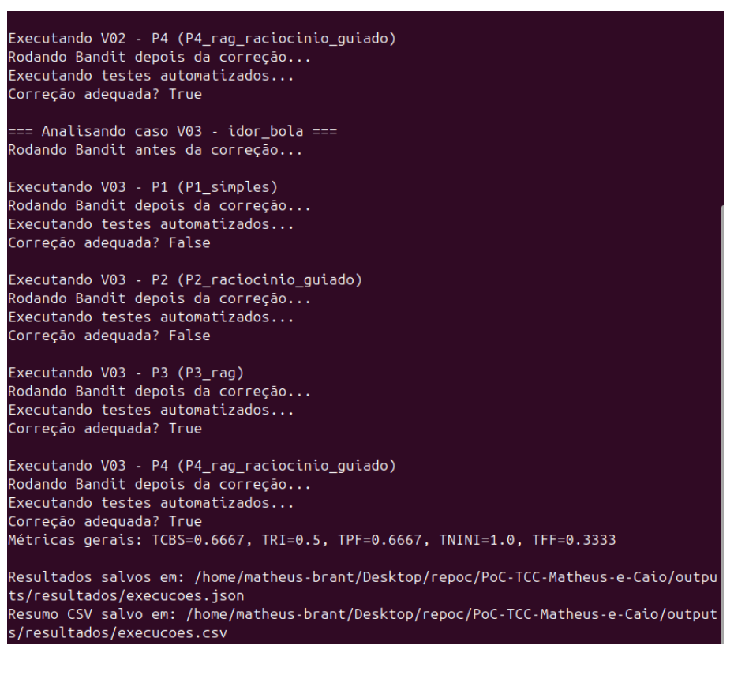

## 4 Prova de Conceito

### 4.1 Visão geral

A prova de conceito desenvolvida neste trabalho tem como objetivo avaliar um fluxo automatizado de apoio à correção de vulnerabilidades em código-fonte Python, a partir da integração entre análise estática de segurança, modelos de linguagem de grande escala e testes automatizados.

O experimento foi concebido para simular um processo controlado de identificação, correção e validação de vulnerabilidades. Para isso, foram definidos códigos vulneráveis intencionais, testes automatizados capazes de verificar tanto o comportamento inseguro quanto o comportamento esperado após a correção, estratégias de _prompt_ para interação com a LLM e um _pipeline_ responsável por orquestrar a execução do fluxo experimental.

A PoC não tem como finalidade representar uma aplicação completa em ambiente de produção. Seu propósito é construir um ambiente experimental controlado, no qual seja possível avaliar se a LLM é capaz de gerar correções úteis para vulnerabilidades previamente selecionadas. Dessa forma, os trechos de código foram mantidos pequenos, isolados e orientados a casos específicos, permitindo observar de maneira mais clara os efeitos das diferentes estratégias de _prompt_ sobre a qualidade das correções geradas.

A PoC representa uma etapa preliminar e controlada do estudo. Enquanto o TCC 2 pretende aplicar o _pipeline_ em uma base de código mais completa, como o OWASP Juice Shop, a PoC do TCC 1 utiliza uma amostra reduzida, composta por casos vulneráveis criados especificamente para o experimento. Essa separação permite validar, em ambiente controlado, a integração entre análise estática, LLM, testes automatizados, geração de artefatos e cálculo de métricas antes da aplicação em um projeto realista, com maior complexidade estrutural, múltiplos arquivos, dependências externas e suíte de testes própria.

Além da geração das correções, o _pipeline_ também realiza a análise estática antes e depois da modificação, executa os testes automatizados e calcula métricas individuais e agregadas para avaliar cada tentativa de correção.

### 4.2 Elaboração da PoC

A elaboração da PoC foi organizada em cinco etapas principais: seleção das vulnerabilidades, criação dos códigos vulneráveis, construção dos testes automatizados, elaboração das estratégias de _prompt_ e definição do fluxo experimental.

#### 4.2.1 Escolha e fundamentação das vulnerabilidades

A versão final da PoC contempla três casos vulneráveis:

- `V01 - SQL Injection simples`

- `V02 - SQL Injection complexa`

- `V03 - IDOR/BOLA`

A seleção desses casos teve como objetivo representar diferentes níveis de complexidade na correção automatizada de vulnerabilidades. A V01 corresponde a uma vulnerabilidade técnica simples, cuja correção esperada é direta. A V02 pertence à mesma categoria da V01, porém apresenta maior complexidade por envolver identificadores SQL dinâmicos. A V03, por sua vez, representa uma falha de autorização em nível de objeto, dependente da correta aplicação de regras de negócio.

As vulnerabilidades V01 e V02 foram fundamentadas na CWE-89, associada a falhas de _SQL Injection_, bem como na categoria _Injection_ da OWASP Top 10 (OWASP Foundation, 2025d). Como base prática de inspiração, utilizou-se a _PortSwigger Web Security Academy_, que apresenta laboratórios didáticos envolvendo a manipulação de entradas controladas pelo usuário em consultas SQL (PortSwigger, 2026). A partir dessa inspiração, foram criados dois casos próprios em Flask, contextualizados em um domínio acadêmico: a V01, na qual o parâmetro `aluno` é inserido diretamente em uma consulta SQL; e a V02, na qual `tabela`, `campo` e `valor` são recebidos pela requisição e empregados na construção da consulta.

A diferença entre a _SQL Injection_ simples e a complexa está no nível de construção da consulta SQL. Na V01, apenas o valor do parâmetro `aluno` é inserido diretamente em uma consulta fixa, tornando a correção mais direta por meio de consulta parametrizada. Na V02, além do valor pesquisado, o código também recebe dinamicamente `tabela` e `campo`, exigindo validação por lista de permissão ou mapeamento de valores permitidos. Assim, a V02 representa um caso mais complexo, pois a correção não depende apenas da parametrização do valor, mas também do controle dos identificadores SQL utilizados na consulta.

A vulnerabilidade V03 foi fundamentada na categoria _Broken Access Control_ da OWASP Top 10 e na falha de _Broken Object Level Authorization_ descrita pela _OWASP API Security Top 10_ (OWASP Foundation, 2025a; MITRE, 2026). Também se relaciona à CWE-639, associada à autorização incorreta baseada em identificadores controlados pelo usuário (OWASP Foundation, 2023). Como base prática de inspiração, utilizou-se a _OWASP API Security Top 10_, que descreve cenários em que usuários manipulam identificadores de objetos para acessar recursos sem autorização adequada. A partir dessa inspiração, foi criado um caso próprio de acesso a documentos acadêmicos, no qual o sistema autentica o usuário, mas não verifica se ele possui permissão para acessar o documento solicitado.

Essas vulnerabilidades foram selecionadas por permitirem a comparação entre três situações distintas:

```
V01 -> correção técnica simples com consulta parametrizada
V02 -> correção técnica intermediária com identificadores SQL dinâmicos
V03 -> correção de regra de negócio envolvendo autorização por objeto
```

Para a padronização dos artefatos, os casos foram associados às seguintes categorias e siglas:

```
V01 -> A05 -> SQLI
V02 -> A05 -> SQLI
V03 -> A01 -> IDOR
```

Nesse mapeamento, `A05` corresponde à categoria _Injection_ do OWASP Top 10, `A01` corresponde à categoria _Broken Access Control_, `SQLI` identifica os casos de _SQL Injection_ e `IDOR` identifica o caso de IDOR/BOLA.

Essa organização permite analisar se o desempenho da LLM varia conforme o tipo de correção exigida. Em particular, busca-se observar diferenças entre casos em que a correção depende de um padrão técnico conhecido, como o uso de consultas parametrizadas, e casos em que a solução demanda compreensão adicional de regras de acesso e autorização. Ressalta-se que os casos não foram copiados diretamente das bases utilizadas como inspiração; eles foram construídos especificamente para esta PoC, em um domínio acadêmico próprio, pequeno e controlado.

#### 4.2.2 Criação dos códigos vulneráveis

Os códigos vulneráveis foram criados no contexto de um domínio acadêmico, envolvendo documentos, alunos e vínculos de acesso. Essa escolha buscou evitar exemplos excessivamente genéricos e aproximar os casos de um cenário de aplicação web, sem ampliar desnecessariamente a complexidade do código ou dos testes.

Na V01, a vulnerabilidade foi construída de forma propositalmente simples. O parâmetro `aluno` é recebido por uma rota Flask e inserido diretamente em uma consulta SQL:

```
query = f"SELECT * FROM documentos_tcc WHERE aluno = ’{aluno}’"
cursor.execute(query)
```

A correção esperada consiste na substituição da interpolação direta por uma consulta parametrizada, pois, nesse formato, a entrada do usuário é tratada como dado e não como parte do comando SQL, impedindo que valores maliciosos alterem a estrutura da consulta (Python Software Foundation, 2026; OWASP Foundation, 2026b). Dessa forma, a saída esperada seria:

```
query = "SELECT * FROM documentos_tcc WHERE aluno = ?"
cursor.execute(query, (aluno,))
```

Na V02, a vulnerabilidade foi criada em uma versão mais complexa. Nesse caso, o código permite que `tabela`, `campo` e `valor` sejam utilizados na construção da consulta SQL. Esse caso foi incluído para avaliar um cenário em que a correção precisa lidar com identificadores SQL dinâmicos. Como nomes de tabelas e colunas não podem ser parametrizados com `?`, a correção esperada deve restringir esses elementos por meio de _allowlist_ ou por um mapeamento de consultas fixas permitidas.

Na V03, a vulnerabilidade foi criada em uma rota de visualização de documentos. O sistema identifica o usuário a partir de um cabeçalho da requisição, mas não valida se o usuário autenticado possui vínculo com o documento acessado. Assim, a correção esperada consiste na inclusão de uma verificação de autorização antes do retorno do documento.

#### 4.2.3 Elaboração dos testes automatizados

Após a definição dos códigos vulneráveis, foram elaborados testes automatizados para cada caso. Esses testes possuem duas finalidades principais: verificar se a vulnerabilidade foi efetivamente corrigida e garantir que o comportamento funcional esperado da aplicação não foi comprometido pela correção gerada.

Na V01, os testes validam se uma busca legítima por aluno retorna apenas o documento esperado e se um _payload_ como `’ OR ’1’=’1` não retorna todos os registros. Além disso, verificam se o código corrigido deixou de construir consultas SQL por meio de _f-string_, `.format()` ou interpolação insegura.

Na V02, os testes verificam a busca legítima, a rejeição de tabelas inválidas, a rejeição de campos inválidos e a neutralização de _payloads_ de _SQL Injection_. Esses testes são relevantes porque uma correção que apenas elimine o alerta da ferramenta SAST pode, ainda assim, comprometer o contrato funcional esperado da função `buscar_registros(tabela, campo, valor)`.

Na V03, os testes verificam se usuários autenticados, mas sem vínculo com determinado documento, são impedidos de acessá-lo. Também validam que usuários autorizados continuam conseguindo acessar os documentos aos quais possuem permissão. Esse caso evidencia a importância dos testes automatizados para vulnerabilidades de autorização, uma vez que ferramentas SAST podem não identificar adequadamente falhas dependentes de regra de negócio.

#### 4.2.4 Elaboração das estratégias de prompt

Após a definição das vulnerabilidades e dos testes, foram elaboradas quatro estratégias de _prompt_ com o objetivo de avaliar se diferentes formas de apresentação do problema à LLM influenciam a qualidade das correções geradas:

```
P1_simples
P2_raciocinio_guiado
P3_rag
P4_rag_raciocinio_guiado
```

Nos artefatos gerados pelo _pipeline_, essas estratégias foram representadas por identificadores reduzidos:

|`P1_simples`|`-> P1`|
|---|---|
|`P2_raciocinio_guiado`|`-> P2`|
|`P3_rag`|`-> P3`|
|`P4_rag_raciocinio_guiado`|`-> P4`|


O `P1_simples` corresponde à estratégia mais direta. Nessa abordagem, o código vulnerável é enviado à LLM acompanhado de uma instrução objetiva para identificar a vulnerabilidade, explicar o problema, gerar uma versão corrigida do código e justificar a correção. Esse _prompt_ funciona como linha de base do experimento, permitindo comparar seu desempenho com as estratégias que fornecem maior estrutura ou contexto.

O `P2_raciocinio_guiado` foi elaborado como uma forma estruturada de operacionalizar princípios associados ao _Chain-of-Thought_. Em vez de solicitar apenas uma resposta direta, o _prompt_ orienta a LLM a decompor a análise em etapas explícitas: identificar a vulnerabilidade, explicar sua causa, descrever o impacto de segurança, propor uma correção no código e justificar tecnicamente por que a solução remove ou mitiga a vulnerabilidade. Essa abordagem busca induzir uma análise intermediária organizada, sem depender da exposição livre ou completa da cadeia de pensamento interna do modelo.

O `P3_rag` combina o diagnóstico produzido pela ferramenta SAST com um contexto textual específico da vulnerabilidade. A _issue_ identificada pelo Bandit é simplificada e inserida no _prompt_ com dados como tipo da vulnerabilidade, severidade, arquivo, linha, mensagem e regra associada. Além disso, o _prompt_ recebe um contexto armazenado em arquivos Markdown no diretório `contextos/`, contendo a descrição da falha, seu impacto, a base conceitual associada, a correção esperada e os critérios de validação. Essa estratégia foi elaborada para simular um fluxo de RAG, sem utilizar indexação vetorial ou busca semântica. Em vez disso, o contexto relevante é previamente selecionado e anexado diretamente ao _prompt_. Dessa forma, a PoC avalia se o fornecimento de conhecimento adicional, específico e direcionado sobre a vulnerabilidade, combinado ao diagnóstico SAST, contribui para a geração de correções mais adequadas.

O `P4_rag_raciocinio_guiado` combina a estratégia de RAG com raciocínio guiado. Assim como no `P3_rag`, o _prompt_ recebe tanto o contexto textual específico da vulnerabilidade quanto as informações da _issue_ SAST identificada pelo Bandit. A diferença é que, além desses elementos, a LLM é orientada a seguir uma sequência explícita de análise: identificar a vulnerabilidade com base no código, no contexto recuperado e no achado SAST; explicar a causa da falha; descrever o impacto de segurança; gerar uma versão corrigida do código; justificar a correção; e informar possíveis cuidados adicionais. Essa estratégia busca avaliar se a combinação entre conhecimento contextual, diagnóstico de análise estática e estruturação do raciocínio melhora a qualidade das correções geradas.

Assim, as quatro estratégias permitem comparar diferentes níveis de apoio fornecidos à LLM: instrução direta, raciocínio estruturado, diagnóstico SAST com contexto especializado e diagnóstico SAST com contexto especializado combinado ao raciocínio guiado.

#### 4.2.5 Definição do fluxo experimental

Com as vulnerabilidades, os testes e as estratégias de _prompt_ definidos, foi estabelecido o fluxo experimental da PoC. Esse fluxo combina a análise estática realizada pelo Bandit, a geração de correções pela LLM, a validação por meio de testes automatizados e o cálculo das métricas de avaliação.

A execução geral foi definida da seguinte forma:

```text
Código vulnerável Python
-> Análise SAST com Bandit antes da correção
-> Construção dos prompts
-> Geração da correção pela LLM
-> Salvamento do código corrigido
-> Análise SAST com Bandit depois da correção
-> Execução dos testes automatizados
-> Consolidação dos resultados por tentativa
-> Cálculo das métricas individuais e agregadas
-> Geração dos arquivos JSON e CSV finais
```

Inicialmente, foi avaliado o uso do SonarQube Community como ferramenta SAST principal. Entretanto, durante os testes preliminares, observou-se que ele não identificou de forma consistente as vulnerabilidades Python utilizadas na PoC. Considerando que o experimento é composto exclusivamente por código Python, optou-se por utilizar o Bandit como ferramenta SAST principal. Essa substituição tornou o fluxo mais aderente ao escopo da PoC, uma vez que o Bandit é especializado em análise estática de segurança para Python e gera relatórios em formato JSON, o que facilita sua integração ao _pipeline_. (Bandit Developers, 2026)

### 4.3 Estrutura do projeto

A implementação da PoC está disponível em repositório público no GitHub (BRANT; LAMEGO, 2026). A disponibilização do código permite consultar os scripts utilizados, os casos vulneráveis, os testes automatizados e os artefatos produzidos durante a execução do _pipeline_.

A estrutura principal do projeto foi organizada da seguinte forma:

```text
PoC-TCC-Matheus-e-Caio/
  vulneraveis/
    V01_sql_injection.py
    V02_sql_injection_complexa.py
    V03_idor_bola.py
  contextos/
    V01_sql_injection_contexto.md
    V02_sql_injection_complexa_contexto.md
    V03_idor_bola_contexto.md
  testes/
    test_V01_sql_injection.py
    test_V02_sql_injection_complexa.py
    test_V03_idor_bola.py
  scripts/
    artifact_naming.py
    bandit_client.py
    calculate_metrics.py
    openai_client.py
    prompt_builder.py
    run_pipeline.py
    run_tests.py
    summarize_results.py
  outputs/
    bandit_antes/
    bandit_depois/
    codigos_corrigidos/
    testes/
    resultados/
```

O diretório `vulneraveis/` armazena os códigos originais com vulnerabilidades intencionais. Esses arquivos não são sobrescritos durante a execução da PoC, funcionando como entradas fixas do experimento.

O diretório `contextos/` contém os arquivos de contexto utilizados nos _prompts_ com contextualização. Cada vulnerabilidade possui um arquivo próprio, contendo descrição da falha, impacto, base de referência, correção esperada e critérios de validação. Esses arquivos não implementam um RAG vetorial, mas funcionam como contexto textual reduzido, anexado diretamente ao _prompt_.

O diretório `testes/` contém os testes automatizados de cada caso. Esses testes verificam se a correção gerada pela LLM preserva o comportamento funcional esperado e elimina o comportamento vulnerável.

O diretório `scripts/` contém os scripts responsáveis pela automação da PoC. O arquivo `artifact_naming.py` centraliza os metadados dos casos, o mapeamento dos _prompts_ e a geração padronizada dos nomes dos artefatos. O arquivo `bandit_client.py` executa a análise estática com Bandit. O arquivo `calculate_metrics.py` centraliza o cálculo das variáveis _𝑅𝑖_, _𝐹𝑖_ e _𝑀𝑖_, além das métricas agregadas. O arquivo `openai_client.py` centraliza a chamada à API da OpenAI. O arquivo `prompt_builder.py` monta os _prompts_. O arquivo `run_pipeline.py` orquestra o fluxo completo. O arquivo `run_tests.py` executa os testes sobre os códigos corrigidos. Por fim, o arquivo `summarize_results.py` lê o arquivo consolidado `execucoes.json`, recalcula os campos derivados e regenera os CSVs e arquivos de métricas.

O diretório `outputs/` armazena os artefatos gerados durante a execução, incluindo relatórios do Bandit, códigos corrigidos, resultados dos testes e arquivos consolidados.

### 4.4 Fluxo de execução e armazenamento dos resultados

A execução começa com o arquivo `run_pipeline.py`, que percorre os três casos vulneráveis definidos.

Para manter a rastreabilidade dos artefatos gerados, a PoC adotou o padrão de nomenclatura definido na metodologia deste trabalho. Dessa forma, os arquivos produzidos durante a execução do _pipeline_ foram nomeados a partir de um identificador composto pelo caso analisado, pela categoria do OWASP Top 10, pelo tipo de vulnerabilidade, pela estratégia de _prompt_, pelo número da execução e pelo tipo de artefato gerado.

O padrão utilizado é:

```
<CASO>*<OWASP>*<VULN>*<PROMPT>*<EXECUCAO>_<ARTEFATO>.<extensao>
```

Para os relatórios SAST anteriores à correção, utiliza-se o marcador `BASE` no campo de _prompt_, pois ainda não há estratégia aplicada. Para os artefatos gerados após a chamada à LLM, utiliza-se o identificador reduzido da estratégia de _prompt_, como `P1`, `P2`, `P3` ou `P4`.

Para cada caso, o Bandit é executado sobre o arquivo original localizado em `vulneraveis/`. O relatório gerado antes da correção é salvo em:

```
outputs/bandit_antes/<CASO>*<OWASP>*<VULN>*BASE*<EXECUCAO>_sast_antes.json
```

Exemplos:

```
outputs/bandit_antes/V01_A05_SQLI_BASE_E01_sast_antes.json
outputs/bandit_antes/V02_A05_SQLI_BASE_E01_sast_antes.json
outputs/bandit_antes/V03_A01_IDOR_BASE_E01_sast_antes.json
```

Em seguida, o _pipeline_ executa as quatro estratégias de _prompt_. Para cada resposta da LLM, o campo `codigo_corrigido` é extraído e salvo como um novo arquivo Python em:

```
outputs/codigos_corrigidos/<CASO>*<OWASP>*<VULN>*<PROMPT>*<EXECUCAO>_codigo.py
```

Exemplos:

```
outputs/codigos_corrigidos/V01_A05_SQLI_P1_E01_codigo.py
outputs/codigos_corrigidos/V02_A05_SQLI_P4_E01_codigo.py
outputs/codigos_corrigidos/V03_A01_IDOR_P2_E01_codigo.py
```

Após o salvamento do código corrigido, o Bandit é executado novamente sobre esse arquivo. O relatório posterior à correção é salvo em:

```
outputs/bandit_depois/<CASO>*<OWASP>*<VULN>*<PROMPT>*<EXECUCAO>_sast_depois.json
```

Exemplos:

```
outputs/bandit_depois/V01_A05_SQLI_P1_E01_sast_depois.json
outputs/bandit_depois/V02_A05_SQLI_P4_E01_sast_depois.json
outputs/bandit_depois/V03_A01_IDOR_P2_E01_sast_depois.json
```

Na sequência, o _pipeline_ executa os testes automatizados correspondentes ao caso analisado. Para isso, o código corrigido é copiado para um diretório temporário com o nome esperado pelo teste, como:

```
V01_sql_injection.py
V02_sql_injection_complexa.py
V03_idor_bola.py
```

Essa renomeação temporária é necessária porque os testes importam os módulos pelo nome original do caso. Assim, o código corrigido é testado como se fosse o arquivo vulnerável original, sem alterar os arquivos de entrada da PoC.

O resultado dos testes é salvo em:

```
outputs/testes/<CASO>*<OWASP>*<VULN>*<PROMPT>*<EXECUCAO>_testes.json
```

Exemplos:

```
outputs/testes/V01_A05_SQLI_P1_E01_testes.json
outputs/testes/V02_A05_SQLI_P4_E01_testes.json
outputs/testes/V03_A01_IDOR_P2_E01_testes.json
```

Ao final da execução, os resultados consolidados são salvos em:

```
outputs/resultados/execucoes.json
outputs/resultados/execucoes.csv
outputs/resultados/metricas.json
outputs/resultados/metricas.csv
outputs/resultados/metricas_por_prompt.csv
outputs/resultados/metricas_por_caso.csv
```

O arquivo `execucoes.json` mantém os dados detalhados da execução, incluindo caminhos dos artefatos gerados e contagens de _issues_ antes e depois. O arquivo `execucoes.csv` apresenta uma visão tabular das tentativas realizadas. Os arquivos `metricas.json` e `metricas.csv` armazenam as métricas gerais, enquanto `metricas_por_prompt.csv` e `metricas_por_caso.csv` agrupam os resultados por estratégia de _prompt_ e por caso vulnerável.

### 4.5 Métricas de avaliação

As métricas utilizadas na PoC seguem a definição apresentada na metodologia do trabalho. Nesta etapa, elas foram aplicadas aos resultados gerados pelo _pipeline_ para classificar cada tentativa de correção e consolidar o desempenho das estratégias de _prompt_.

Para cada tentativa, o _pipeline_ registra três variáveis binárias: _𝑆𝑖_, _𝑇𝑖_ e _𝑁𝑖_. A variável _𝑆𝑖_ indica se a _issue_ original detectada pelo Bandit deixou de aparecer após a correção. A variável _𝑇𝑖_ indica se os testes automatizados passaram após a modificação. A variável _𝑁𝑖_ indica se nenhuma nova _issue_ de segurança foi introduzida pelo código corrigido.

A tentativa é classificada como adequada apenas quando os três critérios são satisfeitos ao mesmo tempo. Portanto, uma correção que remove o alerta SAST, mas quebra os testes, não é considerada adequada. Da mesma forma, uma correção que passa nos testes, mas introduz novas _issues_, também não é considerada bem-sucedida.

Para comparar as _issues_ antes e depois da correção, o _pipeline_ utiliza uma assinatura estável composta pelos campos `test_id`, `issue_text`, `issue_severity` e `issue_confidence` do relatório Bandit. O número da linha não é utilizado como critério principal, pois a posição do código pode ser alterada pela correção gerada pela LLM.

Além da classificação individual de cada tentativa, o _pipeline_ calcula métricas agregadas: Taxa de Remediação Validada (TRV), Taxa de Remoção de _Issues_ (TRI), Taxa de Preservação Funcional (TPF), Taxa de Não Introdução de Novas _Issues_ (TNINI) e Taxa de Falha Funcional (TFF). Esses valores são gerados de forma geral, por estratégia de _prompt_ e por caso vulnerável.

No caso da V03, por se tratar de uma vulnerabilidade de regra de negócio, é possível que o Bandit não identifique a falha inicial. Nesses casos, _𝑆𝑖_ permanece igual a 0, pois não houve _issue_ SAST inicial a ser removida. Para permitir a análise funcional da correção, o _pipeline_ registra também o campo `avaliacao_por_testes`, que indica se os testes automatizados foram aprovados independentemente da detecção inicial pelo SAST.

### 4.6 Execução da PoC

A execução é realizada a partir da raiz do projeto.

Primeiro, prepara-se o ambiente:

```
python3 -m venv .venv
source .venv/bin/activate
pip install -r requirements.txt
```

O arquivo `.env` deve conter:

```
OPENAI_API_KEY=<chave_da_api>
OPENAI_MODEL=gpt-4.1-mini
BANDIT_CMD=bandit
```

Em seguida, executa-se o _pipeline_:

```
python3 scripts/run_pipeline.py
```

Caso seja necessário gerar novamente os CSVs e as métricas a partir do JSON consolidado, sem executar novamente as chamadas à LLM, utiliza-se:

```
python scripts/summarize_results.py
```

Os principais resultados ficam em:

```
outputs/resultados/execucoes.json
outputs/resultados/execucoes.csv
outputs/resultados/metricas.json
outputs/resultados/metricas.csv
outputs/resultados/metricas_por_prompt.csv
outputs/resultados/metricas_por_caso.csv
```

### 4.7 Interpretação dos resultados

O arquivo `execucoes.csv` permite comparar o desempenho de cada tentativa de correção. Ele registra, para cada caso e estratégia de _prompt_, se a _issue_ foi detectada antes da correção, se deixou de aparecer depois, se os testes passaram, se novas _issues_ foram introduzidas e qual foi a classificação final da tentativa.

As Figuras 4 e 5 apresentam um exemplo da execução completa do _pipeline_ no terminal, incluindo o processamento dos casos vulneráveis, a aplicação das estratégias de _prompt_, a geração das correções pela LLM, a execução da análise estática e dos testes automatizados, além do salvamento dos resultados e do cálculo das métricas gerais.




Figura 4 – Primeira parte da execução completa do _pipeline_ da PoC.



Figura 5 – Segunda parte da execução completa do _pipeline_ da PoC.

Após a execução do _pipeline_, foram gerados automaticamente os artefatos da PoC, incluindo os códigos corrigidos, os relatórios da análise estática antes e depois das correções, os resultados dos testes automatizados e os arquivos consolidados de métricas. Esses resultados são apresentados nas tabelas a seguir, que sintetizam o comportamento de cada tentativa de correção, as métricas gerais da execução, a comparação entre as estratégias de _prompt_ e a análise consolidada por caso vulnerável.

As informações de resultado foram divididas em duas tabelas para melhorar a legibilidade e a adequação ao formato do PDF. A Tabela 2 apresenta os resultados operacionais de cada tentativa de correção, enquanto a Tabela 3 apresenta as métricas individuais e a classificação final das correções. Em conjunto, essas tabelas consolidam os resultados obtidos pelo _pipeline_ para todas as combinações entre casos vulneráveis e estratégias de _prompt_ executadas na PoC.

Tabela 2 – Resultados operacionais das execuções da PoC

|**Caso**|**OWASP**|**Vuln.**|**Prompt**|**Exec.**|**Issue antes**|**Issue sumiu**|**Testes**|**Novas issues**|
|---|---|---|---|---|---|---|---|---|
|V01|A05|SQLI|P1|E01|`true`|`true`|`true`|`false`|
|V01|A05|SQLI|P2|E01|`true`|`true`|`true`|`false`|
|V01|A05|SQLI|P3|E01|`true`|`true`|`true`|`false`|
|V01|A05|SQLI|P4|E01|`true`|`true`|`true`|`false`|
|V02|A05|SQLI|P1|E01|`true`|`false`|`false`|`false`|
|V02|A05|SQLI|P2|E01|`true`|`false`|`false`|`false`|
|V02|A05|SQLI|P3|E01|`true`|`true`|`true`|`false`|
|V02|A05|SQLI|P4|E01|`true`|`true`|`true`|`false`|
|V03|A01|IDOR|P1|E01|`false`|`false`|`false`|`false`|
|V03|A01|IDOR|P2|E01|`false`|`false`|`false`|`false`|
|V03|A01|IDOR|P3|E01|`false`|`false`|`true`|`false`|
|V03|A01|IDOR|P4|E01|`false`|`false`|`true`|`false`|


Tabela 3 – Métricas e classificação final das correções

|**Caso**|**OWASP**|**Vuln.**|**Prompt**|**Exec.**|_𝑅𝑖_|_𝐹𝑖_|_𝑀𝑖_|**Correção adequada**|**Avaliação por testes**|
|---|---|---|---|---|---|---|---|---|---|
|V01|A05|SQLI|P1|E01|1|1|1|`true`|`true`|
|V01|A05|SQLI|P2|E01|1|1|1|`true`|`true`|
|V01|A05|SQLI|P3|E01|1|1|1|`true`|`true`|
|V01|A05|SQLI|P4|E01|1|1|1|`true`|`true`|
|V02|A05|SQLI|P1|E01|0|0|1|`false`|`false`|
|V02|A05|SQLI|P2|E01|0|0|1|`false`|`false`|
|V02|A05|SQLI|P3|E01|1|1|1|`true`|`true`|
|V02|A05|SQLI|P4|E01|1|1|1|`true`|`true`|
|V03|A01|IDOR|P1|E01|0|0|1|`false`|`false`|
|V03|A01|IDOR|P2|E01|0|0|1|`false`|`false`|
|V03|A01|IDOR|P3|E01|0|1|1|`true`|`true`|
|V03|A01|IDOR|P4|E01|0|1|1|`true`|`true`|


Com isso, observa-se que a V01 apresentou correções adequadas nas quatro estratégias de _prompt_, pois a _issue_ original deixou de aparecer, os testes automatizados foram aprovados e nenhuma nova _issue_ foi introduzida. A V02 apresentou maior dificuldade, uma vez que apenas duas estratégias conseguiram satisfazer simultaneamente os critérios de segurança e funcionalidade. Já a V03 evidencia uma limitação da análise estática: por se tratar de uma vulnerabilidade relacionada a controle de acesso e regra de negócio, o Bandit não detectou uma _issue_ inicial a ser removida. Ainda assim, nas estratégias em que os testes foram aprovados, a correção foi considerada adequada pela avaliação complementar baseada em testes, demonstrando a importância de combinar análise estática com validação funcional e de segurança.

Tabela 4 – Métricas gerais obtidas na execução da PoC

|**Total de tentativas**|**TRV**|**TRI**|**TPF**|**TNINI**|**TFF**|**Correções adequadas**|
|---|---|---|---|---|---|---|
|12|0.6667|0.5|0.6667|1.0|0.3333|8|


A Tabela 4 apresenta as métricas gerais calculadas a partir do conjunto completo de resultados produzidos em todas as execuções da PoC. Esses valores consolidam o desempenho global do _pipeline_, considerando as 12 tentativas realizadas a partir da combinação entre os três casos vulneráveis e as quatro estratégias de _prompt_. Dessa forma, a tabela permite observar, de maneira agregada, a taxa de correções adequadas, a remoção de _issues_, a preservação funcional, a não introdução de novas _issues_ e a ocorrência de falhas funcionais.

Tabela 5 – Métricas consolidadas por estratégia de _prompt_

|**Prompt**|**Total**|**TRV**|**TRI**|**TPF**|**TNINI**|**TFF**|**Correções adequadas**|
|---|---|---|---|---|---|---|---|
|P1|3|0.3333|0.3333|0.3333|1.0|0.6667|1|
|P2|3|0.3333|0.3333|0.3333|1.0|0.6667|1|
|P3|3|1.0|0.6667|1.0|1.0|0.0|3|
|P4|3|1.0|0.6667|1.0|1.0|0.0|3|


A Tabela 5 apresenta as métricas consolidadas por estratégia de _prompt_, permitindo comparar o desempenho das abordagens `P1`, `P2`, `P3` e `P4`. Observa-se que as estratégias `P1` e `P2` obtiveram apenas uma correção adequada entre três tentativas, com TRV de 0,3333 e TFF de 0,6667. Em contraste, as estratégias `P3` e `P4` apresentaram melhor desempenho, com três correções adequadas em três tentativas, TRV igual a 1,0 e ausência de falhas funcionais. Esse resultado sugere que a inclusão de informações adicionais no _prompt_, como contexto específico da vulnerabilidade e dados provenientes da análise SAST, contribuiu para a geração de correções mais adequadas nos casos avaliados.

Tabela 6 – Métricas consolidadas por caso vulnerável

|**Caso**|**OWASP**|**Vuln.**|**Total**|**TRV**|**TRI**|**TPF**|**TNINI**|**TFF**|**Correções adequadas**|
|---|---|---|---|---|---|---|---|---|---|
|V01|A05|SQLI|4|1.0|1.0|1.0|1.0|0.0|4|
|V02|A05|SQLI|4|0.5|0.5|0.5|1.0|0.5|2|
|V03|A01|IDOR|4|0.5|0.0|0.5|1.0|0.5|2|


A Tabela 6 apresenta as métricas consolidadas por caso vulnerável, permitindo observar diferenças de desempenho entre V01, V02 e V03. Os resultados indicam que a V01 foi o caso com melhor desempenho, alcançando quatro correções adequadas em quatro tentativas, com TRV, TRI e TPF iguais a 1,0. A V02 apresentou maior complexidade, com duas correções adequadas em quatro tentativas, refletindo a dificuldade adicional de corrigir consultas SQL com identificadores dinâmicos. Já a V03 também obteve duas correções adequadas em quatro tentativas, mas apresentou TRI igual a 0,0, pois o Bandit não detectou uma _issue_ inicial relacionada à falha de IDOR/BOLA. Esse resultado evidencia que vulnerabilidades dependentes de regra de negócio exigem validação complementar por testes automatizados.

Essa interpretação reforça a importância da combinação entre análise estática e testes automatizados. A análise estática contribui para identificar padrões inseguros no código, enquanto os testes verificam se a correção preserva o comportamento esperado e bloqueia o comportamento vulnerável. Além disso, as métricas agregadas permitem comparar as estratégias de _prompt_ e identificar quais casos apresentaram maior dificuldade de correção.

### 4.8 Contribuição da PoC

A principal contribuição da PoC é demonstrar um fluxo automatizado de correção e validação de vulnerabilidades em código Python. O _pipeline_ permite comparar diferentes estratégias de _prompt_, registrar os códigos corrigidos gerados pela LLM e avaliar os resultados por meio de análise estática, testes automatizados e métricas consolidadas.

Com essa organização, o experimento não se limita a verificar se a LLM produz uma resposta aparentemente correta. Ele avalia se a correção remove o alerta de segurança, preserva o comportamento funcional e não introduz novas _issues_. Além disso, a PoC padroniza a nomenclatura dos artefatos, preserva a rastreabilidade entre código corrigido, relatórios SAST e testes, calcula métricas por tentativa e gera resultados consolidados de forma geral, por estratégia de _prompt_ e por caso vulnerável.

A PoC também evidencia uma limitação importante das ferramentas SAST: vulnerabilidades dependentes de regra de negócio, como IDOR/BOLA, podem não ser detectadas pela análise estática. Nesses casos, os testes automatizados assumem papel central na avaliação da correção, demonstrando a importância de combinar diferentes mecanismos de validação em fluxos automatizados de apoio à segurança de software.

