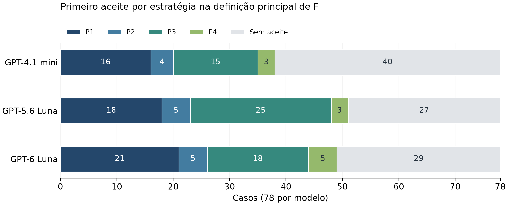

## 5 Resultados e discussão

Este capítulo apresenta os resultados de três campanhas do pipeline no OWASP Juice Shop. A análise responde a três questões práticas: quantos casos receberam uma proposta aceita, quais critérios impediram outros aceites e qual modelo se destacou em eficácia, custo e tempo. Também compara as estratégias de prompt, as categorias de alerta e o resultado da aplicação conjunta das alterações.

Uma proposta foi considerada aceita quando aplicada ao código com R=F=M=1: remoção do alerta original, preservação funcional na interpretação por critérios e ausência de novos alertas. A expressão correção válida utiliza esse sentido operacional, definido nas Seções 3.10 e 3.11. Os resultados gerais abrangem o catálogo de 78 alertas; as análises restritas aos 55 casos confirmados na triagem são identificadas separadamente.

### 5.1 Campanhas e conjunto de casos analisados

Foram analisadas três campanhas concluídas em 6 de novembro de 2026, uma por modelo: GPT-4.1 mini, GPT-5.6 Luna e GPT-6 Luna. As campanhas utilizaram os mesmos 78 casos, a mesma versão do Juice Shop, o mesmo perfil SAST, a mesma base de contexto e a mesma referência dos testes. Todas empregaram quatro cópias de trabalho isoladas e a sequência P1–P4. Pilotos, simulações e diagnósticos ficaram fora dessa comparação.

Os 78 casos foram selecionados de 124 alertas. As 46 exclusões abrangeram 31 alertas em exemplos dos Coding Challenges, 13 em arquivos de automação do GitHub e dois em configurações do npm. Os exemplos continham alternativas de correção dos exercícios, e os outros arquivos tratavam de aspectos não avaliados pelos testes da aplicação. Conforme a Seção 3.5, esse recorte concentrou o experimento no código das funcionalidades do Juice Shop.

O catálogo incluiu 55 casos classificados como confirmados, 21 como falsos positivos e dois como inconclusivos. Os dois autores revisaram os 21 falsos positivos; os demais rótulos foram mantidos conforme a triagem versionada descrita na Seção 3.5. Como todos os grupos participaram das campanhas, os resultados sobre os 78 casos medem o processamento do catálogo de alertas. O recorte dos 55 confirmados permite examinar separadamente os aceites nesse grupo.

A classificação OWASP final distribuiu os 78 casos em sete categorias, apresentadas na Seção 5.5. Ela preservou as 29 associações originais e complementou os 49 casos sem categoria após as campanhas, sem modificar as tentativas ou seus resultados.

Um caso podia receber até quatro tentativas, uma por estratégia. Para a análise principal, foram contadas as tentativas até o primeiro aceite por critérios; quando não houve aceite, foram contadas todas até P4. Os registros executados depois desse primeiro aceite ficaram identificados como pós-aceite, conforme a Tabela 1.

**Tabela 1 — Tentativas registradas e incluídas na análise principal**

| Modelo | Total registrado | Incluídas na análise principal | Posteriores ao primeiro aceite |
|---|---|---|---|
| GPT-4.1 mini | 283 | 241 | 42 |
| GPT-5.6 Luna | 277 | 223 | 54 |
| GPT-6 Luna | 274 | 221 | 53 |

Fonte: registros e consolidados das campanhas de 06/11/2026. Cada modelo recebeu os mesmos 78 casos; a delimitação da análise principal utiliza F por critérios.

Os registros pós-aceite existem porque a regra de parada era mais restrita que a classificação da análise principal, conforme a Seção 3.9. Durante a execução, uma falha nova persistente em qualquer teste podia levar à estratégia seguinte. Na análise principal, os testes que dependiam da manutenção de uma vulnerabilidade foram separados no conjunto D. Por exemplo, impedir um ataque podia fazer falhar o teste que esperava sua exploração: a proposta podia ser aceita por critérios, embora a execução tivesse prosseguido. A separação da Tabela 1 evita contar novas tentativas de um caso já aceito na análise principal.

### 5.2 Resultados gerais do pipeline

#### 5.2.1 Casos aceitos e Taxa de Remediação Validada

A proporção de casos aceitos informa quantos casos receberam pelo menos uma proposta aplicada e aprovada em R, F e M. Cada caso é contado uma única vez, independentemente da quantidade de tentativas. A Tabela 2 apresenta essa proporção para o catálogo completo de 78 alertas e, em coluna separada, para os 55 confirmados na triagem. Nas duas colunas, valores maiores indicam que mais casos receberam uma proposta aceita.

**Tabela 2 — Aceites por caso e por tentativa**

| Modelo | Casos aceitos no catálogo completo | Casos aceitos entre os confirmados | TRV por tentativa no catálogo completo |
|---|---|---|---|
| GPT-4.1 mini | 38/78 (48,72%) | 32/55 (58,18%) | 38/241 (15,77%) |
| GPT-5.6 Luna | 51/78 (65,38%) | 39/55 (70,91%) | 51/223 (22,87%) |
| GPT-6 Luna | 49/78 (62,82%) | 36/55 (65,45%) | 49/221 (22,17%) |

Fonte: registros das campanhas finais, com F por critérios. As duas primeiras colunas contam casos distintos; a última conta tentativas da população principal sobre os 78 alertas.

O GPT-5.6 Luna apresentou o maior alcance: obteve aceite em 51 dos 78 casos e em 39 dos 55 confirmados. O GPT-6 Luna ficou em segundo lugar nos dois recortes, seguido pelo GPT-4.1 mini. Portanto, quando a prioridade foi obter aceites para a maior quantidade de casos, o resultado favoreceu o GPT-5.6 Luna.

A Taxa de Remediação Validada (TRV) informa qual proporção das tentativas foi aceita. Diferentemente da proporção por caso, ela inclui cada tentativa realizada até o primeiro aceite, inclusive as não aplicadas e as indeterminadas. Por exemplo, no GPT-5.6 Luna, foram necessárias 223 tentativas para obter os 51 aceites: a proporção por caso foi 51/78 (65,38%), enquanto a TRV foi 51/223 (22,87%). Os indicadores respondem, respectivamente, quantos casos receberam uma proposta aceita e qual parcela das tentativas atendeu aos três critérios.

O GPT-5.6 Luna também apresentou a maior TRV, com 22,87%, próximo do GPT-6 Luna, com 22,17%; o GPT-4.1 mini alcançou 15,77%. Assim, os dois Luna tiveram maior proporção de tentativas aceitas, e a diferença entre eles foi pequena nas campanhas observadas. A TRV não é a porcentagem de vulnerabilidades eliminadas do projeto: seu denominador é o número de tentativas sobre o catálogo de alertas.

#### 5.2.2 Remoção de alertas, preservação funcional e novos alertas

As métricas da Tabela 3 mostram em qual aspecto as propostas foram aprovadas ou reprovadas. Cada uma considera apenas as tentativas em que o critério correspondente pôde ser medido. TRI, TPF e TNINI são mais favoráveis quando aumentam; a TFF é mais favorável quando diminui.

**Tabela 3 — Resultados de cada critério de avaliação**

| Modelo | TRI | TPF | TFF | TNINI | Sem medição de R/M; de F |
|---|---|---|---|---|---|
| GPT-4.1 mini | 85/221 (38,46%) | 145/218 (66,51%) | 73/218 (33,49%) | 214/221 (96,83%) | 20; 23 |
| GPT-5.6 Luna | 82/216 (37,96%) | 154/212 (72,64%) | 58/212 (27,36%) | 212/216 (98,15%) | 7; 11 |
| GPT-6 Luna | 77/203 (37,93%) | 154/199 (77,39%) | 45/199 (22,61%) | 198/203 (97,54%) | 18; 22 |

Fonte: população principal sobre os 78 alertas, com F por critérios. Células apresentam aprovações ou reprovações/medições disponíveis (%). A última coluna informa quantas tentativas ficaram sem medição conclusiva; as ausências de R, M e F podem se sobrepor.

A Taxa de Remoção de Issues (TRI) mede a proporção de tentativas em que o alerta original deixou de ser detectado. Os resultados ficaram próximos de 38% nos três modelos. O GPT-4.1 mini teve o maior valor, 38,46%, mas a distância para os Luna foi inferior a um ponto percentual. A conclusão é que a remoção isolada do alerta teve resultados semelhantes e não explicou, sozinha, as diferenças de aceite. Além disso, em mais de 60% das tentativas com R medido, o alerta permaneceu detectável.

A Taxa de Preservação Funcional (TPF) mede a proporção de tentativas aprovadas na compilação e nos testes, segundo a interpretação por critérios. O GPT-6 Luna apresentou o maior valor, 77,39%, seguido pelo GPT-5.6 Luna, com 72,64%, e pelo GPT-4.1 mini, com 66,51%. Esse resultado favoreceu o GPT-6 Luna quando o critério observado foi preservar o comportamento avaliado pelos testes. A aprovação funcional isolada não garante aceite: uma proposta pode preservar os testes e manter o alerta original.

A Taxa de Falha Funcional (TFF) mostra a proporção de tentativas reprovadas nessa mesma avaliação. Ela complementa a TPF: as duas somam 100% sobre as tentativas com F medido. O GPT-6 Luna apresentou a menor TFF, 22,61%, frente a 27,36% do GPT-5.6 Luna e 33,49% do GPT-4.1 mini. Portanto, o GPT-6 Luna teve a menor proporção de reprovações funcionais entre as tentativas avaliadas; a TFF não identifica, por si só, a causa de cada falha.

A Taxa de Não Introdução de Novas Issues (TNINI) mede a proporção de tentativas em que o Semgrep não identificou novos alertas. Os três modelos ficaram acima de 96%, com maior valor no GPT-5.6 Luna, 98,15%. Houve novos alertas em sete tentativas do GPT-4.1 mini, quatro do GPT-5.6 Luna e cinco do GPT-6 Luna. A conclusão é que a introdução de alertas foi pouco frequente sob o perfil utilizado. Uma TNINI alta não demonstra remoção do alerta original nem ausência de falhas fora do alcance do detector.

Esses resultados mostram por que as métricas devem ser lidas em conjunto. Preservar os testes e evitar novos alertas foi mais frequente que remover o alerta original. Somente a aprovação simultânea em R, F e M produziu um aceite e entrou no numerador da TRV. O GPT-6 Luna liderou a preservação funcional, mas o GPT-5.6 Luna obteve mais aceites completos.

Os denominadores diferem porque nem todas as tentativas produziram todas as medições. Foram registradas 17 propostas não aplicadas no GPT-4.1 mini, sete no GPT-5.6 Luna e 16 no GPT-6 Luna, por motivos como resposta inválida, ausência de edições ou trecho de referência não localizado. Mesmo após a aplicação, R e M ficaram indeterminados em três, zero e duas tentativas, respectivamente. Na Tabela 3, uma tentativa sem medição fica fora do denominador do critério correspondente. Na TRV, ela permanece no denominador e não conta como aceite. Ausência de medição não foi convertida em reprovação observada.

#### 5.2.3 Efeito do tratamento dos testes sobre a TRV

O Juice Shop possui testes que esperam a exploração das vulnerabilidades intencionais. Uma correção pode impedir o ataque e fazer esses testes falharem. Para examinar esse efeito, foram comparadas as três interpretações de F definidas na Seção 3.10. Sem separação, qualquer falha nova persistente reprova F. Por marcador, são separadas apenas as falhas de testes que afirmam explicitamente a resolução de um desafio. Por critérios, são separados os testes do conjunto D, identificados pelo conteúdo das asserções que dependem do comportamento inseguro; falhas novas persistentes nos testes de comportamento legítimo continuam reprovando F.

**Tabela 4 — Sensibilidade da TRV à definição de F**

| Modelo | F sem separação | F por marcador | F por critérios (principal) |
|---|---|---|---|
| GPT-4.1 mini | 17/241 (7,05%) | 17/241 (7,05%) | 38/241 (15,77%) |
| GPT-5.6 Luna | 22/223 (9,87%) | 22/223 (9,87%) | 51/223 (22,87%) |
| GPT-6 Luna | 23/221 (10,41%) | 23/221 (10,41%) | 49/221 (22,17%) |

Fonte: registros das campanhas finais; tentativas aceitas/total de tentativas da população principal (%). Em cada modelo, as três colunas usam as mesmas tentativas e o mesmo denominador; varia somente a interpretação de F.

A interpretação por critérios produziu mais aceites nos três modelos. No GPT-6 Luna, por exemplo, o total passou de 23 para 49 sobre as mesmas 221 tentativas. A conclusão é que o tratamento dos testes dependentes das vulnerabilidades alterou tanto a quantidade de aceites quanto a comparação entre modelos: sem separação, o GPT-6 Luna apresentou a maior TRV; por critérios, o GPT-5.6 Luna apresentou o maior valor. Por isso, os resultados principais deste capítulo utilizam explicitamente F por critérios. Essa comparação reavalia os registros existentes, sem simular uma campanha com outra regra de parada.

### 5.3 Comparação das estratégias de prompt

A sequência partiu da suposição de que uma estratégia com mais orientações ou contexto também poderia corrigir os casos aceitos por uma estratégia anterior, conforme a Seção 3.13. Essa premissa justificou encerrar as tentativas após o aceite e concentrar as estratégias seguintes nos casos restantes. Como as etapas posteriores não foram aplicadas a todos os casos já aceitos, a preservação desses aceites permaneceu uma suposição do desenho experimental.

P1 forneceu a instrução direta; P2 acrescentou o roteiro de resposta; P3 forneceu também o diagnóstico SAST e a documentação recuperada; e P4 combinou contexto e roteiro. A Tabela 5 informa quantos casos receberam o primeiro aceite em cada etapa. Por exemplo, 25/55 em P3 do GPT-5.6 Luna significa que essa estratégia obteve aceite em 25 dos 55 casos ainda sem aceite nas etapas anteriores. Os denominadores de P2–P4 diminuem porque os casos aceitos deixam a sequência da análise principal.

**Tabela 5 — Primeiros aceites e tentativas por estratégia**

| Modelo | P1 | P2 | P3 | P4 |
|---|---|---|---|---|
| GPT-4.1 mini | 16/78 (20,51%) | 4/62 (6,45%) | 15/58 (25,86%) | 3/43 (6,98%) |
| GPT-5.6 Luna | 18/78 (23,08%) | 5/60 (8,33%) | 25/55 (45,45%) | 3/30 (10,00%) |
| GPT-6 Luna | 21/78 (26,92%) | 5/57 (8,77%) | 18/52 (34,62%) | 5/34 (14,71%) |

Fonte: população principal, F por critérios. Cada célula informa aceites/tentativas da estratégia (%); os denominadores de P2–P4 correspondem aos casos que chegaram à etapa na cadeia delimitada pelo primeiro aceite principal.


As estratégias posteriores contribuíram com casos que não haviam recebido aceite nas etapas anteriores. Além dos aceites de P1, P2–P4 acrescentaram 22 casos no GPT-4.1 mini, 33 no GPT-5.6 Luna e 28 no GPT-6 Luna. A Figura 1 permite visualizar essa composição sem contar o mesmo caso mais de uma vez. Ela também evidencia que permaneceram casos sem aceite após o percurso completo, de modo que ampliar a sequência não eliminou todas as dificuldades de correção.



**Figura 1 — Distribuição dos casos pelo primeiro aceite e pela ausência de aceite.** Cada barra representa os 78 casos solicitados, com F por critérios. Os segmentos mostram quantos tiveram o primeiro aceite em cada estratégia; os casos sem aceite completam o total.

Fonte: elaboração a partir dos registros conferidos. Dados e script de geração preservados nas notas de evidência.

A Tabela 5a apresenta o aumento relativo de casos aceitos ao continuar a sequência depois de P1. O cálculo corresponde à quantidade de aceites adicionais dividida pelos aceites de P1, multiplicada por 100. Diferentemente das porcentagens da Tabela 5, que indicam o sucesso entre os casos que chegaram a cada etapa, esse indicador mostra quanto o total de aceites cresceu em relação ao resultado do prompt inicial.

**Tabela 5a — Aumento dos casos aceitos com a sequência completa em relação a P1**

| Modelo | Aceitos em P1 | Aceitos ao final de P1–P4 | Aceites adicionais | Aumento relativo sobre P1 |
|---|---|---|---|---|
| GPT-4.1 mini | 16 | 38 | 22 | 137,50% |
| GPT-5.6 Luna | 18 | 51 | 33 | 183,33% |
| GPT-6 Luna | 21 | 49 | 28 | 133,33% |

Fonte: primeiros aceites por estratégia na população principal sobre os 78 alertas, com F por critérios. Aumento relativo = (aceitos ao final − aceitos em P1) / aceitos em P1 × 100. Cada caso é contado uma única vez.

No GPT-5.6 Luna, o total passou de 18 para 51 casos aceitos, com 33 aceites adicionais: 33/18 × 100 = 183,33% de aumento. O crescimento foi de 137,50% no GPT-4.1 mini e de 133,33% no GPT-6 Luna. Portanto, a continuidade da sequência mais que dobrou o total de casos aceitos nos três modelos, e o GPT-5.6 Luna teve o maior crescimento relativo. Esses percentuais medem o aumento sobre P1, não a proporção de sucesso nos 78 casos.

Todas as estratégias acrescentaram casos aceitos nos três modelos, aumentando o total acumulado a cada etapa. Entre as estratégias posteriores a P1, P3 apresentou a maior contribuição: 15 aceites adicionais no GPT-4.1 mini, 25 no GPT-5.6 Luna e 18 no GPT-6 Luna. Considerando a premissa de que as estratégias com mais orientações ou contexto também poderiam corrigir os casos aceitos anteriormente, o desenho concentrou cada etapa nos casos restantes. Nesse percurso, o roteiro de resposta, o diagnóstico SAST e a documentação recuperada compuseram estratégias que ampliaram o alcance da sequência, conforme os ganhos acumulados da Tabela 5a.

### 5.4 Comparação entre modelos de linguagem

#### 5.4.1 Eficácia e aplicação das propostas

O GPT-5.6 Luna apresentou a maior eficácia medida pelo aceite: liderou a proporção de casos aceitos nos dois recortes e a TRV principal, conforme a Tabela 2. O GPT-6 Luna ficou próximo no catálogo completo, com dois casos aceitos a menos, e apresentou a maior TPF. Assim, para obter mais aceites completos, o resultado favoreceu o GPT-5.6 Luna; para a aprovação funcional isolada, favoreceu o GPT-6 Luna.

A proporção de propostas aplicadas indica se as edições geradas puderam ser inseridas no código pelo pipeline. O GPT-5.6 Luna teve o maior valor, com 216/223 (96,86%), seguido pelo GPT-4.1 mini, com 224/241 (92,95%), e pelo GPT-6 Luna, com 205/221 (92,76%). Isso indica menos impedimentos de aplicação nas propostas do GPT-5.6 Luna. Aplicar a proposta, contudo, foi apenas o primeiro requisito: a alteração ainda precisava atender a R, F e M.

A Tabela 2 apresentou quantos casos receberam uma proposta aceita de cada modelo. A Tabela 6 examina se esses aceites ocorreram nos mesmos casos. A expressão sobreposição significa que dois ou mais modelos obtiveram uma proposta aceita para a mesma ocorrência de alerta, ainda que tenham produzido alterações diferentes no código. Por exemplo, um caso aceito pelos três modelos é compartilhado entre eles; um caso aceito somente pelo GPT-6 Luna é exclusivo desse modelo.

**Tabela 6 — Casos aceitos em comum e exclusivos de cada modelo**

| Modelos que obtiveram aceite no caso | Modelos que não obtiveram aceite no caso | Quantidade de casos |
|---|---|---:|
| Os três modelos | Nenhum | 32 |
| GPT-4.1 mini e GPT-5.6 Luna | GPT-6 Luna | 4 |
| GPT-4.1 mini e GPT-6 Luna | GPT-5.6 Luna | 1 |
| GPT-5.6 Luna e GPT-6 Luna | GPT-4.1 mini | 11 |
| Somente GPT-4.1 mini | GPT-5.6 Luna e GPT-6 Luna | 1 |
| Somente GPT-5.6 Luna | GPT-4.1 mini e GPT-6 Luna | 4 |
| Somente GPT-6 Luna | GPT-4.1 mini e GPT-5.6 Luna | 5 |
| Nenhum | Os três modelos | 20 |

Fonte: identificadores dos casos aceitos, com F por critérios, no catálogo completo de 78 alertas. Cada caso aparece em uma única linha; as quantidades somam 78.

A linha com quatro casos aceitos pelo GPT-4.1 mini e pelo GPT-5.6 Luna inclui apenas os casos em que esses dois obtiveram aceite e o GPT-6 Luna não. Os casos aceitos pelos três estão separados na primeira linha. Para recuperar o total de um modelo, somam-se todas as linhas em que ele obteve aceite. No GPT-5.6 Luna, por exemplo, 32 + 4 + 11 + 4 = 51 casos, o mesmo total apresentado na Tabela 2.

Ao todo, 58 casos receberam aceite por pelo menos um modelo, e 20 ficaram sem aceite nos três. O GPT-6 Luna teve cinco aceites exclusivos, o GPT-5.6 Luna quatro e o GPT-4.1 mini um. Portanto, o GPT-5.6 Luna obteve o maior total, mas não aceitou todos os casos aceitos pelos demais. A tabela evidencia essa diferença de cobertura; ela não demonstra que os patches dos diferentes modelos possam ser integrados em uma única versão funcional.

#### 5.4.2 Custo de geração

O custo total informa quanto as chamadas de uma campanha custaram segundo os tokens consumidos e as tarifas configuradas no pipeline. O custo por caso aceito divide esse total pela quantidade de casos aceitos entre os 78 alertas. Esse segundo indicador permite comparar o gasto de geração em relação ao resultado obtido; nos dois indicadores, valores menores são mais favoráveis. A Tabela 7 apresenta também os tokens de entrada e de saída, que registram o volume enviado e recebido nas chamadas.

**Tabela 7 — Consumo e custos registrados das campanhas**

| Modelo | Tokens de entrada | Tokens de saída | Custo total (US$) | Custo total / caso aceito (US$) |
|---|---|---|---|---|
| GPT-4.1 mini | 587207 | 155015 | 0,433169 | 0,011399 |
| GPT-5.6 Luna | 574447 | 156186 | 0,314826 | 0,006173 |
| GPT-6 Luna | 563266 | 153481 | 0,138800 | 0,002833 |

Fonte: todas as chamadas registradas, incluindo as posteriores ao aceite principal, e tarifas configuradas nas campanhas. O custo por caso divide o custo total pelos 38, 51 e 49 casos aceitos. Não inclui infraestrutura ou revisão das propostas e não foi conferido com faturamento externo.

O GPT-6 Luna apresentou o menor custo total, US$ 0,138800, e o menor custo por caso aceito, US$ 0,002833. O GPT-5.6 Luna ficou em segundo lugar nos dois indicadores, seguido pelo GPT-4.1 mini. A conclusão econômica é que o GPT-6 Luna foi a escolha de menor custo de geração nas campanhas avaliadas, mesmo sem obter o maior número de aceites. Esses custos incluem os registros pós-aceite da Tabela 1; portanto, seu conjunto de chamadas é maior que o utilizado na TRV principal.

#### 5.4.3 Tempo de geração e duração da campanha

A latência mede quanto tempo uma chamada levou para produzir a resposta do modelo. A média resume todas as chamadas, enquanto a mediana indica o valor central das latências ordenadas. A duração da campanha mede o tempo total decorrido entre seu início e término, incluindo geração, aplicação, SAST, testes e espera por recursos. Nos três indicadores, tempos menores são mais favoráveis, mas eles representam partes diferentes da execução.

**Tabela 8 — Latência de geração e duração das campanhas**

| Modelo | Chamadas registradas | Latência média (s) | Mediana (s) | Duração da campanha (min) |
|---|---|---|---|---|
| GPT-4.1 mini | 283 | 5,85 | 5,22 | 129,24 |
| GPT-5.6 Luna | 277 | 6,92 | 6,71 | 130,77 |
| GPT-6 Luna | 274 | 6,04 | 5,75 | 121,34 |

Fonte: todas as chamadas registradas e uma sessão por modelo. A duração da campanha não inclui a avaliação conjunta da RRIS.

O GPT-4.1 mini foi o mais rápido para gerar respostas individuais: apresentou a menor média, 5,85 segundos, e a menor mediana, 5,22 segundos. O GPT-6 Luna concluiu a campanha em menos tempo, 121,34 minutos, seguido pelo GPT-4.1 mini e pelo GPT-5.6 Luna. Assim, a escolha para reduzir a espera por uma resposta individual foi o GPT-4.1 mini; para o menor tempo total observado, foi o GPT-6 Luna. A duração da campanha também dependeu da quantidade de tentativas, dos testes e da execução concorrente, por isso não expressa apenas a velocidade do modelo.

### 5.5 Resultados por tipo de vulnerabilidade e categoria

A distribuição dos aceites variou entre os tipos de alerta catalogados, como mostra a Tabela 9. Os três modelos tiveram oito aceites entre os 12 casos de XSS; em IDOR, os totais foram diferentes, com maior número no GPT-5.6 Luna. Nos sete casos de travessia de diretórios, o GPT-4.1 mini e o GPT-6 Luna tiveram cinco aceites cada. Esses resultados descrevem o conjunto estudado, mas os grupos pequenos exigem cautela: o aceite do único caso de SSRF, por exemplo, não sustenta uma estimativa geral de eficácia para esse tipo de problema.

**Tabela 9 — Casos aceitos por tipo de alerta catalogado**

| Tipo de alerta | GPT-4.1 mini | GPT-5.6 Luna | GPT-6 Luna |
|---|---|---|---|
| Scripting entre sites (XSS) | 8/12 | 8/12 | 8/12 |
| Referência direta insegura a objetos (IDOR) | 3/8 | 7/8 | 6/8 |
| Travessia de diretórios | 5/7 | 3/7 | 5/7 |
| Credenciais fixas | 0/4 | 0/4 | 0/4 |
| Injeção de código | 3/4 | 3/4 | 4/4 |
| Exposição de informações | 0/4 | 3/4 | 2/4 |
| Negação de serviço por expressão regular | 0/2 | 1/2 | 0/2 |
| Redirecionamento aberto | 1/2 | 1/2 | 1/2 |
| Injeção SQL | 1/2 | 2/2 | 2/2 |
| Requisição indevida pelo servidor (SSRF) | 1/1 | 1/1 | 1/1 |
| Outros rótulos do catálogo | 16/32 | 22/32 | 20/32 |

Fonte: catálogo e primeiros aceites na definição por critérios. Células apresentam casos aceitos/total de casos do tipo. Os grupos são descritivos e não comprovam a existência de vulnerabilidade explorável em todas as ocorrências.


O agrupamento por regra refinou essa descrição. Na regra relacionada ao uso de HTML tratado como confiável no Angular, os três modelos obtiveram oito aceites em nove casos. Já na regra de consulta sem delimitação pelo identificador da requisição, os aceites foram um, três e dois, em quatro casos, na ordem dos modelos das tabelas. Nenhum modelo obteve aceite nos quatro casos rotulados como credenciais fixas. Esses contrastes indicam dificuldades distintas no conjunto observado, mas não permitem atribuí-las automaticamente à complexidade de uma vulnerabilidade. Uma explicação de causa exige examinar a proposta, a aplicação e os testes, como nos exemplos da seção seguinte.

A Tabela 10 agrupa os aceites dos 78 alertas pela classificação OWASP final. Foram mantidas 29 associações originais e complementados 49 casos após as campanhas, com 41 associações pelas listas de CWEs e oito por análise contextual. A proporção de casos aceitos permite comparar os modelos dentro de cada categoria, mantendo o mesmo denominador.

**Tabela 10 — Casos aceitos por categoria OWASP na classificação final**

| Categoria OWASP 2025 | GPT-4.1 mini | GPT-5.6 Luna | GPT-6 Luna | Maior proporção observada |
|---|---|---|---|---|
| A01 | 9/26 | 18/26 | 16/26 | GPT-5.6 Luna |
| A02 | 1/3 | 2/3 | 1/3 | GPT-5.6 Luna |
| A04 | 2/5 | 4/5 | 4/5 | GPT-5.6 Luna e GPT-6 Luna |
| A05 | 15/22 | 17/22 | 18/22 | GPT-6 Luna |
| A06 | 8/12 | 7/12 | 7/12 | GPT-4.1 mini |
| A07 | 3/7 | 3/7 | 3/7 | Empate entre os três |
| A08 | 0/3 | 0/3 | 0/3 | Nenhum aceite |

Fonte: classificação complementar por caso e registros de aceite das campanhas finais. Células apresentam casos aceitos/total da categoria, com F por critérios. As linhas particionam os 78 casos e incluem os rótulos confirmados, falsos positivos e inconclusivos da triagem. Os totais permanecem 38, 51 e 49 aceites, respectivamente.

No catálogo completo, o GPT-5.6 Luna liderou em A01 e A02, o GPT-6 Luna em A05 e o GPT-4.1 mini em A06. Houve empate dos Luna em A04, empate dos três em A07 e nenhum aceite em A08. Essas indicações abrangem todos os alertas, incluindo os falsos positivos e os inconclusivos.

Para avaliar a escolha entre modelos somente nos casos confirmados na triagem, a Tabela 10a apresenta esse grupo separadamente. Seus denominadores somam 55 casos, e os aceites utilizam a mesma avaliação automatizada com F por critérios.

**Tabela 10a — Aceites e modelos com maior proporção no recorte confirmado por OWASP**

| Categoria OWASP 2025 | GPT-4.1 mini | GPT-5.6 Luna | GPT-6 Luna | Maior proporção observada |
|---|---|---|---|---|
| A01 — Falhas de controle de acesso | 7/18 | 12/18 | 11/18 | GPT-5.6 Luna |
| A02 — Configuração incorreta de segurança | 1/1 | 1/1 | 1/1 | Empate entre os três |
| A04 — Falhas criptográficas | 1/1 | 1/1 | 0/1 | GPT-4.1 mini e GPT-5.6 Luna |
| A05 — Injeção | 13/16 | 15/16 | 15/16 | GPT-5.6 Luna e GPT-6 Luna |
| A06 — Projeto inseguro | 7/10 | 7/10 | 6/10 | GPT-4.1 mini e GPT-5.6 Luna |
| A07 — Falhas de autenticação | 3/7 | 3/7 | 3/7 | Empate entre os três |
| A08 — Falhas de integridade de software ou dados | 0/2 | 0/2 | 0/2 | Nenhum aceite |

Fonte: classificação OWASP final, rótulos da triagem e primeiros aceites por caso com F por critérios. Foram incluídos somente os 55 casos classificados como confirmados; os numeradores somam 32, 39 e 36 aceites, respectivamente. A última coluna compara aceites dentro da mesma categoria, sem usar custos ou tempos por categoria.

No recorte confirmado, o resultado favoreceu o GPT-5.6 Luna em A01, com 12/18 aceites (66,67%). Em A05, os dois Luna empataram com 15/16 (93,75%); em A06, o GPT-4.1 mini e o GPT-5.6 Luna empataram com 7/10 (70,00%). Em A07, os três tiveram 3/7, e em A08 nenhum obteve aceite. A02 e A04 tiveram apenas um caso confirmado cada, base insuficiente para indicar uma preferência consistente.

A conclusão por categoria é que A05 apresentou a maior proporção de aceites entre os grupos com mais de um caso confirmado nos três modelos. A01 diferenciou os modelos a favor do GPT-5.6 Luna, enquanto A08 permaneceu sem solução aceita. Não houve um único modelo líder em todas as categorias. A diferença entre as Tabelas 10 e 10a também mostra por que a escolha precisa identificar se considera todos os alertas ou apenas os confirmados.

Não houve casos atribuídos a A03, A09 ou A10. As indicações se limitam às categorias e aos casos analisados, sem comparação de custo ou tempo por categoria. Uma campanha que escolhesse um modelo diferente para cada categoria não foi executada.

<!-- Evidência: experimento@2e8f9a9285c8bf521ee3ddc33d8d20a62495ca59; config/classificacao_owasp/v1/classificacao-78-casos.csv, idêntico ao derivado em evidencias/classificacao-owasp-complementar-2026-11-11/; outputs/rris/AMP_REAL_20261106T{151004Z_f49ac0d2,125801Z_0eb68fe4,105533Z_aa697342}_METRICAS/tentativas.csv; Q3. Tabela 10 utiliza a classificação complementar posterior às campanhas. Distribuição original preservada nas evidências de 11/11/2026. -->

### 5.6 Análise de correções e falhas representativas

Foram selecionados dois casos para examinar quatro tentativas com resultados contrastantes. A seleção considerou a disponibilidade dos artefatos, a clareza da alteração e a possibilidade de confrontar remoção do alerta com preservação funcional. A Tabela 11 reúne as evidências. A leitura documental dos patches, das comparações e dos testes foi realizada para esta discussão, com apoio automatizado. Os autores não realizaram inspeção manual dos patches; a avaliação das correções utilizou as verificações automatizadas e as métricas definidas no Capítulo 3. Os exemplos têm finalidade explicativa e não constituem uma amostra representativa de todas as correções.

**Tabela 11 — Evidências dos exemplos selecionados**

| Caso e tentativa | R | F por critérios | F sem separação | M | Classificação principal |
|---|---|---|---|---|---|
| Pedidos — GPT-4.1 mini/P1 | 1 | 1 | 0 | 1 | Aceita |
| CAPTCHA — GPT-4.1 mini/P1 | 1 | 0 | 0 | 1 | Rejeitada |
| CAPTCHA — GPT-6 Luna/P1 | 1 | 0 | 0 | 1 | Rejeitada |
| CAPTCHA — GPT-6 Luna/P2 | 1 | 1 | 1 | 1 | Aceita |

Fonte: registros, patches, comparações e testes das quatro tentativas identificadas nas notas de evidência. Seleção ilustrativa de dois casos, sem auditoria humana independente.


O primeiro caso foi uma consulta de acompanhamento de pedidos que utilizava uma expressão dinâmica com $where. Na tentativa P1 do GPT-4.1 mini, o patch substituiu a expressão dinâmica com $where por um filtro direto em orderId. A comparação registrou R=1 e M=1. A falha nova identificada no teste que obtinha todos os pedidos por injeção foi separada no conjunto D, resultando em F por critérios igual a 1 e F sem separação igual a 0. O aceite, portanto, dependeu da definição principal. O exemplo mostra por que um teste vinculado ao ataque pode reprovar após uma alteração, sem que isso comprove, isoladamente, regressão de comportamento legítimo ou segurança completa.

No segundo caso, o alerta incidiu sobre eval no cálculo do CAPTCHA. A tentativa P1 do GPT-4.1 mini substituiu a avaliação dinâmica por operações aritméticas explícitas. Entretanto, o código calculou os operadores da esquerda para a direita: para 2+3*4, essa ordem produz 20, enquanto o teste esperava 14. Foram registradas falhas nas expressões 2+3*4 e 2-3*4, com R=1, M=1 e F=0. O caso tinha rótulo arquivado de falso positivo, pois a expressão original era formada por números e operadores internos. Assim, ilustra tanto a diferença entre retirar um padrão e preservar o comportamento quanto o risco de modificar código a partir de um alerta cuja necessidade de correção não foi demonstrada.

**Excerto da proposta P1 do GPT-4.1 mini para o CAPTCHA:**

```typescript
      let result = numbers[0];
      if (operators[0] === '+') result += numbers[1];
      else if (operators[0] === '-') result -= numbers[1];
      else if (operators[0] === '*') result *= numbers[1];
      if (operators[1] === '+') result += numbers[2];
      else if (operators[1] === '-') result -= numbers[2];
      else if (operators[1] === '*') result *= numbers[2];
```

Fonte: trecho literal do patch arquivado. A função completa e os resultados dos testes estão identificados nas notas de evidência.

Para o mesmo alerta do CAPTCHA, a tentativa P1 do GPT-6 Luna também foi rejeitada pelos testes, mas P2 produziu uma proposta que tratou a precedência da multiplicação e recebeu R=F=M=1 nas duas interpretações funcionais apresentadas. O GPT-4.1 mini permaneceu sem aceite para esse caso nas quatro estratégias. A comparação mostra que propostas diferentes podem receber avaliações distintas para uma mesma entrada, e que os testes adicionais impediram o aceite de alterações que apenas removiam eval. Esse exemplo não prova efeito causal do roteiro de P2 nem transforma a alteração aceita em correção de uma vulnerabilidade comprovada, dado o rótulo original do caso.

**Excerto da proposta P2 do GPT-6 Luna para o mesmo CAPTCHA:**

```typescript
    const answer = (secondOperator === '*'
      ? calculate(firstTerm, firstOperator, calculate(secondTerm, secondOperator, thirdTerm))
      : calculate(calculate(firstTerm, firstOperator, secondTerm), secondOperator, thirdTerm)).toString()
```

Fonte: trecho literal do patch arquivado; a função auxiliar calculate realiza as operações aritméticas explícitas.

### 5.7 Redução conjunta de alertas e RRIS

A Redução Relativa de Issues de Segurança (RRIS) mede a diminuição do total de alertas após reunir os patches selecionados. Seu cálculo divide a diferença entre os alertas antes e depois pelo total inicial; valores maiores indicam maior redução estática. Por exemplo, passar de 78 para 23 alertas representa uma redução de 55/78 (70,51%). Essa métrica avalia o conjunto de alterações, enquanto a TRV avalia as tentativas individuais.

Para cada modelo, foram selecionados os patches do primeiro aceite de cada caso e tentada sua aplicação em uma cópia limpa do projeto. Alguns não puderam ser aplicados porque os arquivos já haviam sido modificados pelos patches anteriores. A Tabela 12 distingue patches selecionados, aplicados e em conflito e apresenta o resultado dos scans e dos testes do conjunto.

A aprovação funcional da Tabela 12 se refere à versão do projeto com os patches efetivamente aplicados em conjunto. O resultado seria “Sim” se essa versão fosse aprovada na compilação e nos testes aplicáveis, conforme a interpretação por critérios da Seção 3.10: sem novos erros de compilação ou falhas persistentes nos testes de comportamento legítimo, em comparação com o baseline. As falhas já presentes na referência e as falhas dos testes do conjunto D não reprovam essa avaliação por si só. Não é necessário eliminar os 78 alertas para obter aprovação funcional; uma versão pode manter alertas e preservar o funcionamento avaliado. Assim, a RRIS informa a redução estática, enquanto a aprovação funcional informa o resultado dos testes sobre a composição.

**Tabela 12 — Aplicação conjunta dos patches e redução dos alertas**

| Modelo | Selecionados | Aplicados | Conflitos | Alertas antes → depois | RRIS | Aprovação funcional do conjunto |
|---|---|---|---|---|---|---|
| GPT-4.1 mini | 38 | 34 | 4 | 78 → 40 | 38/78 (48,72%) | Não |
| GPT-5.6 Luna | 51 | 43 | 8 | 78 → 23 | 55/78 (70,51%) | Não |
| GPT-6 Luna | 49 | 40 | 9 | 78 → 31 | 47/78 (60,26%) | Não |

Fonte: avaliações conjuntas arquivadas, seleção pelo primeiro aceite por caso com F por critérios. RRIS calculada a partir dos scans globais comparáveis; aprovação funcional refere-se ao conjunto integrado.


O GPT-5.6 Luna apresentou a maior RRIS, 70,51%, seguido pelo GPT-6 Luna, com 60,26%, e pelo GPT-4.1 mini, com 48,72%. Portanto, o resultado favoreceu o GPT-5.6 Luna para reduzir o total de alertas na composição obtida. A quantidade de alertas removidos pode diferir da quantidade de patches aplicados, pois uma alteração pode afetar várias ocorrências. A comparação utilizou scans globais sob o mesmo perfil, com as limitações de análise preservadas nos registros.

Os patches selecionados haviam sido aprovados quando testados separadamente sobre o código original. Após sua aplicação conjunta, porém, o projeto apresentou falhas nos testes. Por isso, a aprovação funcional do conjunto foi registrada como “Não” nos três modelos, inclusive na interpretação por critérios. Entre as falhas documentadas, os três apresentaram problema no teste de login de um usuário recém-criado e no teste adicional de persistência e listagem de feedback normal. Nos dois Luna também houve falha na verificação independente da integridade dos cenários de último endereço IP. A conclusão da avaliação conjunta é que houve redução de alertas, mas nenhum modelo entregou uma composição funcionalmente aprovada. Por isso, a RRIS não representa a proporção de vulnerabilidades corrigidas com preservação funcional no projeto integrado. Os registros não permitem atribuir a causa de cada falha a um patch específico.

### 5.8 Respostas às perguntas de pesquisa

**Q1 — É possível gerar correções válidas para vulnerabilidades por meio de um _pipeline_ automatizado que integra LLMs, ferramentas SAST e testes automatizados, considerando a remoção dos alertas, a preservação dos testes automatizados e a não introdução de novas _issues_ de segurança?**

Foi possível gerar propostas aceitas segundo os três critérios do pipeline. O GPT-4.1 mini obteve aceite em 38/78 casos, o GPT-5.6 Luna em 51/78 e o GPT-6 Luna em 49/78. Entre os 55 confirmados na triagem, os totais foram 32, 39 e 36. A resposta é positiva para o aceite individual nas condições avaliadas. A aplicação conjunta teve outro resultado: nenhum dos três conjuntos de patches foi aprovado funcionalmente.

**Q2 — Como diferentes estratégias de prompt, incluindo prompt simples, raciocínio guiado e enriquecimento de contexto por RAG simplificado, influenciam a taxa de correções válidas geradas pelo modelo de linguagem?**

Cada estratégia acrescentou casos aceitos nos três modelos, de modo que o total acumulado aumentou em todas as etapas da sequência P1–P4. O desenho partiu da premissa de que estratégias com mais orientações ou contexto também poderiam corrigir os casos aceitos nas etapas anteriores, concentrando as novas tentativas nos casos restantes. Em relação a P1, a sequência completa acrescentou 22 casos no GPT-4.1 mini, 33 no GPT-5.6 Luna e 28 no GPT-6 Luna, correspondendo a aumentos de 137,50%, 183,33% e 133,33%. P3, que reuniu diagnóstico SAST e documentação recuperada, apresentou a maior contribuição adicional entre as etapas posteriores a P1. Portanto, a utilização das diferentes estratégias ampliou o total de casos aceitos em todos os modelos avaliados.

**Q3 — O desempenho do _pipeline_ varia de acordo com o tipo de vulnerabilidade ou categoria associada ao OWASP Top 10?**

Houve variação por tipo e categoria. No catálogo completo, o GPT-5.6 Luna liderou em A01 e A02, o GPT-6 Luna em A05 e o GPT-4.1 mini em A06; A04 e A07 tiveram empates, e A08 não teve aceite. No recorte dos 55 confirmados, mais adequado para discutir os casos classificados como vulnerabilidades, a indicação foi GPT-5.6 Luna para A01; GPT-5.6 Luna ou GPT-6 Luna para A05; e GPT-4.1 mini ou GPT-5.6 Luna para A06. A07 teve empate dos três e A08 permaneceu sem aceite. A05 apresentou as maiores proporções entre as categorias com mais de um confirmado, enquanto A02 e A04 tiveram apenas um confirmado cada, insuficiente para indicar preferência consistente. As Tabelas 9, 10 e 10a detalham os tipos de alerta e os dois recortes por OWASP.

**Q4 — Quais limitações práticas surgem ao aplicar um _pipeline_ automatizado de correção de vulnerabilidades em uma base de código real, com dependências, arquitetura própria e suíte de testes existente?**

As principais limitações foram a aplicação das edições, a reprovação funcional e a integração dos patches. Propostas não puderam ser aplicadas quando os trechos de referência estavam ausentes ou ambíguos. Outras removeram o alerta, mas falharam nos testes, como no CAPTCHA. Na integração, houve conflitos e reprovação funcional nos três modelos. Portanto, gerar e aceitar uma alteração individual não foi suficiente para obter uma versão integrada aprovada.

**Q5 — Como diferentes modelos de linguagem se comparam na geração de correções válidas pelo pipeline, considerando eficácia, custo e tempo de execução?**

A escolha depende do objetivo da comparação. Para maximizar os aceites, o resultado favoreceu o GPT-5.6 Luna, líder na proporção de casos aceitos e na TRV principal. Para reduzir o custo de geração, favoreceu o GPT-6 Luna, com o menor custo total e por caso aceito; esse modelo também concluiu a campanha em menos tempo. Para reduzir a latência de uma resposta individual, favoreceu o GPT-4.1 mini. O GPT-6 Luna teve ainda a maior TPF e a menor TFF, embora o GPT-5.6 Luna tenha obtido mais aceites completos. As escolhas se referem às campanhas observadas, com uma execução por modelo; a Seção 5.4 apresenta os valores e a distinção entre as medidas.

### 5.9 Discussão com a literatura e implicações

Os achados dialogam com a discussão do referencial sobre contexto e validação externa. Khan, Liu e Gao (2025) investigaram reparo de estouro de buffer com GitHub Copilot e contexto de segurança; Sriram et al. (2026) propuseram um fluxo de geração e reparo com recuperação semântica, compilador, CodeQL e execução simbólica. Esses desenhos diferem do presente estudo em alvo, ferramentas, recuperação e critérios de avaliação, de modo que suas taxas não foram tratadas como diretamente comparáveis. A aproximação é conceitual: informação contextual e verificação por ferramentas compõem o processo, mas sua contribuição precisa ser examinada no desenho em que foi medida. [Khan, Liu e Gao (2025)](https://arxiv.org/abs/2409.18395v2), [Sriram et al. (2026)](https://arxiv.org/abs/2601.00509v1).

Neste experimento, a combinação de SAST e testes permitiu distinguir situações que uma única verificação não separaria. O exemplo do CAPTCHA mostrou remoção de alerta acompanhada de falha funcional, enquanto o acompanhamento de pedidos evidenciou a influência dos testes associados ao ataque. A avaliação conjunta acrescentou um terceiro nível, ao revelar falhas na composição de alterações aceitas isoladamente. A contribuição observada do pipeline esteve também nessa capacidade de registrar diferentes formas de insucesso, evitando reduzir a avaliação à presença ou ausência de um alerta.

Como implicação prática, os modelos puderam apoiar a elaboração de propostas, mas os resultados não sustentaram sua adoção automática como versão final da aplicação. A existência de um aceite exclusivo do GPT-4.1 mini e de aceites exclusivos dos Luna sugere diversidade de soluções, sem validar uma política combinada de uso. Os custos calculados ajudam a dimensionar a geração, mas não incluem o trabalho necessário para revisar propostas e resolver incompatibilidades. A utilização das correções em outro contexto exigiria examinar sua adequação e sua integração, atividades que não foram demonstradas por uma revisão humana integral neste estudo.

### 5.10 Alcance dos resultados e possibilidades de continuidade

Os resultados caracterizam o desempenho do pipeline nas condições avaliadas: uma versão do Juice Shop e uma campanha final por modelo. O aceite representa o atendimento às verificações de SAST e testes adotadas, e a escolha entre modelos se refere às medidas observadas nessas campanhas. A remoção de um alerta e a aprovação nos testes não demonstram a eliminação de todas as formas de uma vulnerabilidade. Esses limites delimitam o alcance das conclusões e orientam possibilidades de continuidade da pesquisa.

Uma primeira ampliação seria repetir as campanhas e incluir outras aplicações, especialmente projetos com requisitos funcionais distintos dos desafios do Juice Shop. As repetições permitiriam examinar a estabilidade dos aceites, dos custos e dos tempos, enquanto a inclusão de outros projetos permitiria verificar se as diferenças entre modelos e categorias também aparecem em outros contextos. Parâmetros de geração, tarifas e condições de execução precisariam ser registrados para permitir a comparação.

Outra possibilidade seria aplicar P1, P2, P3 e P4 separadamente a todos os casos, mantendo a avaliação de cada estratégia mesmo quando outra já tivesse obtido aceite. Isso permitiria verificar a premissa de que os prompts com mais orientações ou contexto também corrigiriam os casos aceitos anteriormente. Condições adicionais, com diagnóstico SAST sem documentação e com documentação sem diagnóstico, permitiriam examinar a contribuição de cada componente. No desenho realizado, as estratégias posteriores receberam casos remanescentes e P3 forneceu diagnóstico e documentação em conjunto; a contribuição medida foi o acréscimo de aceites ao longo da sequência.

A avaliação de segurança também poderia ser ampliada com revisão independente dos rótulos de triagem, testes de exploração e análise de uma amostra maior de patches. A remoção do alerta e a ausência de novos alertas permaneceriam como indicadores estáticos, complementados por evidências sobre o comportamento de segurança. Os critérios do conjunto D, que evoluíram durante a preparação, inclusive após uma execução exploratória descartada, também poderiam receber revisão independente. Isso permitiria examinar a separação entre testes dependentes das vulnerabilidades intencionais e testes de comportamento legítimo. Os dois exemplos documentais deste capítulo e a comparação entre interpretações de F oferecem pontos de partida para essa ampliação.

A integração das correções constitui outra frente de continuidade. Como os patches aceitos individualmente produziram conflitos ou reprovação funcional quando reunidos, trabalhos posteriores poderiam avaliar testes após a inclusão de cada patch, diferentes ordens de aplicação e geração de propostas sobre o código já modificado. O acompanhamento permitiria investigar em qual etapa surgem as falhas e quais alterações precisam ser revistas. Essa avaliação deveria manter separadas a redução estática dos alertas e a aprovação funcional do projeto integrado.

O GPT-5.6 Luna apresentou mais aceites e maior redução conjunta de alertas; o GPT-6 Luna apresentou menor custo de geração, menor duração de campanha e maior preservação funcional; e o GPT-4.1 mini gerou respostas individuais mais rapidamente. P3 teve a maior contribuição adicional entre as etapas posteriores a P1, e A05 se destacou entre as categorias com mais de um caso confirmado. Nenhum conjunto integrado foi aprovado nos testes. Esses resultados situam a contribuição do pipeline na geração e avaliação de propostas individuais e indicam a integração como dificuldade ainda não resolvida.
